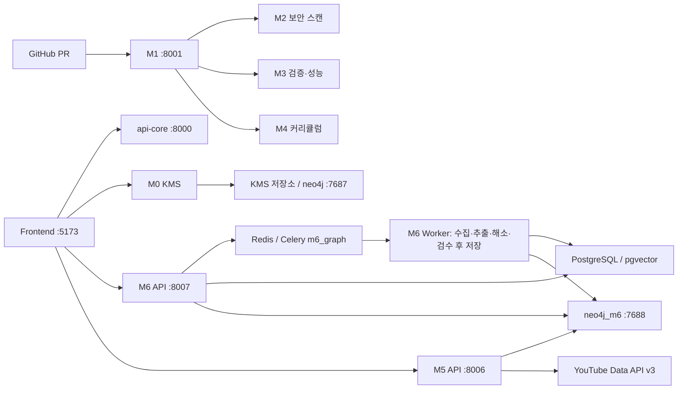

# CodeShepherd

조직의 기술 문서와 코드 변경을 개발자 학습으로 연결하는 지식 관리·온보딩 플랫폼입니다. 4인 팀 프로젝트이며, 이 문서는 저장소의 실행 코드와 Compose 구성을 기준으로 설명합니다.

## 모듈 구성

| 모듈 | 역할 | 호스트 포트 |
| --- | --- | --- |
| api-core | GitHub OAuth, 사용자·팀 관리, JWT 인증 | 8000 |
| M0 | KMS 문서 처리·청킹·HITL | 8002 |
| M1 | PR 웹훅 감지와 모듈 호출 조정 | 8001 |
| M2 | 정적 분석·보안 스캔 | 8003 |
| M3 | 테스트 검증·성능 분석 영역 | 8004 |
| M4 | 학습 커리큘럼 문서 생성 | 8005 |
| M5 | 그래프 조회·기술 맥락 기반 YouTube 추천 | 8006 |
| M6 | 외부 문서의 온톨로지 기반 지식 그래프 구축·HITL | 8007 |
| frontend | React·Vite·TypeScript UI | 5173 |

표는 모듈별 역할 요약이며 모든 기능의 완성을 뜻하지 않습니다. M3는 기본 Compose와 자동 적용되는 `docker-compose.override.yml`의 진입점이 다릅니다. 실제 실행 진입점은 두 파일을 함께 확인하세요.

## 아키텍처



M5·M6는 M1의 PR 처리 체인과 별도로 API를 제공합니다. M6가 지식을 구축하고 M5가 그 그래프를 조회합니다. 두 모듈 사이에 직접 Python import나 M6→M5 추천 호출은 없으며, Compose의 `neo4j_m6`를 통해 데이터를 공유합니다. M0용 `neo4j`와는 별도 인스턴스입니다.

- [M5 사용법·API](backend/m5/README.md)
- [M6 실행·검수·시드](backend/m6/README.md)
- [M5·M6 상세 아키텍처와 구현 제약](docs/M5_M6_ARCHITECTURE.md)

## 실행 준비

저장소 루트에서 Docker와 Docker Compose를 사용합니다. 현재 루트에 `.env.example`은 없습니다. 실제 환경에 맞는 루트 `.env`를 준비하세요. 비밀값과 인증 파일은 커밋하지 않습니다.

전체 스택에는 Cloud SQL 연결 정보 `CLOUD_SQL_INSTANCE_CONNECTION_NAME`, 호스트의 ADC JSON 파일 경로 `GOOGLE_ADC_PATH`, DB 인증 정보와 각 모듈의 외부 API 설정이 필요합니다. Proxy는 인증 파일을 컨테이너의 `/secrets/credentials.json`에 읽기 전용으로 마운트하며, 호스트 DB 접근 포트는 15432입니다. 모듈별 설정은 해당 README와 실행 코드를 확인하세요.

```bash
docker compose config --quiet
docker compose up --build
```

M5·M6만 실행하려면 [M6 실행 절차](backend/m6/README.md)를 따릅니다. `/health`는 프로세스 응답 확인이며 DB·외부 API의 종합 정상 판정은 아닙니다.

```bash
curl http://localhost:8006/health
curl http://localhost:8007/health
```

Neo4j Browser는 KMS용 http://localhost:7474, M5·M6용 http://localhost:7475 입니다. 데이터 보존을 위해 일반 종료에는 `docker compose down`을 사용합니다.

## 저장소 구조

```text
backend/
  _shared/     # 공유 계약·설정·인증·로깅
  api-core/
  m0/ ... m6/  # 서비스별 코드·테스트·문서
frontend/
docs/          # 공통 설계·운영 문서
docker-compose.yml
docker-compose.override.yml
```

## 검증

서비스별 의존성과 외부 DB가 준비된 환경에서 테스트를 실행합니다. M5의 기존 계약 테스트에는 폐기된 `/youtube/recommend` 경로가 남아 있으므로 현재 API와 구분해야 합니다. 문서 정비 시 테스트 실행 성공이나 실측 성능을 추정해 기재하지 않습니다.

```bash
docker compose run --rm m5 uv run pytest
docker compose run --rm m6 python -m pytest
docker compose run --rm api-core uv run alembic upgrade head
```

마지막 명령은 api-core 마이그레이션입니다. M6 전용 테이블 초기화를 대신하지 않으며, M6의 시드·스키마 준비는 해당 README에 설명합니다.
