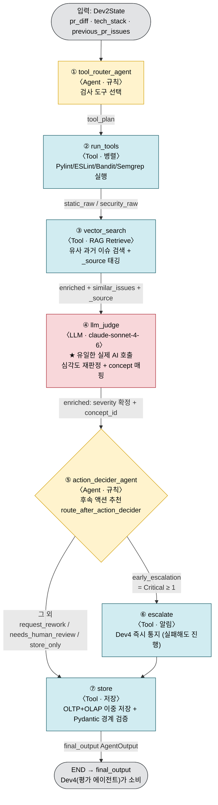
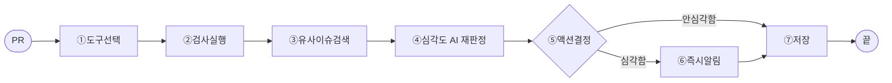

# M2 정적분석·보안 — 에이전트별 상세 역할 및 메커니즘 명세

> 대상 파이프라인: M2 풀 설계 (`sub2_new/dev2/` LangGraph, 7노드)
> 근거: 실제 코드 `graph.py` `build_graph()` + 각 노드 구현(`nodes/*.py`)
> ⚠️ 작성 시점에 `sub2_new/dev2/` 소스가 작업트리에서 보이지 않음(브랜치/이동 추정).
>     본 명세는 직전 세션에서 읽은 실제 코드 기준이며, 재확인은 해당 디렉토리 복구 후 가능.

---

## 0. 노드 한눈에 보기

```
PR(코드 변경) 입력 (Dev2State)
  │
  ① tool_router_agent  ─▶ ② run_tools ─▶ ③ vector_search ─▶ ④ llm_judge ─▶ ⑤ action_decider_agent
  │                                                                                │
  │                                                          ┌──── route_after_action_decider ────┐
  │                                                   early_escalation                       그 외
  │                                                          │                                 │
  │                                                   ⑥ escalate ──────▶ ⑦ store ◀────────────┘
  │                                                                          │
  └──────────────────────────────────────────────────────────────────────▶ END
```

| # | 노드 | 분류 | LLM 호출 | 한 줄 역할 |
|---|---|---|---|---|
| ① | tool_router_agent | **판단 노드(Agent)** | ✗ (규칙 기반, LLM 확장 설계) | 이번 PR에 돌릴 검사 도구를 선택 |
| ② | run_tools | **Tool** | ✗ | 선택된 도구를 병렬 실행해 raw 이슈 수집 |
| ③ | vector_search | **Tool** | ✗ (임베딩 검색) | 과거 유사 이슈를 RAG로 검색·첨부 |
| ④ | llm_judge | **LLM** | ✓ (claude-sonnet-4-6) | 이슈 심각도 재판정 + concept 매핑 |
| ⑤ | action_decider_agent | **판단 노드(Agent)** | ✗ (규칙 기반) | 결과 보고 후속 액션 추천(경로 결정) |
| ⑥ | escalate | **Tool** | ✗ | Critical 시 Dev4에 즉시 알림 |
| ⑦ | store | **Tool** | ✗ | OLTP+OLAP 이중 저장 + Output Contract 반환 |

> **분류 기준**: "스스로 무엇을 할지 정하는가"(판단 노드/Agent) vs "시킨 일을 수행하는가"(Tool).
> 실제 LLM(AI 모델)이 도는 곳은 ④ 한 곳. ①·⑤는 현재 규칙 기반 의사결정 노드다(설계상 LLM 확장 가능).

---

## 0-1. 에이전트 구조 흐름도 (데이터 흐름 포함)

```
 ┌──────────────────────────────────────────────────────────────────────────────┐
 │  입력: Dev2State { pr_diff, tech_stack, previous_pr_issues, task_id, ... }      │
 └──────────────────────────────────────────────────────────────────────────────┘
            │
            ▼  [Agent · 규칙]
 ┌────────────────────────┐   tool_plan          PR 맥락 분석 → 검사 도구 선택
 │ ① tool_router_agent    │ ───{selected_tools}─▶ (entry point)
 └────────────────────────┘
            │
            ▼  [Tool · 병렬]
 ┌────────────────────────┐   static_raw         선택 도구 실행(Pylint/Radon/
 │ ② run_tools            │ ───/security_raw───▶  ESLint/Bandit/Semgrep…)
 └────────────────────────┘
            │
            ▼  [Tool · RAG Retrieve]
 ┌────────────────────────┐   enriched(+similar  유사 과거 이슈 검색(pgVector)
 │ ③ vector_search        │ ───_issues, _source)▶ + 출처 태깅(static/security)
 └────────────────────────┘
            │
            ▼  [LLM · claude-sonnet-4-6]   ◀── 유일한 실제 AI 호출
 ┌────────────────────────┐   enriched(severity  심각도 재판정 + 오탐 필터
 │ ④ llm_judge            │ ───확정, concept_id)▶ + concept 매핑
 └────────────────────────┘
            │
            ▼  [Agent · 규칙]
 ┌────────────────────────┐   action_decision    결과 보고 후속 액션 추천
 │ ⑤ action_decider_agent │ ──{recommended_action}  (꼬리표 부착)
 └────────────────────────┘
            │
            ▼   route_after_action_decider(state)   ◀── ★ 동적 라우팅 = Agentic 핵심
      ┌─────┴───────────────────────────┐
   recommended_action                  그 외
   == "early_escalation"        (request_rework /
   (= Critical ≥ 1)              needs_human_review /
      │                          store_only)
      ▼  [Tool · 알림]                  │
 ┌────────────────────┐                 │
 │ ⑥ escalate         │  notify_dev4    │
 │  (Dev4 즉시 통지)  │  (실패해도 진행) │
 └────────────────────┘                 │
      │                                 │
      └───────────────┬─────────────────┘
                      ▼  [Tool · 저장]
            ┌──────────────────────┐   final_output       OLTP(PostgreSQL)+OLAP(BigQuery)
            │ ⑦ store              │ ──[AgentOutput]──▶   Pydantic 경계 검증 후 반환
            └──────────────────────┘
                      │
                      ▼
                    END  →  final_output 을 Dev4(평가 에이전트)가 소비
```

**범례**: `[Agent]` 판단 노드(규칙, LLM 확장 설계) · `[LLM]` 실제 AI 호출 · `[Tool]` 실행/저장
**에지 종류**: ①→②→③→④→⑤ 는 항상 진행(직선), ⑤ 이후만 조건부 분기, ⑥→⑦ 은 항상 진행.

### 간단형 (슬라이드 1장용)
```
PR ─▶ ①도구선택 ─▶ ②검사실행 ─▶ ③유사이슈검색 ─▶ ④심각도AI재판정 ─▶ ⑤액션결정
                                                                      │
                                                       심각함 ┌───────┴───────┐ 안심각함
                                                            ⑥즉시알림        │
                                                              └────▶ ⑦저장 ◀─┘ ─▶ 끝
```

### Mermaid 버전 (상세 — 데이터 흐름 + 분기)



> **색 범례**: 노랑=Agent(판단·규칙) · 파랑=Tool(실행/저장) · 빨강=LLM(실제 AI 호출) · 회색=입출력.
> ⑤만 마름모(분기)로 그렸다 — 추천값에 따라 ⑥을 거치거나 건너뛴다(상태 기반 동적 라우팅 = Agentic 핵심).

### Mermaid 버전 (간단형 — 슬라이드 1장용)



---

## ① tool_router_agent — 검사 도구 선택 에이전트

- **분류**: 판단 노드(Agent). 그래프 진입점(entry point).
- **역할**: PR 맥락을 분석해 "이번 변경에 어떤 검사 도구를 돌릴지" 계획(`tool_plan`)을 세운다.
- **입력(트리거)**: `Dev2State`의 `pr_diff`, `tech_stack`, `previous_pr_issues`.
- **메커니즘 (MVP: LLM 없이 규칙 기반)**:
  1. `_extract_all_files(diff)` — unified diff에서 변경 파일 전체 추출(의존성 파일 포함).
  2. 파일 확장자/언어로 기본 도구 매핑 (Python→pylint·radon·bandit, JS/TS→eslint, 공통 semgrep).
  3. `SECURITY_KEYWORDS`(`auth`, `password`, `sql`, `eval(`, `os.system`, `subprocess`, `innerHTML` 등) 감지 시 보안 도구 강화.
  4. `previous_pr_issues`에 보안 키워드(SQL Injection/XSS/CSRF/인증 등) 있으면 보안 스캔 가중.
  5. 의존성 파일 변경(`requirements.txt`/`package.json` 등) 시 `pip_audit`/`npm_audit` 추가.
  6. XSS 키워드(`innerHTML`/`mark_safe`) 시 HTML semgrep 룰 추가.
  7. `ALLOWED_TOOLS` 화이트리스트로 최종 도구 목록 필터.
- **출력**: `state["tool_plan"] = ToolPlan{ selected_tools, llm_required, ... }`.
- **비유**: 환자(PR)를 보고 어떤 검사를 할지 정하는 **접수 간호사**.
- **확장 포인트**: `llm_required` 필드로 LLM 기반 도구 선택으로 대체 가능하게 설계됨.

---

## ② run_tools — 도구 병렬 실행 (Tool)

- **분류**: Tool (결정론적 실행).
- **역할**: ①이 고른 `selected_tools`를 실제로 실행해 raw 이슈를 모은다.
- **입력**: `tool_plan.selected_tools`, 복원된 변경 파일.
- **메커니즘**: 선택된 도구를 **병렬 실행**(Pylint/Radon/ESLint/Bandit/Semgrep/pip-audit 등). 각 도구 출력 → 공통 이슈 포맷으로 정규화. 도구 미설치·타임아웃은 graceful skip(파이프라인 중단 없음).
- **출력**: `static_raw` / `security_raw` (도구 종류별 raw 이슈 목록).
- **비유**: 여러 검사 장비를 한 번에 돌리는 **검사실**.

---

## ③ vector_search — 유사 이슈 RAG 검색 (Tool)

- **분류**: Tool (RAG Retrieve, 임베딩 검색).
- **역할**: 이번에 발견된 이슈와 **의미가 비슷한 과거 이슈**를 벡터 DB에서 찾아 참고자료로 붙인다.
- **입력**: `static_raw` / `security_raw` 이슈 텍스트.
- **메커니즘**: 이슈를 임베딩 → pgVector 코사인 유사도 검색 → 유사 이슈(`similar_issues`)를 각 이슈에 첨부. 동시에 출처 태그 **`_source`**(`static`/`security`)를 각 이슈에 부착(⑦ store가 에이전트 이름 결정에 사용).
- **출력**: `enriched` 후보(유사 이슈 첨부 + `_source` 태깅).
- **비유**: "예전에 이런 적 있었지" 하고 **과거 진료기록을 조회**.

--- 

## ④ llm_judge — 심각도 재판정 LLM 노드

- **분류**: **LLM** (실제 AI 모델 호출 — 파이프라인 내 유일).
- **역할**: 도구가 매긴 1차 심각도를 LLM이 **재판정**하고, 사내 개념(concept)에 매핑한다. (RAG Generate 단계)
- **입력**: `enriched`(유사 이슈 첨부된 이슈), 검색된 컨텍스트.
- **메커니즘**:
  1. 모델 라우팅(비용 최적화): **Critical→claude-sonnet-4-6**, Major→claude-haiku-4-5, Minor→LLM 생략(도구 판단 신뢰).
  2. 이슈 + 유사사례를 프롬프트로 LLM 호출 → severity 재조정(예: 도구가 Major로 본 SQL 조합을 Critical로 승격), 오탐(FP) 필터.
  3. `concept_id` 매핑(M4 커리큘럼 연계용).
  4. 각 이슈에 `llm_judged`/`llm_model`/`llm_rationale` 메타 부착.
- **출력**: 재판정된 `enriched`(최종 severity 확정).
- **비유**: 검사 결과를 종합 판독하는 **전문의**.

---

## ⑤ action_decider_agent — 후속 액션 결정 에이전트 (핵심)

- **분류**: 판단 노드(Agent). **이 노드의 결정이 다음 경로를 바꾼다 → Agentic의 핵심.**
- **역할**: 최종 이슈를 보고 "이걸 어떻게 처리할지" 추천 꼬리표(`recommended_action`)를 붙인다.
- **입력**: `state["enriched"]`(llm_judge까지 끝난 최종 이슈).
- **메커니즘 (규칙 기반 우선순위 판정, `decide_action`)**:

  | 우선순위 | 조건 | recommended_action | confidence |
  |---|---|---|---|
  | 1 | Critical ≥ 1 | `early_escalation` | 0.95 |
  | 2 | Major ≥ 3 | `request_rework` | 0.85 |
  | 3 | 중요 파일(auth/login/password/token/payment/billing/order 등)에 Critical·Major | `needs_human_review` | 0.80 |
  | 4 | confidence_score 0.6 미만 이슈 존재 | `needs_human_review` | 0.70 |
  | 5 | 위 어디에도 해당 없음 | `store_only` | 0.90 |

  - `signals` dict에 판단 근거(critical/major/minor 카운트, 중요파일 여부, 저신뢰 여부) 기록.
  - **중요**: M2는 추천만 한다. PR 승인/반려는 직접 결정하지 않음 → `request_rework`/`needs_human_review`는 store에 값만 기록하고 실제 판단은 m0/Dev4가 수행.
- **출력**: `state["action_decision"] = ActionDecision{recommended_action, reason, confidence, signals}`.
- **다음 경로 분기 (`route_after_action_decider`, graph.py:86)**:
  - `recommended_action == "early_escalation"` → **escalate** 경로
  - 그 외(request_rework/needs_human_review/store_only) → **store** 경로
- **비유**: 진단 결과 보고 다음 조치를 정하는 **담당 의사**.

### 구체 예시 (왜 "경로가 바뀐다"인가)
```
▶ A) SQL 인젝션(Critical) 1건 → "early_escalation" → escalate(즉시 알림) → store
▶ B) 변수명 위반(Minor) 2건    → "store_only"       → store (escalate 건너뜀)
```
같은 그래프인데 검사 결과에 따라 A는 escalate를 거치고 B는 건너뛴다 → **상태 기반 동적 라우팅 = Agentic Workflow.**

---

## ⑥ escalate — Critical 에스컬레이션 (Tool)

- **분류**: Tool (외부 알림).
- **역할**: Critical 이슈를 담당 평가 에이전트(Dev4)에 **즉시 통지**한다.
- **입력**: Critical severity 이슈 목록, `task_id`.
- **메커니즘**: `notify_dev4()` — `DEV4_WEBHOOK_URL`로 HTTP 알림 발송.
  - 토큰/URL 미설정(개발 환경) → 경고 로그 후 skip.
  - 알림 실패 → 로그만 남기고 **파이프라인 계속 진행**(알림 실패가 PR 리뷰를 막으면 안 됨).
  - state 변경 없음(`{}` 반환) → 이후 store가 `enriched`를 직접 읽음.
- **출력**: 없음(부작용=알림). 항상 store로 이어짐.
- **비유**: 응급이면 바로 **응급실 호출**.

---

## ⑦ store — 결과 이중 저장 + Output Contract 반환 (Tool)

- **분류**: Tool (영속 저장 + 경계 검증).
- **역할**: 최종 이슈를 영구 저장하고, Dev4가 소비할 깨끗한 `final_output`을 반환한다.
- **입력**: `enriched`(`_source` 태깅 포함).
- **메커니즘**:
  1. `_source` 기준으로 `static`/`security` 분리 → 에이전트 이름 결정(`static_analysis`/`security_scan`).
  2. **Pydantic 경계 검증**: `Issue` 모델 필드(severity/line/file/message/rule_id/suggestion/similar_issues)만 통과, 내부 필드(`llm_judged`/`llm_model`/`_source` 등) 자동 제거.
  3. **PostgreSQL(OLTP)** 적재: `scan_executions → scan_issues → scan_summaries` (운영 단건 조회용). 실패 시 re-raise(핵심 기능).
  4. **BigQuery(OLAP)** 적재: analytics DW(정확도 추이·개발자 패턴 집계용). 실패 시 로그만 남기고 skip(부가 기능).
- **출력**: `final_output = [AgentOutput dict, ...]` (Output Contract, CLAUDE.md §5-A).
- **비유**: 진료기록을 **차트에 기록**(운영용+분석용 두 장부).

---

## 부록 A — 분류 정리 (질문 방어용)

- **Agent(판단 노드)**: ① tool_router_agent, ⑤ action_decider_agent — 현재 **규칙 기반**, LLM 확장 설계.
- **LLM**: ④ llm_judge — 유일하게 실제 AI 모델 호출(claude-sonnet-4-6 등).
- **Tool**: ② run_tools, ③ vector_search, ⑥ escalate, ⑦ store.
- **Agentic 근거**: AI 모델 사용 여부가 아니라 ⑤ 결정에 따라 ⑥을 거치거나 건너뛰는 **상태 기반 동적 라우팅**(`route_after_action_decider`).

## 부록 B — 설계본 vs 운영본 (정직성)

- 위 7노드는 **풀 설계(`sub2_new/dev2/`)** 기준이다.
- 실제 dev 머지된 운영본(`app/`)은 **②검사 → 집계**만 하는 경량본으로, ①·④·⑤·⑥(판단·LLM·에스컬레이션)은 빠져 있다.
- ⚠️ 본 명세 작성 시점에 `sub2_new/dev2/` 소스가 작업트리에 보이지 않음 — 직전 세션 코드 기준 작성. 정확 재검증은 해당 디렉토리 복구(브랜치 전환/restore) 후 가능.

## 부록 C — 원본 경로

| 항목 | 경로 |
|---|---|
| 그래프 조립 | `backend/m2/sub2_new/dev2/graph.py` (build_graph, route_after_action_decider) |
| 도구 선택 | `.../nodes/tool_router_agent.py` |
| 도구 실행 | `.../nodes/run_tools.py` |
| RAG 검색 | `.../nodes/vector_search.py` |
| 심각도 LLM | `.../nodes/llm_judge.py` |
| 액션 결정 | `.../nodes/action_decider_agent.py` |
| 에스컬레이션 | `.../nodes/escalate.py` |
| 저장 | `.../nodes/store.py` |
| 운영 경량본 | `backend/m2/app/main.py`, `analyzer.py` |
