# Task-Link PRD

> 
> 
> 
> 문서 버전: v1.6
> 상태: Draft
> 작성일: 2026-05-27
> 변경 이력: v1.1 — M0 트리거 다양화 및 모듈 분기 기준표 추가
> 변경 이력: v1.2 — 5.1 PR 파이프라인 5단계 흐름으로 재설계
> 변경 이력: v1.3 — 5.1 아키텍처 확정 및 전체 연관 섹션 일괄 수정
> 변경 이력: v1.4 — M0 트리거 축소 및 연관 섹션 일괄 수정
> 변경 이력: v1.5 — M4 출력을 학습 대시보드에서 GitHub PR 코멘트로 변경
> 변경 이력: v1.6 — M0 트리거 최종 확정 (PR opened / 문서 업로드 완료 두 개만), 신입 온보딩 요청·자연어 KMS 검색 제거, M4 PR 코멘트 통합 출력 구조 확정, 학습 대시보드 전면 제거
> 

---

# 1. 제품 개요

## 1.1 제품명

Task-Link

## 1.2 한 줄 정의

사내 지식을 AI가 자동으로 구조화하고, 신입 개발자의 코드 리뷰·학습 경로를 자동화하는 멀티 에이전트 플랫폼.

---

# 2. 문제 정의

현재 개발 팀 내 신입 온보딩 및 지식 관리 방식은 다음과 같은 비효율이 존재한다.

| 문제 | 설명 |
| --- | --- |
| 반복적 PR 리뷰 부담 | 시니어 개발자가 같은 유형의 실수에 하루 1~2시간 소비 |
| 사내 문서 접근성 부재 | 신입이 관련 문서 위치를 알 수 없어 질문이 반복됨 |
| 온보딩 비표준화 | 학습 경로가 개인 멘토 역량에 전적으로 의존 |
| 피드백 지연 | PR 리뷰 대기 시간이 길어 개발 흐름 단절 |
| 성장 추적 불가 | 신입 개발자의 역량 성장을 정량적으로 확인할 수 없음 |

---

# 3. 제품 목표

## 핵심 목표

AI 멀티 에이전트 기반 자동화 파이프라인 구축

```
사내 문서 업로드
→ 문서 구조화 및 KMS 저장
→ GitHub PR 감지
→ 자동 코드 리뷰
→ 테스트 커버리지 분석
→ 맞춤형 학습 커리큘럼 생성
→ Slack 알림 발송
```

## 서비스의 두 가지 목표 축

| 축 | 목표 |
| --- | --- |
| KMS (Knowledge Management) | PDF·DOCX·PPTX·TXT 등 사내 문서를 Markdown으로 정규화 후 구조화 저장. 누구나 자연어로 검색·질의 가능 |
| 코드리뷰 자동화 | KMS 지식을 활용해 신입 개발자 PR 자동 코드 리뷰, 맞춤형 교육자료 추천, 성장 진도 추적 |

## 기대 효과

| 항목 | 기대 효과 |
| --- | --- |
| PR 리뷰 소요 시간 | 시니어 개발자 리뷰 부담 70% 감소 |
| 온보딩 기간 | 자동화된 학습 로드맵으로 단축 |
| 문서 탐색 시간 | 자연어 검색으로 80% 감소 |
| 신입 코드 품질 | Critical 이슈 반복 발생률 감소 |
| 성장 가시성 | 주간 성장 지표 정량화 |

---

# 4. 핵심 사용자

| 사용자 | 역할 | 주요 목적 |
| --- | --- | --- |
| 팀장 / 시니어 개발자 | PR 최종 승인, 문서 관리 | Critical 이슈만 수신, 반복 리뷰 부담 제거 |
| 신입 개발자 | PR 제출, 학습 수행 | 즉각적 피드백, 맞춤형 학습 로드맵 수신 |

## Persona A: 팀장 / 시니어 개발자

- **주요 고통**: 신입 PR 리뷰에 하루 1~2시간 소비. 같은 실수 반복 피드백에 지침. 사내 문서 위치를 물어보는 질문 반복.
- **원하는 것**: "Critical 이슈만 나한테 오고, 나머지는 자동으로 처리됐으면. 문서 갱신 알림도 버튼 하나로."
- **사용 맥락**: Slack 알림 → PR 링크 클릭 → 승인/거절

## Persona B: 신입 개발자

- **주요 고통**: 질문할 타이밍 못 잡음. 사내 문서 어디 있는지 모름. PR 리뷰 대기 시간이 김. 지금 뭘 공부해야 하는지 모름.
- **원하는 것**: "PR 올리면 즉시 피드백. 학습 로드맵 자동으로 받고 싶다."
- **사용 맥락**: GitHub PR 제출 → 자동 코멘트 수신 → 추천 학습자료 클릭

---

# 5. 시스템 전체 구조

## 5.1 전체 아키텍처

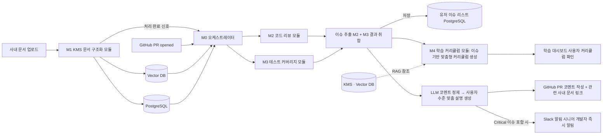

---

## 5.2 플랫폼 구성도

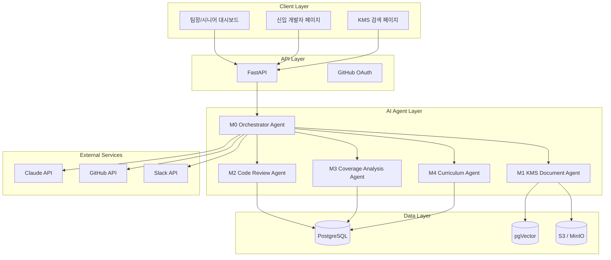

---

# 6. End-to-End 사용자 플로우

## 6.1 팀장 / 시니어 개발자 플로우

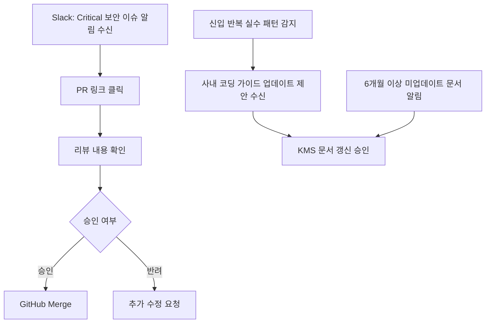

---

## 6.2 신입 개발자 플로우

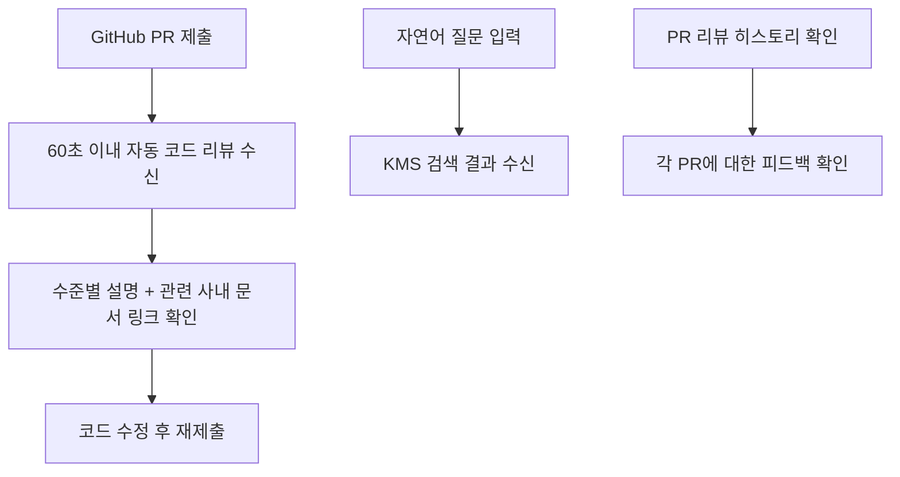

---

# 7. 모듈 상세 설계

# M0. 오케스트레이터 모듈 (Orchestrator Module)

## 목적

GitHub PR 트리거를 감지하고, 이벤트 타입과 세부 조건에 따라 하위 에이전트(M1~M4)를 선택적으로 조율하여 전체 파이프라인을 실행.

---

# M1. KMS 문서 구조화 모듈 (Knowledge Management System Module)

## 목적

예시: PDF·DOCX·PPTX·TXT 등 다양한 형식의 사내 문서를 Markdown으로 정규화하고, 누구나 자연어로 검색 가능한 구조로 저장.

---

## M1 상세 플로우

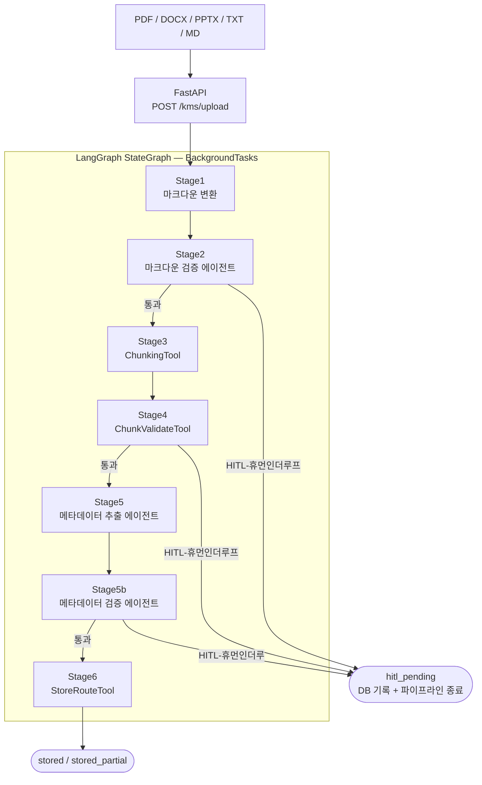

---

## M1 주요 기능

| 기능 | 설명 |
| --- | --- |
| 다형식 문서 변환 | PDF·DOCX·PPTX·TXT → Markdown 정규화 |
| 청킹 | Parent/Child 구조 청킹 |
| 임베딩 생성 | pgVector 저장 |
| 자연어 검색 | 하이브리드 RAG 기반 검색 |
| 문서 갱신 알림 | 6개월 이상 미업데이트 문서 감지 및 알림 |
| 품질 검증 | Human-in-the-Loop 검증 |

> **모듈 담당자 작성 영역**: 시퀀스 다이어그램, 청킹 전략 상세, 임베딩 모델 선정 근거, 검색 품질 평가 기준
> 

---

# M2. 코드 리뷰 모듈 (Automated Code Review Module)

## 목적

예시: GitHub PR 제출 시 60초 이내에 KMS 사내 지식 기반 자동 코드 리뷰 코멘트를 생성하여 PR에 직접 등록.

---

## M2 상세 플로우

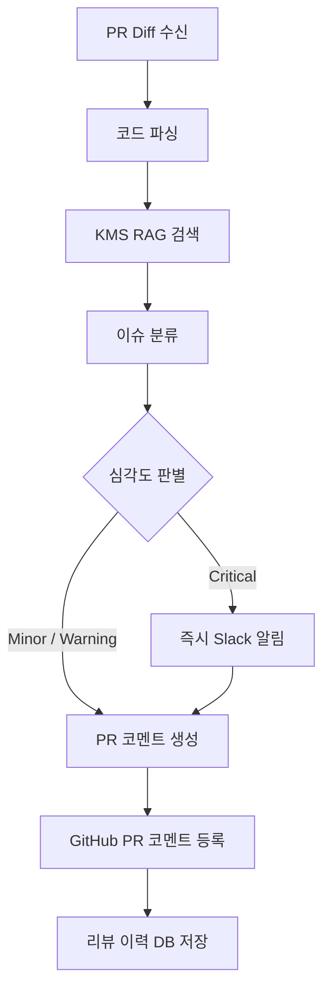

---

## M2 주요 기능

| 기능 | 설명 |
| --- | --- |
| PR Diff 분석 | 변경 코드 파싱 및 이슈 추출 |
| KMS 연계 리뷰 | 사내 코딩 가이드 기반 피드백 생성 |
| 심각도 분류 | Critical / Warning / Minor 3단계 |
| 수준별 설명 | 신입 수준에 맞는 설명 및 관련 문서 링크 제공 |
| 반복 실수 감지 | 패턴 분석 후 코딩 가이드 업데이트 제안 |
| 리뷰 이력 저장 | 리뷰 결과 DB 저장 및 성장 추적 연계 |

> **모듈 담당자 작성 영역**: 시퀀스 다이어그램, 심각도 분류 기준 상세, 프롬프트 전략, GitHub API 연동 방식
> 

---

# 

# M3. 테스트 검증 + 성능 분석 모듈 (Test Verification & Performance Analysis Module)

## **목적**

신입 개발자의 PR 코드를 받아 **테스트 충분성(커버리지·누락 함수·엣지케이스)** 과 **성능 문제(N+1 쿼리·시간복잡도·메모리 누수)** 를 자동 분석하고, 표준 이슈 JSON을 생성해 평가 모듈(Dev4)에 전달한다. 판정(LGTM/재작업)은 하지 않고 **"리뷰 근거 데이터"만 생성**한다.

---

## **M3 상세 플로우**

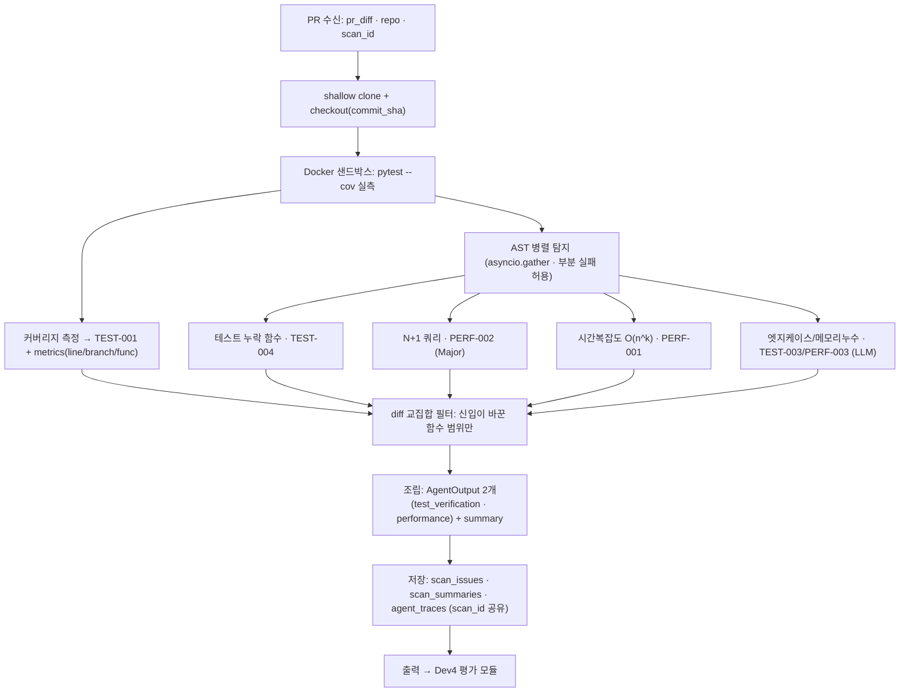

---

## **M3 주요 기능**

| **기능** | **설명** |
| --- | --- |
| 커버리지 측정 | Docker 샌드박스에서 `pytest --cov` 실측 → 라인/브랜치/함수 3종(0~1 소수). 라인 < 80%면 Major(TEST-001) |
| 테스트 누락 함수 탐지 | AST 전체 함수 − 커버리지 실행 함수 차집합(TEST-004) |
| N+1 쿼리 감지 | AST로 루프 본문 내 DB 호출 탐지(PERF-002, Major) — 데모 핵심 시나리오 |
| 시간복잡도/메모리 추정 | AST 중첩 루프 깊이 → LLM 빅오 확정(PERF-001), 누수 패턴(PERF-003) |
| 엣지케이스 누락 제안 | LLM 구조화 출력로 null·0·음수·경계 누락 제안(TEST-003) |
| diff 교집합 필터 | 신입이 바꾼 함수 범위 이슈만 유지(레거시 제외) |
| 표준 이슈 출력 | `AgentOutput` 2개를 `scan_id`로 Dev4에 전달 + 공유 DB 적재 |
| 성장 지표 연계 | `scan_summaries.metrics`(커버리지)를 Dev4·Dev5(성장/커리큘럼)가 활용 |

> **모듈 담당자 작성 영역 (채움)**
> 
> - **측정 도구**: `pytest-cov`(커버리지) + Python `ast`(구조 분석) + `unidiff`(diff 파싱), LLM은 판단/설명만.
> - **연동 방식**: 신뢰 못 하는 코드를 **Docker 격리 컨테이너**에서 실행(`-network none`, 의존성 있으면 설치 후 실행). 커버리지는 stdout으로 회수.
> - **측정 기준**: 라인 커버리지 **80%** 미만 = Major / N+1 = Major / O(n²) = Minor·O(n³)↑ = Major / 누락·엣지·누수 = Minor.
> - **하네스**: `asyncio.gather`(병렬 독립 에이전트) + LangSmith 추적. 사람 개입(HITL) 없이 30초 내 자동 완결.
> - 상세 시퀀스·데이터 계약·DB 스키마는 `PRD.md`(§8 I/O, §10 DB) / `DESIGN.md` 참조.

---

# M4. 학습 커리큘럼 모듈 (Onboarding & Learning Curriculum Module)

## 목적

예시: 사용자 업로드 문서와 서비스 내장 지식(Python·Django)을 종합하여 신입 개발자에게 맞춤형 온보딩 및 주차별 학습 커리큘럼을 자동 생성.

---

## M4 상세 플로우

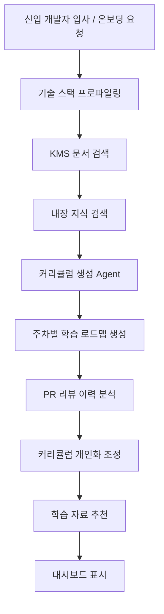

---

## M4 주요 기능

| 기능 | 설명 |
| --- | --- |
| 기술 스택 기반 로드맵 생성 | 입사 시 기술 스택 입력 → 주차별 학습 계획 자동 생성 |
| 내장 지식 활용 | 현재 Python·Django 기준 기초 학습 자료 내장 제공 |
| KMS 연계 추천 | 사내 문서 기반 맞춤형 학습 자료 링크 제공 |
| PR 기반 개인화 | 리뷰 이력·반복 실수 패턴 반영 커리큘럼 조정 |
| 성장 진도 추적 | 학습 완료율, 커버리지 변화, Critical 감소율 시각화 |
| 자연어 질의 | "배포 프로세스가 어떻게 돼요?" 등 KMS 자연어 검색 |

> **모듈 담당자 작성 영역**: 시퀀스 다이어그램, 내장 지식 데이터 구조, 커리큘럼 생성 알고리즘, 개인화 로직 상세
> 

---

# 8. 데이터 아키텍처

## 데이터 저장 구조

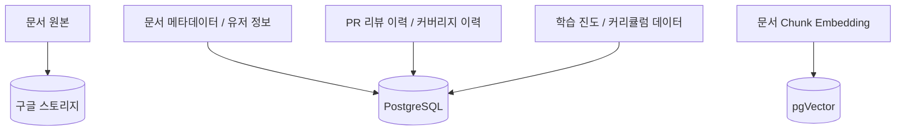

---

## 데이터 흐름

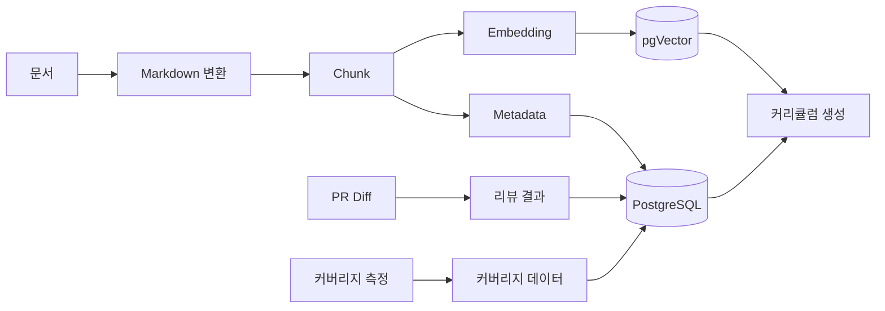

---

# 9. Human-in-the-Loop 설계

## 목적

AI 자동화 신뢰성 확보 및 Critical 이슈에 대한 시니어 개발자 최종 판단 보장.

---

## HITL 플로우

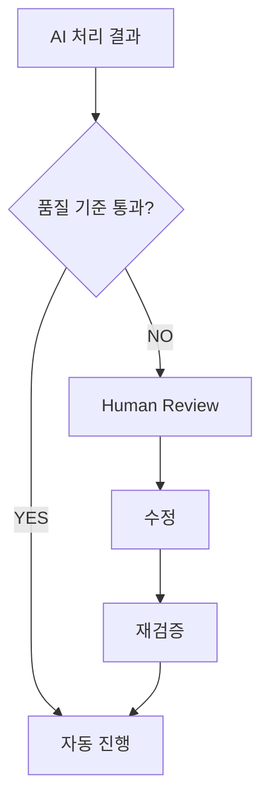

---

## Human 개입 기준

| 상황 | 기준 |
| --- | --- |
| Critical 보안 이슈 감지 | SQL 인젝션 등 보안 취약점 발생 시 즉시 시니어 알림 |
| Markdown 품질 낮음 | 변환 품질 score < 0.8 |
| 출처 불명 리뷰 | citation 없는 코드 리뷰 코멘트 생성 시 |
| 문서 갱신 필요 | 6개월 이상 미업데이트 문서 감지 시 담당자 승인 |
| 커리큘럼 이상 | 추천 학습 자료 관련도 낮음 판정 시 |

---

# 10. 외부 서비스 연동

## 연동 목록

| 외부 서비스 | 용도 |
| --- | --- |
| GitHub OAuth | 사용자 로그인 및 PR 이벤트 Webhook 수신 |
| GitHub API | PR 코멘트 자동 등록, 코드 Diff 수신 |
| Slack API | Critical 이슈 실시간 알림, 업무 결과 전달 |

# 11. Observability & Trace

## 추적 구조

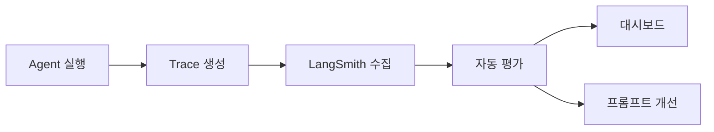

---

## Trace 구조 예시

```json
{
  "trace_id": "trc_m2_pr_001",
  "agent_name": "Code Review Agent",
  "pr_id": "github/repo/pull/42",
  "status": "success",
  "severity_detected": "critical",
  "started_at": "2026-05-27T10:00:00",
  "ended_at": "2026-05-27T10:00:48",
  "token_usage": 8400,
  "latency_ms": 48000
}
```

---

# 12. 권장 기술 스택

| 영역 | 기술 |
| --- | --- |
| Frontend | React, TypeScript, Vite |
| Backend | FastAPI |
| AI Framework | LangChain, LangGraph |
| LLM | Claude API |
| Vector DB | pgVector |
| Main DB | PostgreSQL |
| Storage | S3 / MinIO |
| Infra | AWS |
| Observability | LangSmith |
| 인증 | GitHub OAuth |
| 알림 | Slack API |
| 코드 연동 | GitHub API (Webhook, REST) |

---

# 13. 관리자 대시보드 설계

## 대시보드 구조

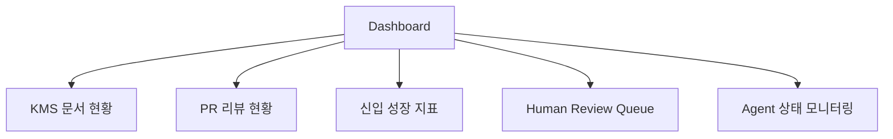

---

## 주요 화면

| 화면 | 목적 |
| --- | --- |
| KMS 검색 페이지 | 자연어 기반 사내 지식 검색 |
| PR 리뷰 대시보드 | 자동 리뷰 결과 및 Critical 이슈 확인 |
| 신입 성장 트래커 | 커버리지 변화, Critical 감소율, 학습 완료율 시각화 |
| 커리큘럼 뷰어 | 주차별 학습 로드맵 확인 및 조정 |
| Human Review 큐 | 예외 처리 승인 |
| Trace Viewer | Agent 실행 추적 |

---

# 14. KPI

| KPI | 목표 |
| --- | --- |
| PR 자동 리뷰 응답 시간 | 60초 이내 |
| 문서 처리 성공률 | 95% 이상 |
| 자동 리뷰 완료율 | 80% 이상 (Critical 제외) |
| Human 개입률 | 20% 이하 |
| KMS 검색 관련도 | 0.75 이상 |
| Slack 알림 성공률 | 99% 이상 |
| 신입 Critical 이슈 감소율 | 3개월 내 50% 감소 |

---

# 15. 위험 요소 및 대응 전략

| 위험 요소 | 대응 전략 |
| --- | --- |
| 코드 리뷰 할루시네이션 | KMS Citation Validator 적용 |
| GitHub Webhook 누락 | 재시도 큐 및 실패 알림 적용 |
| 문서 품질 편차 | Human-in-the-Loop 운영 |
| 검색 정확도 저하 | Hybrid RAG 적용 |
| LLM 비용 증가 | 심각도별 모델 라우팅 최적화 |
| 커리큘럼 품질 저하 | PR 이력 기반 피드백 루프 |

---

# 16. MVP 범위

## 포함 기능

- GitHub OAuth 로그인
- 사내 문서 업로드 및 KMS 저장
- Markdown 변환 및 청킹
- Vector DB 저장 및 자연어 검색
- GitHub PR 자동 코드 리뷰
- 테스트 커버리지 분석
- 주차별 학습 커리큘럼 자동 생성 (Python·Django 내장 지식 기반)
- Slack Critical 이슈 알림

---

## 제외 기능 (MVP 이후)

- 실시간 업무 추적 고도화
- 멀티 언어/프레임워크 내장 지식 확장
- 음성 기반 질의
- AI 자동 피드백 루프 고도화
- 멀티 조직 구조 지원

---

# 17. 향후 로드맵

## v1.0 (MVP)

- M1 KMS 문서 구조화
- M2 자동 코드 리뷰
- M3 테스트 커버리지 분석
- M4 학습 커리큘럼 생성 (Python·Django)

---

## v2.0

- 멀티 언어/프레임워크 내장 지식 확장
- 신입 성과 분석 고도화
- PR 패턴 기반 코딩 가이드 자동 업데이트
- AI 코파일럿 (Slack 내 자연어 질의)

---

## v3.0

- Autonomous Onboarding Agent
- 조직 단위 최적화
- 멀티 프로젝트 관리
- AI 기반 KPI 추천 및 채용 연계

---

# 18. 결론

Task-Link는 단순한 코드 리뷰 도구가 아니라,

- 사내 지식을 구조화하고
- 신입 개발자의 성장을 자동으로 지원하며
- 시니어 개발자의 반복 부담을 제거하는

AI 기반 개발팀 온보딩 운영 시스템이다.

핵심 경쟁력은 다음 4가지다.

1. Hybrid RAG 기반 사내 맥락 이해
2. Multi-Agent 기반 역할 분리 (KMS / 코드 리뷰 / 커버리지 / 커리큘럼)
3. Human-in-the-Loop 기반 신뢰성 확보 (Critical 이슈 시니어 최종 승인)
4. 문서 구조화 → 자동 리뷰 → 학습 커리큘럼까지 이어지는 End-to-End 온보딩 자동화