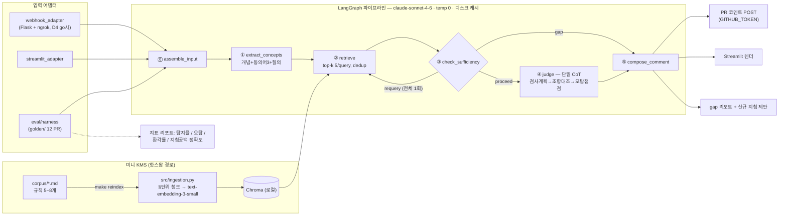

# PRD — Dev3 코드리뷰 에이전트 (5일 MVP)

> 마스터 지시문: [DEV3_MVP_KICKOFF.md](../DEV3_MVP_KICKOFF.md) (충돌 시 브리프 우선)
> 작성: D1 (2026-06-12) · 상태: 계약 승인 대기 (게이트 2)

## 1. 한 줄 정의

PR diff를 받아 **사내 KMS 컨벤션에 근거해서만** 리뷰 코멘트를 다는 에이전트.
세상 기준이 아니라 **우리 회사 기준**으로 보고, 모르면 모른다고 한다.

## 2. 차별점 (시연으로 증명할 3가지)

1. **KMS 근거 인용** — 모든 지적에 rule_id·조항(§)·출처 링크. 인용 문구는 코퍼스 원문과 string-match (환각률 자동 검증).
2. **지침공백 정직 보고** — 지침이 없으면 지어내지 않고 gap 리포트 + 신규 지침 제안.
3. **핫스왑** — 코퍼스 문서 수정 + `make reindex` 만으로, 코드 변경 없이 같은 PR의 판정이 바뀜.

## 3. 스코프

**In (MVP, D+5)**: 자체 미니 KMS(마크다운 5~8개 + 로컬 Chroma), 노드 6개 LangGraph 파이프라인, 골든셋 12 PR + 자동 평가 하네스, Streamlit 데모, (go 시) GitHub 웹훅 라이브 코멘트, AST N+1 보조 신호(D4 stretch, 14:00 자동 컷).

**Out (v2 — MVP 기간 언급 금지)**: 팀 KMS·오케스트레이터 통합, Neo4j, Postgres, GitHub Actions, 멀티 에이전트. 통합 인터페이스는 contracts/ 스키마로 고정 — v2는 이 스키마로 붙는다.

## 4. 아키텍처

상태·노드 I/O 계약: [contracts/README.md](../contracts/README.md) (게이트 2 동결 대상).

## 5. 파이프라인 동작 명세

| 단계 | 핵심 동작 | 기본값 (D3 튜닝 대상) |
|---|---|---|
| ⓪ | diff + 변경 파일 전문 → pr_context (judge 입력은 함수 주변 컨텍스트로 다이어트) | — |
| ① | LLM이 PR에서 검사 대상 개념 추출 + 동의어 3개/개념 + 검색 질의 생성 | 동의어 3 |
| ② | 질의별 Chroma top-k 5, rule_id+section 기준 dedup | top-k 5 |
| ③ | LLM relevance yes/no — proceed / requery(전 파이프라인 1회) / gap. 불충분 시 **재작성 질의**로 State.queries 갱신 → ② 재검색 (동일 질의 재검색 금지) | 재질의 1회 |
| ④ | 단일 CoT: 검사계획 → 조항-코드 대조 → 오탐 점검(예외조항). 청크 캡 8, max_tokens 2000 | 캡 8 |
| ⑤ | findings → 출처 인용 코멘트 / gap → 정직 보고 + 신규 지침 제안 | 톤 템플릿 1안 |

비용 규칙(브리프 §9): 디스크 캐시 sha256(모델+프롬프트), Anthropic 프롬프트 캐싱(고정 프리픽스 앞), 부분 실행 모드, D4에 ⑤만 조건부 Haiku 검토(④는 영구 Sonnet).

## 6. 컨벤션 코퍼스 — 후보 규칙 8개 (세션 C 구체화, 정현 검수)

> 설계 원칙: 일반 모범사례가 아니라 **가상 사고 이력이 동기인 회사 특수 규칙**. 세계 표준과 일부러 어긋나도 됨. 템플릿: [corpus/README.md](../corpus/README.md)

| rule_id | 규칙 (요지) | 가상 사고 동기 | sev | 장면 |
|---|---|---|---|---|
| CONV-API-001 | async 함수 안 동기 `requests` 금지 → `httpx.AsyncClient` 강제. **§4 예외: `scripts/`·`batch/` 일회성 배치 제외** | 2025-11 블랙프라이데이: 이벤트루프 블로킹으로 결제 p99 12초 | Major | **1·2·4** |
| CONV-TIME-002 | `datetime.now()`/`utcnow()` 금지 → `common.timeutil.now()` 강제 | 2025-03 정산 이중집계 (서버 2대 TZ 불일치) | Major | 백업 위반 |
| CONV-LOG-003 | `print()`·f-string 로깅 금지 → `struct_logger.log(event=...)` | 2024-12 PII 평문 로그 유출 (마스킹 필터가 struct_logger에만 있음) | Major | 백업 위반 |
| CONV-DB-004 | 루프 내 ORM/쿼리 호출 금지 → 일괄 조회 | 2025-06 대시보드 PR 1건이 DB QPS 40배 | Major | AST stretch 연계 |
| CONV-DEP-005 | `lodash` 임포트 금지 → 사내 `ts-stdlib` | 2024-09 타이포스쿼팅 오인 소동 후 JS 유틸 일원화 | Minor | 코퍼스 현실감 |
| CONV-ERR-006 | bare `except`/조용한 `pass` 금지 → `errors.report(err_code=...)` | 2025-01 결제 실패 4시간 무음 삼킴 | Major | 백업 위반 |
| CONV-CFG-007 | `os.getenv` 직접 호출 금지 → `config.from_env()` 검증 로더 | 2025-08 스테이징 키로 프로드 배포 | Minor | 위반/정상 변형 |
| CONV-SQL-008 | f-string SQL 조립 금지 → 파라미터 바인딩 | 2024-07 모의해킹 인젝션 지적 | Major | 위반/정상 변형 |

- **장면4 핫스왑 설계**: CONV-API-001 §1을 "동기 requests 대신 **httpx** 사용"으로 써 두고, 시연에서 "httpx → **aiohttp**"로 문서만 수정 → reindex → httpx를 쓴 PR이 정상→위반으로 뒤집힘.
- **장면3 gap 설계**: 코퍼스에 없는 영역(예: `subprocess` 사용 규정)을 일부러 비워 둔다.

## 7. 골든셋 & 지표 (게이트 1·4)

구성: 위반 6 / 예외정상 1 / 일반정상 3 / gap 2 = **12 PR** ([golden/README.md](../golden/README.md), 브리프 표기 11↔12 불일치는 라벨 검수 때 확정).

| 지표 | 정의 | 목표 |
|---|---|---|
| 탐지율 | 위반 6 중 올바른 rule_id로 잡은 비율 | 6/6 |
| 오탐 | 정상 4(예외 1 포함)에 violation 낸 건수 | 0 |
| 환각률 | 인용 rule_id 실존 + rule_quote가 청크에 + evidence가 diff에 string-match 실패 비율 | 0% |
| 지침공백 정확도 | gap 2를 gap으로 보고 | 2/2 |

`make eval` 1줄 실행, 실패 로그 JSON(eval/runs/) → 원인 분류 후 보고. 수치의 발표 문구는 게이트 4.

## 8. 시연 4장면 (발표 순서 고정 — 브리프 §7)

1. **위반 탐지**: async 내 requests PR → 「CONV-API-001 §1」 인용 코멘트 (웹훅 go면 라이브 PR, no-go면 Streamlit)
2. **오탐 회피**: scripts/ 배치 PR, 같은 패턴 → §4 예외조항 적용, 미지적/Info
3. **지침공백**: KMS에 없는 패턴 → gap 리포트 + 신규 지침 제안
4. **핫스왑**: corpus "httpx→aiohttp" 수정 → `make reindex` → 같은 PR 재실행 → 판정 변경

데모 타깃 repo: `kskt1234-netizen/-dev3-demo` (전용 데모 repo — 이 repo와 분리, 데모 PR을 여기에 생성).

**핫스왑 원복 절차**: 시연 후 반드시 `git checkout corpus/ && make reindex` 실행. 핫스왑 상태(corpus 수정됨)로 `make eval` 절대 금지 — 골든셋 지표 오염.

## 9. 일정 (브리프 §6 요약)

D1 골격+계약+웹훅점검 ∥ B하네스 ∥ C코퍼스·골든셋 → D2 직선 E2E+통합 → D3 분기·튜닝 → D4 Streamlit·핫스왑·웹훅·최종측정 → D5 버그픽스만.

## 10. 리스크

| 리스크 | 완화 |
|---|---|
| 시연 중 API 장애/한도 | 디스크 캐시로 리허설 입력 0원·결정적 재생 + 녹화 백업 |
| 임베딩 API 장애 | 임베딩 캐시(.cache/embed), reindex는 시연 전 사전 실행 |
| ngrok 터널 끊김 | 고정 도메인(phonics-underwent-scrounger.ngrok-free.dev) URL 불변. 재등록 절차 불필요. 끊기면 `make webhook` 재기동만. no-go 시 Streamlit 단독 |
| 핫스왑 원복 누락 | 시연 후 `git checkout corpus/ && make reindex` 필수. 미원복 시 eval 지표 오염 (스왑 중 eval 금지) |
| LangGraph 버전 함정 | requirements.txt 핀 + examples/langgraph_reference.py 문법만 사용 |
| 골든셋·계약 드리프트 | 게이트 1·2 동결, 하네스가 스키마 검증 |
| ~~유출된 API 키~~ | **완료**: 키 4종 로테이션 완료, repo private 전환 완료. force-push 이력 정리 보류(v2 filter-repo) — 죽은 키·worktree 참조 리스크로 D1 합의. |
