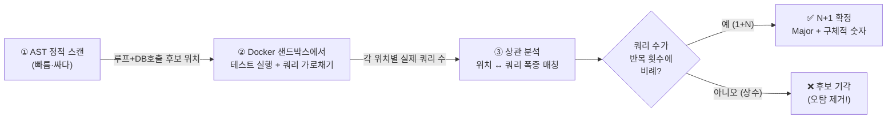
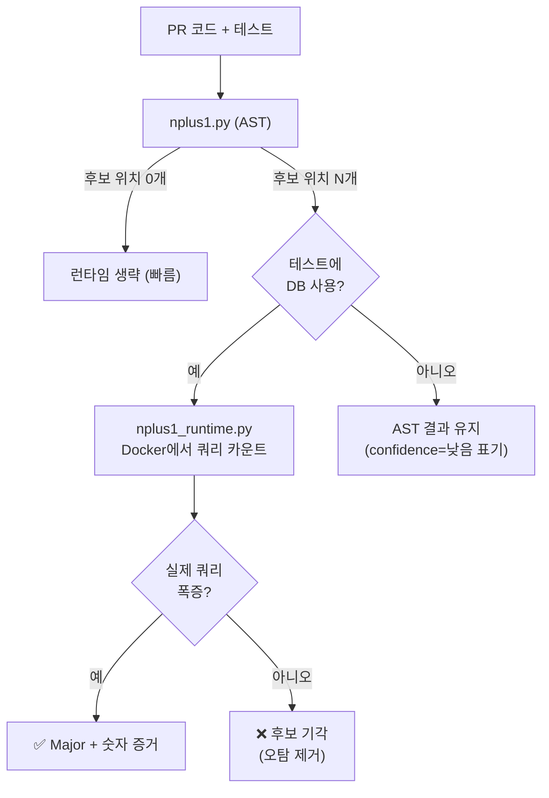

# 🌿 Dev3 확장 가지 A2 — 실제 쿼리 카운팅 (Runtime N+1 Proof)

> **한 줄**: "N+1이 의심된다"가 아니라 **"게시글 10개 조회에 쿼리 87번 발생"** 이라고 증명하는 가지.
> **정체성**: Dev3의 "추정 → 실측" 철학을 N+1 영역까지 완성한다.
> **상태**: 설계 (구현 전). 기존 Docker 샌드박스 + nplus1.py(AST) 재활용.

---

## 1. 왜 이게 필요한가 — 문제의 근원

### 1.1 N+1은 본질적으로 "런타임 현상"이다

N+1 쿼리는 **코드를 읽어서 100% 확신할 수 없는** 문제다. 왜냐하면:

```python
for post in posts:
    author = post.author          # ← 이게 DB 쿼리일까? 아닐까?
```

`post.author`가:
- **이미 eager loading 됐으면** → 쿼리 0번 (문제 없음)
- **lazy loading이면** → 매 반복마다 쿼리 (N+1)

**코드만 봐선 구분 불가.** ORM 설정·세션 상태·관계 정의에 따라 달라진다.

### 1.2 그래서 정적 분석(AST)은 오탐이 난다

어제 실측에서 직접 발견한 사건:

> `gruns/icecream` (DB랑 전혀 무관한 라이브러리)에 nplus1.py를 돌렸더니 **6건 검출.**
> 원인: `.get / .all / .first / .count`가 DB 메서드 이름과 겹쳐서, 일반 메서드를 N+1로 오인.

→ **AST는 "이름이 비슷하다"까지만 알 수 있다.** 진짜 DB를 때리는지는 모른다.

### 1.3 결론

| | 정적 분석 (현재 nplus1.py) | 실측 (A2) |
|---|---|---|
| 방식 | "루프 안에 .query() 이름 있음" | **테스트 돌리며 실제 쿼리 카운트** |
| 결과 | "N+1 의심" (Major, 근거 약함) | **"87번 발생" (Major, 증거 있음)** |
| 오탐 | 많음 (icecream 6건) | **거의 0 (실제 쿼리만 셈)** |
| 경쟁 도구 | SonarQube·Pylint도 이 수준 | **아무도 못 함** |

---

## 2. 핵심 아이디어 — AST가 짚고, 런타임이 증명한다



> **이게 AST+LLM보다 나은 이유**: LLM은 또 다른 추측이다. **런타임 카운트는 사실이다.**
> AST는 "어디를 볼지" 좁혀주고(비용 절감), 런타임은 "진짜인지" 증명한다(정확도).

### 2.1 오탐 제거가 공짜로 따라온다 ⭐

A2의 가장 큰 선물: **icecream 같은 false positive가 자동으로 사라진다.**
- AST가 `.get()`을 N+1 후보로 올림 → 런타임에서 실제 쿼리 0번 → **기각.**
- "이름이 비슷한 일반 메서드"는 쿼리를 안 날리므로 자연히 걸러진다.

---

## 3. 어떻게 쿼리를 가로채나 (기술 상세)

DB 라이브러리마다 "쿼리 실행 직전"에 끼어들 훅이 있다.

### 3.1 SQLAlchemy (가장 흔함)

```python
from sqlalchemy import event
from sqlalchemy.engine import Engine
import traceback

captured = []   # [(query_text, code_location)]

@event.listens_for(Engine, "before_cursor_execute")
def _count(conn, cursor, statement, params, context, executemany):
    # 이 쿼리가 어느 코드 줄에서 났는지 스택에서 추출
    loc = _extract_user_frame(traceback.extract_stack())
    captured.append((statement, loc))
```

### 3.2 sqlite3 (테스트 DB로 흔함)

```python
conn.set_trace_callback(lambda sql: captured.append((sql, _current_location())))
```

### 3.3 Django ORM

```python
from django.test.utils import CaptureQueriesContext
from django.db import connection
with CaptureQueriesContext(connection) as ctx:
    run_target()
# ctx.captured_queries → 전체 쿼리 리스트
```

### 3.4 범용 fallback (DB 드라이버 monkeypatch)

라이브러리를 모를 때: `cursor.execute`를 래핑해서 호출 카운트.

```python
import unittest.mock as mock
orig = SomeDriver.Cursor.execute
def wrapped(self, sql, *a, **k):
    captured.append((sql, _current_location()))
    return orig(self, sql, *a, **k)
```

> **핵심 트릭 — 스택 추적으로 "위치 귀속"**: 쿼리가 실행되는 순간 `traceback.extract_stack()`을 떠서, 사용자 코드(PR 안의 파일) 프레임을 찾는다. → "이 쿼리는 posts.py:7에서 났다"를 알 수 있다. 이게 AST 후보와 매칭하는 열쇠.

---

## 4. N+1 판정 알고리즘

### 4.1 기본 (MVP) — 위치별 쿼리 카운트

```
1. AST로 후보 위치 집합 L 추출  (예: {posts.py:7})
2. Docker에서 PR 테스트 실행 + 쿼리 가로채기
3. 각 쿼리의 발생 위치를 스택에서 추출 → 위치별로 그룹핑
4. 후보 위치 l ∈ L 에 대해:
     count(l) = l에서 발생한 총 쿼리 수
     if count(l) > THRESHOLD (예: 2):
         → 루프 안에서 여러 번 실행됨 = N+1 확정
         → "posts.py:7에서 쿼리 {count}번 발생"
```

### 4.2 고급 (정밀) — 스케일링 검증 ⭐

진짜 N+1인지 "정당한 배치 처리"인지 구분하려면 **입력 크기를 바꿔 두 번 돌린다.**

```
입력 N=5  로 실행 → posts.py:7에서 쿼리 6번   (1 + 5)
입력 N=10 로 실행 → posts.py:7에서 쿼리 11번  (1 + 10)

쿼리 증가량 / 입력 증가량 = (11-6)/(10-5) = 1.0
  → 입력 1개당 쿼리 1개 추가 = 명백한 1+N 패턴 → N+1 확정

vs 정상(eager loading):
입력 N=5  → 쿼리 1번
입력 N=10 → 쿼리 1번
  → 기울기 0 = 입력과 무관 = 문제 없음
```

| 기울기 (쿼리/입력) | 판정 | severity |
|:---:|---|:---:|
| ≈ 1 (선형) | **N+1 확정** | Major |
| ≈ 0 (상수) | 정상 (eager/batch) | — (기각) |
| 0 < x < 1 | 부분 최적화 의심 | Minor |
| > 1 (초선형) | **다중 N+1 중첩** | Major |

> MVP는 4.1(단순 카운트)로 시작 → 데모에서 충분히 강력. 4.2(스케일링)는 합성 하네스가 필요해 2단계.

---

## 5. 데이터 계약

```python
from pydantic import BaseModel
from typing import Literal, Optional

class QueryEvidence(BaseModel):
    """런타임 쿼리 측정 증거 — Issue.message에 녹여 넣는다."""
    file: str
    line: int
    query_count: int                 # 실제 관측된 쿼리 수 (예: 87)
    item_count: Optional[int] = None # N (루프 반복/픽스처 크기, 알 때만)
    pattern: Literal["n_plus_1", "constant", "batch", "unknown"]
    scaling: Optional[float] = None  # 입력당 쿼리 기울기 (스케일링 검증 시)
    sample_query: str = ""           # 대표 쿼리 1개
```

기존 `Issue`로 변환:

```python
Issue(
    severity="Major",
    file="src/posts.py",
    line=7,
    message=f"N+1 쿼리 확정: 항목 {ev.item_count}개 처리에 쿼리 {ev.query_count}번 발생 "
            f"(입력당 {ev.scaling:.1f}개). 예시: {ev.sample_query[:60]}",
    rule_id="PERF-002",
    suggestion="joinedload()/selectinload()로 한 번에 조회하면 쿼리 1~2번으로 감소합니다.",
)
```

> **계약 변화 없음**: 출력은 여전히 표준 `Issue`. message만 "의심"에서 "증거(숫자)"로 강해진다. → Dev4·pr-comment-agent는 코드 변경 0.

---

## 6. 모듈 구조 / 통합

```
performance/
├── nplus1.py            (기존) AST 정적 — FAST PASS, 후보 추출
└── nplus1_runtime.py    (신규) 런타임 실측 — CONFIRM PASS, 증명/기각
```

### 6.1 두 패스의 협업



### 6.2 우아한 폴백 (정직성 원칙 유지)

| 상황 | 동작 |
|---|---|
| 테스트에 DB 없음 | AST 결과 유지, message에 "정적 추정(미검증)" 표기 |
| Docker 실행 실패 | AST 결과 유지 + agent_traces에 partial_fail |
| 쿼리 훅 못 붙임 (미지원 DB) | 범용 monkeypatch 시도 → 실패 시 AST 폴백 |
| 런타임 0건인데 AST 후보 있음 | **후보 기각** (= 오탐이었다고 정직히 인정) |

> **숫자를 지어내지 않는다.** 측정 못 하면 "추정"이라고 정직하게. 측정하면 "확정 + 숫자".

---

## 7. 구현 로드맵 (TDD)

| Task | 모듈 | 핵심 테스트 | 난이도 |
|---|---|---|:---:|
| Q1 | `contracts.py` 에 `QueryEvidence` 추가 | 모델 검증 | 낮 |
| Q2 | `query_counter.py` (sqlite3 trace 카운터) | 픽스처 코드 실행 → 쿼리 N번 카운트 정확 | 중 |
| Q3 | 스택 위치 귀속 `_extract_user_frame` | 쿼리 → posts.py:7 매핑 정확 | 중 |
| Q4 | `nplus1_runtime.py` 판정 (4.1 단순) | N+1 코드 → 확정 / 정상 코드 → 기각 | 중 |
| Q5 | 기존 `nplus1.py`와 협업 (AST→런타임) | icecream → **0건** (오탐 제거 검증) ⭐ | 중 |
| Q6 | 스케일링 검증 (4.2, 선택) | N=5 vs N=10 기울기 계산 | 높 |

> **검증의 하이라이트**: Q5에서 **어제 6건 오탐 났던 icecream을 다시 돌려 0건** 나오면, 이 가지의 가치가 숫자로 증명된다.

### 7.1 새 픽스처 (TDD 입력)

```python
# tests/fixtures/db_repo/src/posts.py  — 진짜 sqlite 쓰는 샘플
import sqlite3
db = sqlite3.connect(":memory:")

def get_posts_bad(post_ids):        # N+1
    out = []
    for pid in post_ids:
        out.append(db.execute(f"SELECT * FROM posts WHERE id={pid}").fetchone())
    return out

def get_posts_good(post_ids):       # 정상 (한 번에)
    q = "SELECT * FROM posts WHERE id IN (%s)" % ",".join("?"*len(post_ids))
    return db.execute(q, post_ids).fetchall()
```

기대: `get_posts_bad` → 항목 N개에 쿼리 N번 (확정), `get_posts_good` → 쿼리 1번 (기각).

---

## 8. 발표 임팩트 — 화면에 뜨는 순간

**Before (현재 AST)**:
```
🟧 Major  PERF-002  posts.py:7
  N+1 쿼리: 루프 안에서 DB 호출이 반복됩니다.  ← "그럴 것 같다"
```

**After (A2 실측)**:
```
🟧 Major  PERF-002  posts.py:7
  N+1 쿼리 확정: 게시글 10개 조회에 쿼리 87번 발생 (입력당 1.0개).
  joinedload 적용 시 2번으로 감소 예상.
  실측 근거: SELECT * FROM posts WHERE id=1 ... (×87)
```

> **"의심된다"에서 "87번"으로.** 청중이 "오" 하는 지점이 바로 이 숫자다.

---

## 9. 한 문장 요약

> **A2는 Dev3의 정체성을 완성한다. 커버리지는 이미 실측이었지만 N+1은 추정이었다.
> 이제 N+1도 실측이 되어, "추측하는 도구"가 아니라 "증명하는 엔진"이 된다.
> 덤으로 어제 발견한 오탐 문제가 근본적으로 사라진다.**

---

*가지 A2 설계서 끝 · 기반: nplus1.py(AST) + prepare/sandbox.py(Docker) 재활용 · 출력 계약 변화 0*
