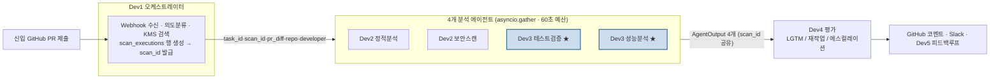
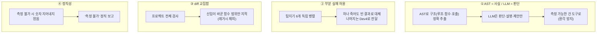
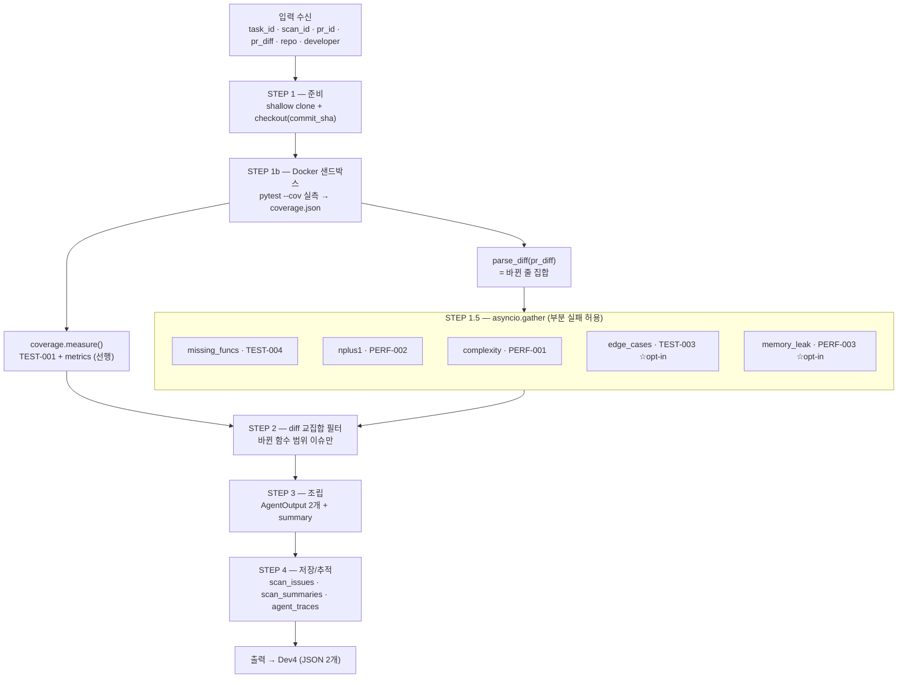
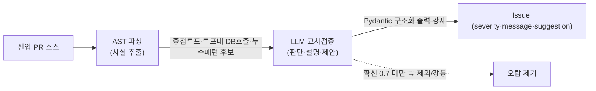
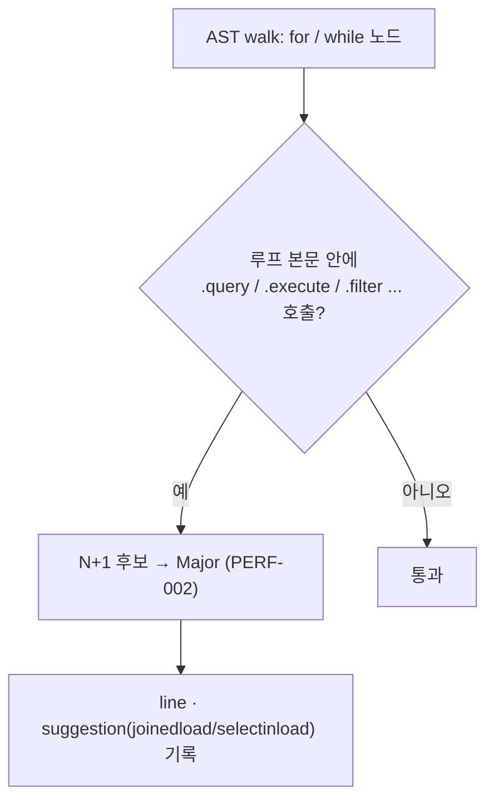
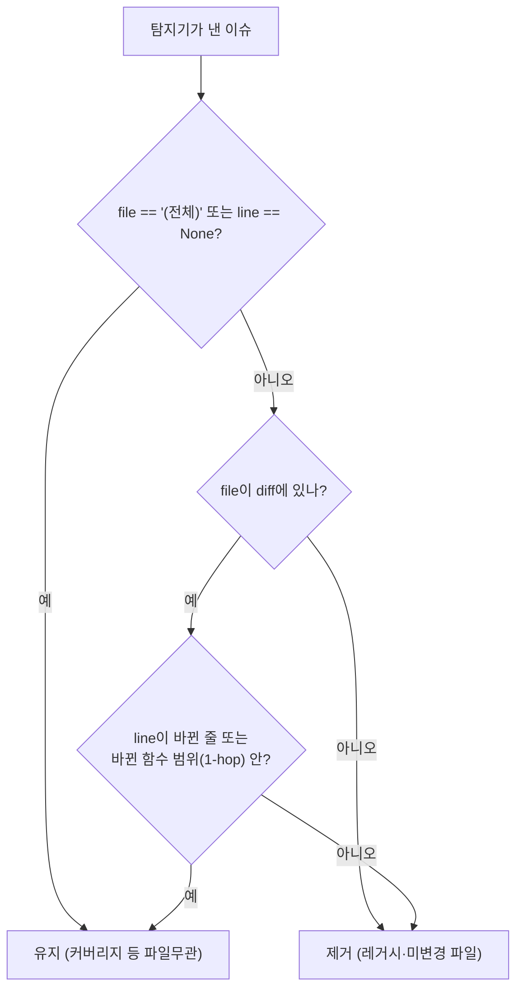
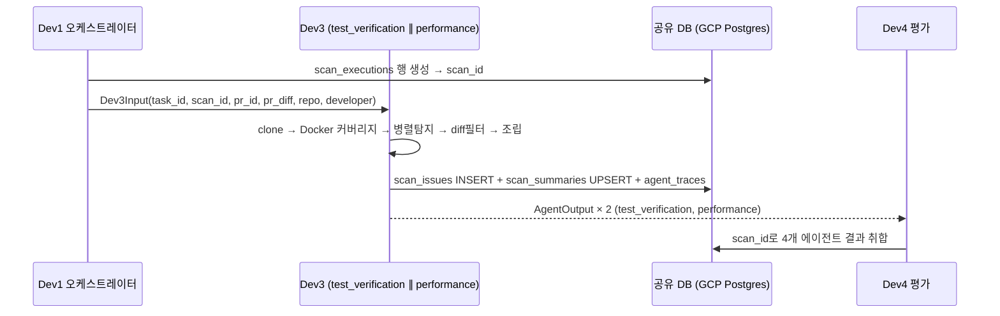
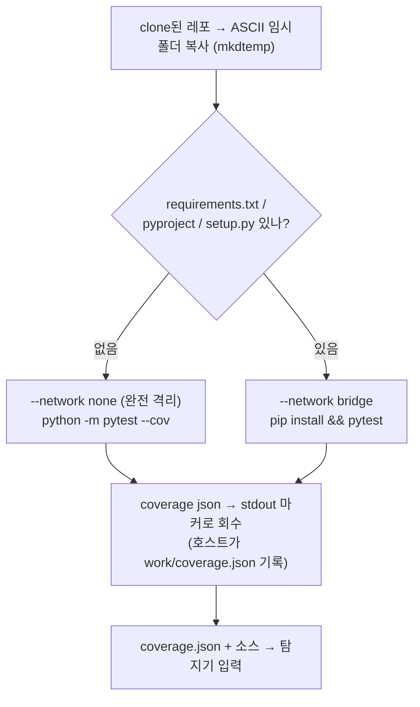
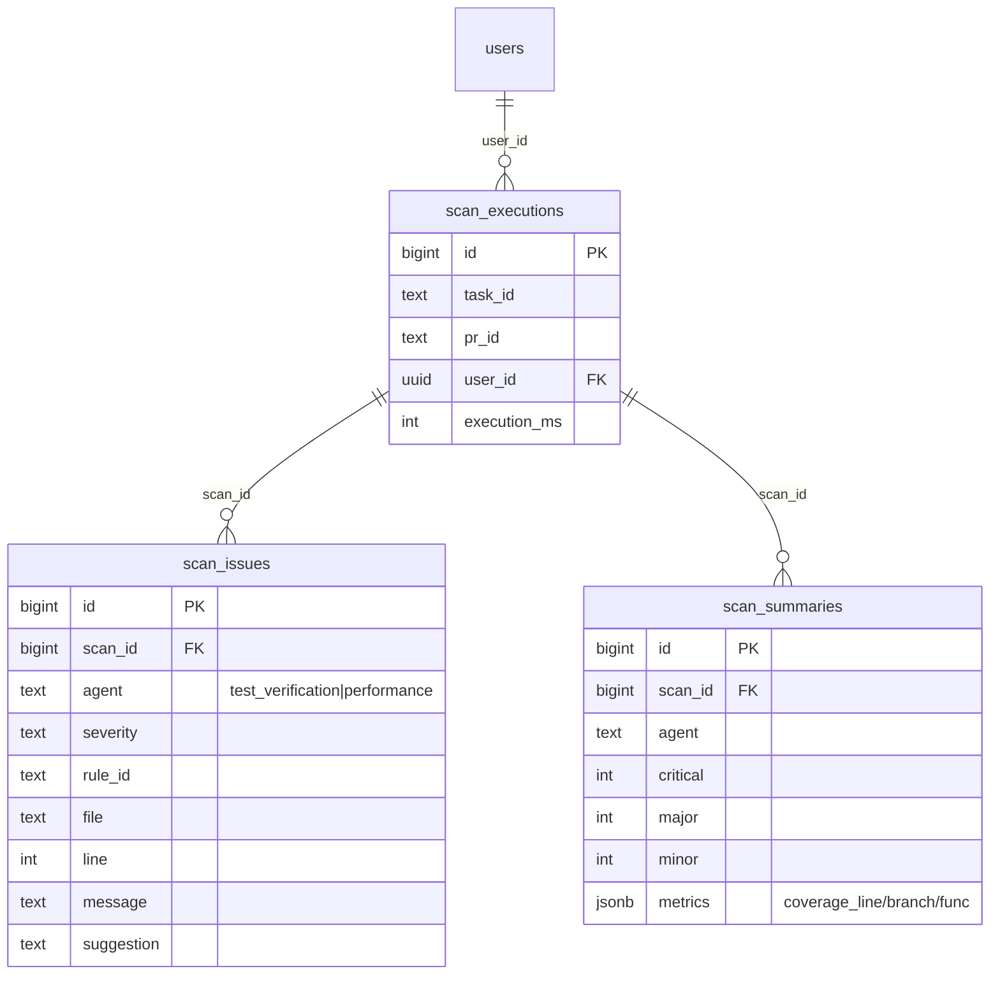
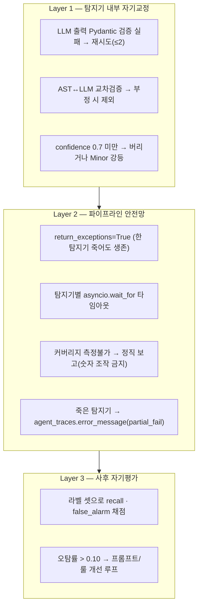

# 테스트 검증 + 성능 분석 모듈 (Dev3) — PRD

**버전**: v1.0
**작성일**: 2026-05-28
**담당**: Dev3
**상태**: MVP 구현 중 (핵심 파이프라인 · Docker 실측 · GCP 적재 · 트레이싱 검증 완료)
**근거 문서**: `DEV3_TECH_SPEC.md`(구현 설계서) · 마스터 `PRD_조직지식관리_온보딩_플랫폼.md`

> 본 PRD는 Dev3 모듈에 한정한다. REST 서비스가 아니라 **오케스트레이터(Dev1)가 호출하는 분석 에이전트**이므로, "API 엔드포인트" 대신 **에이전트 간 데이터 계약**과 **탐지 로직·워크플로우 시각화**를 중심으로 기술한다.

---

## 1. 제품 개요

### 1.1 한 줄 정의
신입 개발자의 PR 코드를 받아 **테스트 충분성**과 **성능 문제**를 자동 분석하고, 표준 이슈 JSON을 생성해 평가 에이전트(Dev4)에 넘기는 **병렬 분석 에이전트**.

### 1.2 배경과 문제
- 시니어가 신입 PR 리뷰에 하루 1~2시간 소비, 같은 실수(N+1, 테스트 누락)를 반복 피드백.
- 테스트 커버리지·성능 안티패턴은 사람이 매번 눈으로 잡기 어렵고 누락됨.
- LLM에 코드를 통째로 던지면 엉뚱한 곳을 지적(환각)하고 비용만 낭비.

### 1.3 Dev3의 정체성
> Dev3는 **"리뷰 의견을 쓰는 사람"이 아니라 "리뷰 근거(테스트·성능 데이터)를 만드는 사람"**.

- 합격/불합격(verdict) 판정은 **Dev4**의 몫. Dev3는 **이슈 사실(issue)만** 생성한다.
- 보안·컨벤션·정적분석은 **Dev2**의 몫. Dev3는 **테스트·성능만** 담당한다.
- 데모 핵심 시나리오 = **N+1 쿼리 감지(F-PERF-02, P0)**.

### 1.4 목표 및 성공 지표 (초기 목표값 · 라벨 셋 실측 후 조정)

> 아래 수치는 **초기 목표값**이다. 라벨 셋이 더 쌓이면 실측 결과에 맞춰 재조정한다. 근거가 마스터 PRD/설계인 항목은 "확정", 제안값인 항목은 "잠정"으로 표기.

| 목표 | 측정 지표 | 목표값 | 근거 |
|------|-----------|--------|------|
| 탐지 정확도 | recall (정답 이슈 중 검출 비율, 라벨 셋) | ≥ 0.9 | 잠정 (라벨셋 확보 후 확정) |
| 오탐 억제 | false_alarm_rate (출력 중 오탐 비율) | ≤ 0.10 | 확정 (DESIGN `FALSE_ALARM_THRESHOLD`) |
| 커버리지 측정 정확도 | 측정 % vs 정답 % 오차 | ≤ ±3%p | 잠정 (pytest-cov 실측이라 실제 오차 ≈ 0 예상) |
| 분석 레이턴시 | PR 수신 → 결과 반환 (Dev3 단독) | ≤ 30초 | 확정 (마스터 PRD 비기능) |
| 부분 실패 내성 | 탐지기 1개 죽어도 나머지 결과 반환 | 100% | 확정 (설계 원칙 `return_exceptions=True`) |

### 1.5 Dev3가 다른 Dev와 다른 점 — 특이점 (왜 Dev3가 특별한가)

| 차이 포인트 | Dev3의 특수성 | 왜 중요한가 |
|---|---|---|
| **실행 기반 측정** | 다른 Dev는 정적분석·문서·판정뿐. **Dev3만 신입 코드를 실제 Docker에서 돌려 커버리지를 측정** | 측정 없이 추정만 하면 환각·오판 위험 |
| **AST + LLM 분업** | 사실(AST: 루프·호출 위치) vs 판단(LLM: 빅오·엣지·누수)을 엄격히 분리 | 정확도·비용·환각 동시 해결 |
| **사람 개입 0 (HITL 없음)** | Dev1·Dev4는 사람 검토 단계 있음. Dev3는 30초 안에 **자기검증 3층으로 자동 완결** | 신입이 즉시 피드백 받는 유일한 경로 |
| **부분 실패 허용** | 6 탐지기 독립 병렬, 하나 죽어도 나머지 살림 (`return_exceptions=True`) | LLM 불안정·인프라 장애에 강함 |
| **신입 학습 데이터 원천** | Dev3의 `metrics`(커버리지·Major 추이)가 **Dev5 성장그래프·커리큘럼 진급 기준**의 직접 원천 | Dev3가 정확해야 학습 시스템 전체가 정확 |
| **데모 핵심 시나리오** | N+1 자동 감지(PERF-002) — 발표 임팩트 가장 큰 부분이 Dev3 | 프로젝트 성패의 가시적 지표 |

→ **한 줄로**: Dev3는 *"PR을 진짜로 돌려보고 측정하는 유일한 에이전트"*. 다른 Dev들이 정적·문서·판정에 머무는 동안, Dev3만 격리 컨테이너에서 진짜 코드를 돈다.

---

## 2. 파이프라인에서의 위치



| 상대 | 방향 | 주고받는 것 |
|------|------|------------|
| **Dev1** | 입력 ← | `task_id`, `scan_id`, `pr_id`, `pr_diff`, `repo{clone_url,commit_sha,test_command}`, `developer` |
| **Dev2** | 공유 | 동일 `scan_id`로 같은 DB 테이블에 기록 · Docker 샌드박스 공동 사용 |
| **Dev4** | 출력 → | `AgentOutput` 2개(`test_verification`, `performance`) JSON |
| **Dev5** | 간접 | Dev3의 `scan_issues`를 집계 → `mistake_patterns` → Dev1이 다음 PR에 맥락 제공 |

---

## 3. 핵심 설계 원칙



1. **AST = 사실 추출 / LLM = 판단·설명.** 커버리지·N+1 위치·중첩 루프는 정답이 정해진 사실 → 도구로. 엣지케이스 추론·빅오 확정은 LLM으로.
2. **부분 실패 허용.** `asyncio.gather(return_exceptions=True)` — 한 탐지기 타임아웃/예외에도 나머지 생존.
3. **diff 교집합.** 실행 범위 = 레포 전체(커버리지 필수), 지적 범위 = 바뀐 함수 + 1-hop.
4. **정직성.** deps 설치 실패 등으로 측정 불가 시 숫자를 지어내지 않고 "측정 불가" 보고.

---

## 4. 사용자 스토리

### P0 — 필수 (MVP)
```
US-DEV3-01: 신입이 PR을 올리면 30초 내에 테스트 커버리지(라인 80% 기준)와
            N+1 쿼리 여부가 자동 분석되어 이슈로 보고된다.
US-DEV3-02: Dev4가 scan_id 하나로 Dev3의 테스트/성능 결과를 한 번에 취합할 수 있다.
US-DEV3-03: 신입이 '바꾼 부분'에 대해서만 지적받고, 레거시 코드 이슈로 떠넘겨지지 않는다.
US-DEV3-04: 탐지기 하나가 실패해도 나머지 분석 결과는 정상 전달된다(부분 실패 허용).
```

### P1 — 다음 단계
```
US-DEV3-05: 테스트가 없는 함수와 빠진 엣지케이스(null·0·음수·경계)를 제안받는다.
US-DEV3-06: O(n²) 이상 복잡도·메모리 누수 의심 지점을 개선안과 함께 받는다.
US-DEV3-07: 검증 층이 오탐률·커버리지 정확도를 자동 채점해 품질을 추적한다.
```

---

## 5. 기능 요구사항

### 5.1 테스트 검증 (F-TEST)

| ID | 요구사항 | 우선순위 | 모듈 | 방법 | severity / rule_id |
|----|----------|:---:|------|------|------|
| F-TEST-01 | 커버리지 측정 (라인/브랜치/함수) | **P0** | `coverage.py` | Docker `pytest --cov` → coverage.json | metrics |
| F-TEST-02 | 커버리지 < 80% Major | **P0** | `coverage.py` | 라인 < 0.80 | Major / `TEST-001` |
| F-TEST-03 | 엣지케이스 누락 탐지 | P1 | `edge_cases.py` | LLM 구조화 출력 | Minor / `TEST-003` |
| F-TEST-04 | 테스트 누락 함수 제안 | P1 | `missing_funcs.py` | AST 함수 ∖ 실행 함수 | Minor / `TEST-004` |

### 5.2 성능 분석 (F-PERF)

| ID | 요구사항 | 우선순위 | 모듈 | 방법 | severity / rule_id |
|----|----------|:---:|------|------|------|
| F-PERF-01 | 시간복잡도 추정 (O(n²)↑) | P1 | `complexity.py` | AST 중첩루프 + LLM 빅오 확정 | O(n²)Minor·O(n³)↑Major / `PERF-001` |
| F-PERF-02 | N+1 쿼리 감지 | **P0** | `nplus1.py` | AST: 루프 본문 내 DB 호출 | Major / `PERF-002` |
| F-PERF-03 | 메모리 누수 패턴 | P1 | `memory_leak.py` | AST 누수패턴 + LLM 검토 | Minor / `PERF-003` |
| F-PERF-04 | 병목 탐지·최적화 제안 | P2 | (차기 버전) | — | — |

### 5.3 검증 (채점기 검사)

| ID | 요구사항 | 우선순위 | 모듈 |
|----|----------|:---:|------|
| F-VAL-01 | 커버리지 측정 정확도 검증 | P1 | `validation/eval.py` |
| F-VAL-02 | 성능 분석 false alarm(오탐) 추적 | P1 | `validation/eval.py` |

> **severity 매핑 요약**: 커버리지<80%→Major(TEST-001), N+1→Major(PERF-002), O(n²)→Minor·O(n³)↑→Major(PERF-001), 엣지/누락함수/메모리누수→Minor. Critical은 Dev3 영역에 거의 없음(보안=Dev2).

### 5.4 탐지기별 부정 케이스 — "잡으면 안 되는 것" (TDD Red 테스트 작성용)

> 각 탐지기는 **긍정 케이스(잡아야 함)뿐 아니라 부정 케이스(잡으면 안 됨)** 도 통과해야 한다. 아래는 TDD 시 반드시 포함할 부정 케이스 + 실측에서 발견된 함정.

**nplus1 (PERF-002)**
- 루프 밖 단일 DB 호출 → 0 issue
- `self.query()` 같은 자기참조 메서드(예: 테스트 클래스의 `query()` 메서드)에 대해선 잡지 않음
- ⚠️ **실측 발견(어제 icecream에서 6건 오탐)**: `.get/.all/.first/.count`는 일반 메서드 이름과 충돌. `DB_CALL_NAMES`를 **`{query, execute, filter, fetchone, fetchall, scalar}` 로 좁혀** 시작. 더 정밀하게 가려면 호출 대상 컨텍스트(`.session/.db/.cursor/.engine`)로 제약 추가
- 단순 반복문 + 산술/문자열 조작만 → 0 issue

**complexity (PERF-001)**
- 단일 루프 (O(n)) → 0 issue
- 비중첩 인접 루프 두 개 → 0 issue
- list/dict comprehension `[f(x) for x in xs]` → 단일 루프로 간주(0 issue)
- 함수 안에 try/except가 있더라도 그 자체로 루프 깊이 안 됨

**missing_funcs (TEST-004)**
- ⚠️ **함정(이미 한 번 당함)**: def 줄은 import 시 항상 실행됨. 함수 본문 범위(`body[0].lineno ~ end_lineno`)와 `executed_lines` 교집합으로 판정. **def 줄만 보면 모든 함수가 covered로 잘못 잡힘** → 반드시 본문만 확인
- 빈 함수(`pass`만) → 본문 1줄 실행 시 covered로 인정
- coverage.json 없으면 graceful skip (0 issue, 예외 X)

**coverage (TEST-001/002)**
- `num_statements == 0`이면 측정 불가 → metrics 비우거나 None, 절대 0/0 같은 NaN 산출 금지
- coverage.json 없음 → metrics=None, 이슈 없음 (정직성 원칙)
- 라인 ≥ 80%면 이슈 없음 (메트릭만 남김)
- branch 데이터 없으면 `coverage_branch` 키 자체를 metrics에서 제외 (null로 두지 말 것)

**edge_cases (TEST-003)**
- 무인자 함수 → 0 issue
- LLM이 "필요한 엣지 없음" 답하면 이슈 안 만들기
- 휴리스틱 모드 메시지엔 반드시 `[heuristic]` 접두사 (LLM 결과와 시각 구분)

**memory_leak (PERF-003)**
- `with open(...) as f:` 블록 → 0 issue
- 대입된 `fh = open(...)` → 0 issue (호출측 책임으로 간주)
- 로컬 변수 list/dict append → 0 issue (함수 종료 시 자동 해제)
- LLM 확신 < 0.7이면 이슈 버리기 (오탐 억제)
- 함수 내부 임시 dict는 누수 아님 (전역만 의심)

> **검증 의무**: 위 부정 케이스가 모두 0 issue로 통과해야 PRD 5.4 합격. `check_detectors.py`와 동등한 부정 케이스 묶음을 새 코드의 TDD Red 단계에서 먼저 작성한다.

---

## 6. 전체 워크플로우



> **실행 순서 주의**: `coverage.measure()`는 gather 전에 선행한다(`missing_funcs`가 coverage.json에 의존). 타이밍: coverage ≤15초 + gather ≤8초 = **≤23초** (30초 예산 이내).

---

## 7. 탐지 로직 시각화

### 7.1 AST → LLM 원리 (탐지견 → 형사)



### 7.2 N+1 감지 (PERF-002, 데모 핵심)



### 7.3 diff 교집합 필터 (신입이 바꾼 부분만)



---

## 8. 입출력 데이터 계약

### 8.1 시퀀스 (Dev1 → Dev3 → Dev4)



### 8.2 입력 (Dev1 → Dev3)
```json
{
  "task_id": "uuid-1234", "scan_id": 42, "pr_id": "PR-001",
  "pr_diff": "diff --git a/src/posts.py ...",
  "repo": { "clone_url": "https://github.com/team/proj.git",
            "commit_sha": "abc123", "language": "python",
            "test_command": "pytest --cov=src --cov-report=json" },
  "developer": { "id": "junior_dev_01", "skill_level": "junior",
                 "tech_stack": ["python","fastapi","postgresql"] }
}
```

### 8.3 출력 (Dev3 → Dev4) — agent별 1개씩, 총 2개
```json
{
  "task_id": "uuid-1234", "scan_id": 42, "pr_id": "PR-001",
  "agent": "test_verification",
  "issues": [
    { "severity": "Major", "file": "(전체)", "line": null,
      "message": "테스트 라인 커버리지 20.0% < 기준 80%.",
      "rule_id": "TEST-001", "suggestion": "테스트를 추가하세요." }
  ],
  "summary": { "critical": 0, "major": 1, "minor": 2 },
  "metrics": { "coverage_line": 0.20, "coverage_branch": 0.0, "coverage_func": 0.25 },
  "execution_ms": 1500
}
```

| 필드 | 비고 |
|------|------|
| `scan_id` / `pr_id` | Dev4의 DB join · GitHub 코멘트 등록용 (출력에 동봉) |
| `metrics` | `test_verification`만 채움 (`performance`는 `null`). **0~1 소수**, 키: `coverage_line/branch/func` |
| `rule_id` | 테스트 = `TEST-xxx`, 성능 = `PERF-xxx` (보안 `SEC-xxx`는 Dev2) |

### 8.4 UI 표현 가이드 — 이슈 카드 (FE 매핑)

Dev3 자체는 화면을 그리지 않고 **출력 JSON만 만든다.** FE/Dev4 PR 뷰어가 아래 규약대로 `issues[]`를 **이슈 카드 컴포넌트**로 렌더링한다.

**와이어프레임**

```
┌─ 🟧 Major  PERF-002   src/posts.py:7  [GitHub↗] ───────┐
│  N+1 쿼리: 루프 안에서 DB 호출이 반복됩니다.            │
│  💡 joinedload()/selectinload() 등으로 루프 밖에서 조회 │
└─────────────────────────────────────────────────────────┘
┌─ 🟧 Major  TEST-001   (전체) ──────────────────────────┐
│  테스트 라인 커버리지 20.0% < 기준 80%.                 │
│  💡 테스트를 추가해 커버리지를 80% 이상으로 올리세요.   │
└─────────────────────────────────────────────────────────┘
┌─ 🟨 Minor  TEST-004   src/posts.py:4   [GitHub↗] ──────┐
│  함수 'get_posts'에 대한 테스트 실행 흔적이 없습니다.   │
│  💡 get_posts()에 대한 단위 테스트를 추가하세요.        │
└─────────────────────────────────────────────────────────┘
```

**필드 → UI 매핑 (props)**

| `issues[].필드` | UI 요소 | 표시 규약 |
|---|---|---|
| `severity` | 색상 막대 + 아이콘 | Critical = 🟥 빨강, **Major = 🟧 주황**, **Minor = 🟨 노랑** |
| `rule_id` | 뱃지 (모노스페이스) | `TEST-*` = 파랑 계열, `PERF-*` = 보라 계열 (보안 `SEC-*` Dev2와 시각 구분) |
| `file` + `line` | 경로:줄번호 + GitHub 링크 | `file == "(전체)"` 또는 `line == null` → 링크 없이 "(전체)" 표시 |
| `message` | 카드 본문 | 1~2줄 |
| `suggestion` | 💡 펼침 영역 | 빈 문자열이면 영역 자체 숨김 |
| `agent` (카드 외부) | 그룹 헤더 | `test_verification` ↔ `performance` 두 섹션으로 분리 정렬 |

**카드 그룹/정렬 규약**
1. `agent`로 2개 섹션 분리: **🧪 Test Verification** · **⚡ Performance Analysis**.
2. 각 섹션 내부 정렬: severity(Critical→Major→Minor) → rule_id → line 오름차순.
3. **헤더에 summary 표시**: `summary.critical/major/minor`를 작은 배지로(예: `Major 1 · Minor 2`).

**상태별 표시 (선택)**
- 카드 hover 시 `rule_id` 클릭하면 사내 가이드(KMS 검색 결과)로 딥링크 → Dev1과의 후속 연계.
- `severity="Critical"`(Dev2에서만 발생)이 있으면 카드 상단에 "시니어 검토 필요" 알림 띠.

**FE 구현 시 필요한 것 = 위 매핑 1개.** Dev3는 `issues[]`/`summary`/`metrics` 스키마를 변경하지 않는 한 UI에 영향이 없다.

---

## 9. 실행 샌드박스 (Docker)

신뢰 못 하는 남의 코드를 호스트에 직접 돌리지 않고 격리 컨테이너에서 실행한다. (Dev2와 공용)



| 항목 | 정책 |
|------|------|
| 격리 | `--network none`(무의존) · `--memory 512m` · 타임아웃 |
| 의존성 | requirements/pyproject 감지 시 `--network bridge`로 설치 후 실행 |
| 커버리지 회수 | Windows+Docker bind-mount 읽기 이슈 → **stdout 마커로 전달** 후 호스트가 기록 |
| 명령 정규화 | `pytest …` → `python -m pytest …`(cwd import) + `--cov-branch` |

---

## 10. 데이터 저장 (공유 DB)

Dev3는 자체 테이블을 만들지 않고 Dev2와 공유 테이블을 같은 `scan_id`로 쓴다.



| 테이블 | Dev3 동작 | 비고 |
|--------|-----------|------|
| `scan_executions` | **생성 안 함** (Dev1이 PR당 1행) | 실제 컬럼 `user_id uuid`(FK users) |
| `scan_issues` | INSERT | `agent` CHECK에 Dev3 값 포함(적용 완료) |
| `scan_summaries` | UPSERT `(scan_id, agent)` | **Dev3가 `CREATE IF NOT EXISTS`로 보장** (현재 GCP에 미존재) |
| `agent_traces` | INSERT (요약 1행) | §12 |

---

## 11. 자기검증 · 안전망 (HITL 없음 — 자동 완결)

> Dev3는 LangGraph(HITL·조건분기)가 **아니다.** `asyncio` 병렬 구조라 사람 개입 없이 30초 안에 **스스로 교정**하는 3층 안전망을 둔다.



---

## 12. 관찰 가능성 (LangSmith + agent_traces)

| 도구 | 역할 |
|------|------|
| **LangSmith** | 깊은 추적(LLM 호출·토큰·트리) 자동 수집 + Eval 데이터셋 |
| **agent_traces** (Postgres) | 요약 1행(성공률·시간) — 중복 저장 금지 |

> **실측 제약 (GCP)**: `agent_traces.status`는 `running/success/fail/review`만 허용 → Dev3의 `partial_fail`은 **`success`로 매핑**(원본은 `error_message` + `output_summary.dev3_status`에 보존). `task_id`는 **uuid 타입**(비-uuid는 NULL + output_summary 보존), `scan_id` 전용 컬럼이 없어 **`output_summary`에 동봉**.

---

## 13. 비기능 요구사항

| 항목 | 요구사항 |
|------|----------|
| 레이턴시 | PR→코멘트 60초(4개 병렬), Dev3 단독 30초 예산 |
| 격리/보안 | 남의 코드는 Docker(`--network none`·메모리/CPU 상한·타임아웃) |
| 정직성 | 측정 불가 시 숫자 지어내지 않음(환각 방지) |
| 추적성 | 모든 실행 `trace_id` + LangSmith/agent_traces |
| 확장성 | 탐지기 = `detect(repo_path, changed)->list[Issue]` 시그니처 통일 → 추가/교체 용이 |
| 설정 | 임계값·타임아웃·모델명은 `config/settings.py` 일원화(하드코딩 금지) |
| 테스트 | 각 탐지기 단위 + 검증층 E2E(`eval.py`) |

### 13.1 타임아웃 / 부분 실패

| 레벨 | 한계 | 처리 |
|------|------|------|
| 전체 에이전트 | 30초 | 초과 시 Dev1이 결과 제외 |
| 탐지기 개별 | coverage 15s / LLM 각 8s | `asyncio.wait_for` |
| Docker | 120s + 강제 종료 | 무한 루프 방어 |
| 예외 | `return_exceptions=True` | 빈 결과 + `partial_fail` 로깅 |

---

## 14. 설정 / 환경변수

| 변수 / 설정 | 기본값 | 설명 |
|------|--------|------|
| `COVERAGE_THRESHOLD` | `0.80` | TEST-001 임계 |
| `COMPLEXITY_MINOR/MAJOR_DEPTH` | `2 / 3` | 중첩 루프 깊이 |
| `DB_CALL_NAMES` | query·execute·filter… | N+1 판별 DB 호출 |
| `AGENT/DOCKER/COV/LLM_TIMEOUT_S` | 30 / 120 / 15 / 8 | 타임아웃 |
| `LLM_MODEL` · `LLM_MAX_RETRY` · `LLM_CONFIDENCE_MIN` | gpt-4o-mini · 2 · 0.7 | LLM |
| `FALSE_ALARM_THRESHOLD` | `0.10` | 개선 루프 트리거 |
| `POSTGRES_URL` | (필수) | GCP Cloud SQL 연결 |
| `OPENAI/ANTHROPIC/GOOGLE_API_KEY` | (선택) | LLM 탐지기 활성 |
| `LANGCHAIN_API_KEY` · `LANGCHAIN_PROJECT` | (선택) | LangSmith |

---

## 15. 단위·통합 검증 현황 (구현·검증까지만 — 실 운영 적재는 별개)

> 아래는 **fixture·롤백 기준**의 단위/통합 검증이다. "PASS = 구현된 경로가 정상 동작" 의미이며, **실 PR 적재·실연동·LLM 경로는 아직 검증 범위 밖**(§16 참조).

| 검증 스크립트 | 검증 범위 | 결과 (fixture/rollback) |
|------|------|------|
| `main.py` → `validation/eval.py` | 골든 5이슈 정합 (recall 1.0 / false_alarm 0.0) | 🟢 PASS |
| `prepare/sandbox.py` | Docker 컨테이너 pytest 실측 (fixture 20% · 의존성 레포 93.1%) | 🟢 PASS |
| `validation/verify_db.py` | GCP scan_issues/summaries 적재 (트랜잭션+롤백) | 🟢 PASS |
| `validation/verify_e2e.py` | clone-less Docker→탐지→GCP 통합 | 🟢 PASS |
| `validation/verify_trace.py` | agent_traces GCP 로깅(status 매핑·uuid) | 🟢 PASS |

→ **"PASS"의 의미**: 코드 경로가 막힘 없이 도는 것까지만 증명. 실 PR/실 적재/LLM은 M4~M6에서.

---

## 16. 마일스톤 / 로드맵 — "구현 ≠ 완료"

> M1~M3는 **구현·단위 검증까지**만 끝났다(fixture/롤백 기준). 실 적재·실연동은 M4~M6에서 마무리한다. 즉 **현재는 "일단 다 만들어놓고, 운영 환경 붙이며 수정 필요한 단계".**

| 단계 | 목표 | 상태 |
|------|------|------|
| M1 | 골든 탐지기(N+1·복잡도·커버리지·누락함수) + 파이프라인 | 🟢 구현·검증 |
| M2 | Docker 실측 커버리지 + GitHub clone + 의존성 자동설치 | 🟢 구현·검증 |
| M3 | GCP 적재(persist_pg) + agent_traces 로깅 + 메트릭 3종 | 🟢 구현·롤백 검증 (실커밋 X) |
| M4 | `scan_summaries` 팀 영구 생성 → 실커밋 1회 | ⏳ 팀 합의 대기 |
| M5 | LLM 연결(edge_cases·complexity 빅오·memory_leak) + LangSmith harness | ⏳ API 키 필요 |
| M6 | Dev1·Dev4 실연동 E2E (실 PR → 코멘트 등록) | ⏳ 예정 |

---

## 17. 범위 밖 (Out of Scope — MVP)

- F-PERF-04 병목 프로파일링(런타임 측정) — 차기
- 다국어/비-Python 레포 분석 — 차기
- 자체 verdict 판정(=Dev4 영역) · GitHub 코멘트 작성(=Dev4)
- 장기 누적 실수 패턴 테이블(`mistake_patterns`) 소유 — Dev5
- 문서 파이프라인/HITL(=Dev1/KMS 영역)

---

## 18. 확장성 — 미래 가지 (코드 짤 때 막지 않도록)

> PRD MVP는 좁게 지키되, 아래 가지들은 **모듈 시그니처 통일(`detect(repo_path, changed) -> list[Issue]`) + 인프라 분리(샌드박스/LLM/DB 어댑터)** 덕에 향후 쉽게 확장 가능. 새 코드 작성 시 **이 가지들을 막는 결정은 피한다**.

| 가지 | 무엇을 의미하나 | 진입 비용 |
|---|---|---|
| **언어 확장** (JS·TS·Java) | 탐지기 시그니처는 언어 무관. 언어별 AST 어댑터만 추가하면 같은 파이프라인 재사용 | 중 |
| **탐지기 추가** | 6종 외 race condition·dead code·dependency staleness·deprecated API 등 같은 시그니처로 추가 | 낮 |
| **신입별 severity 가중치** | Dev5의 `mistake_patterns`를 읽어 반복 실수에 가중치 → 개인화 피드백 강도 조절 | 낮 |
| **IDE 플러그인** | VS Code/JetBrains에서 PR 올리기 전 로컬 분석 (조기 발견) | 중 |
| **CI/CD 직접 통합** | GitHub Actions 단독 모드 (Dev1 webhook 없이도) | 낮 |
| **시계열 대시보드** | `scan_summaries` 누적 → 팀·개인 커버리지/Major 추이 그래프 | 중 |
| **자기 학습 루프** | LangSmith Eval로 시니어 verdict와 Dev3 출력 비교 → 탐지 임계 자동 조정 | 중·고 |
| **다중 PR 비교** | PR 시리즈 누적 분석 → "이 신입은 N+1 7회→1회로 줄었음" 같은 진보 추적 | 낮 |

### 18.1 가지를 안 막는 4가지 코딩 원칙

1. **탐지기는 `detect(repo_path, changed) -> list[Issue]` 시그니처를 깨지 않는다** — 새 탐지기 추가가 모듈 1개 작성으로 끝나도록.
2. **언어/실행 환경은 어댑터로 격리** — `sandbox.py`가 "파이썬 전용"이 아니라 "샌드박스 어댑터 인터페이스"가 되도록.
3. **개인화 정보(skill_level·previous_pr_issues)는 `Dev3Context`로 받아 전달** — 가중치·강도 조절 훅을 미리 열어둠.
4. **모든 출력은 `scan_id`로 join 가능하게** — 시계열·다중 PR 비교가 SQL 한 줄로 되도록.

---

*Dev3 PRD v1.0 · 근거: `DEV3_TECH_SPEC.md` · 검증된 구현 기준 작성*
