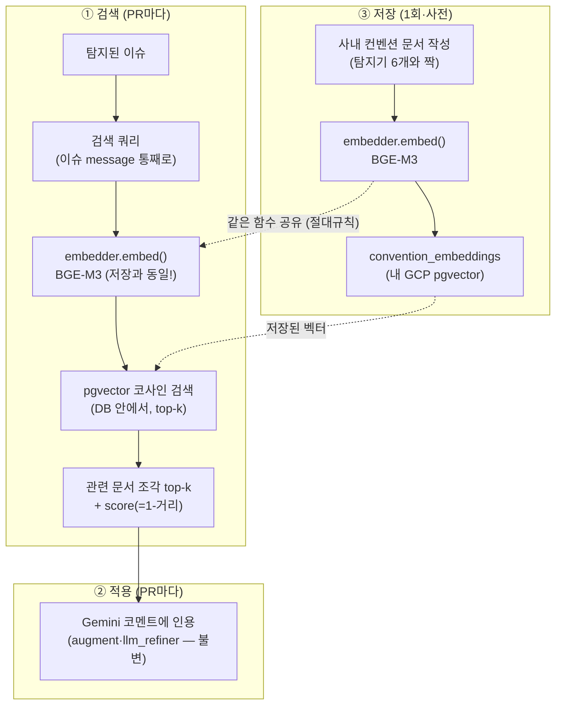

# 🔍 Dev3 사내 컨벤션 RAG — 설계서 (B안·자급자족·정본)

> ⭐ **이 파일이 RAG 설계의 유일한 정본.** (인수인계 §3은 요약일 뿐, 상세는 여기)
> 이 문서 = 구현 청사진. VS Code 클로드는 이거 보고 TDD로 구현만 하면 됨.
> LLM = Gemini 2.5 Flash 통일. 임베딩 = **BGE-M3(무료, 1024차원)**. 벡터DB = **내 GCP Postgres + pgvector**.

> ### 🔄 아키텍처 변경 이력 — A안 → B안 (2026-06-03)
> 원래 설계(A안)는 **"Dev1 KMS 검색 API에 위임"** 이었음. 그런데 앞단(오케스트레이터·API)이
> 없어지면서 **B안 = "자급자족"** 으로 전환:
> - 컨벤션 문서를 **Dev3가 직접** BGE-M3로 임베딩 → **내 pgvector 테이블에 저장**.
> - 런타임에 이슈를 **Dev3가 직접** BGE-M3로 임베딩 → **pgvector가 DB 안에서 코사인 검색** → top-k.
> - **절대규칙: 저장 임베딩 모델 == 검색 임베딩 모델 (둘 다 BGE-M3).** → 공유 `embedder.py`로 구조 강제.
> - `search_convention()` **시그니처·반환형은 그대로** → `augment.py`·`llm_refiner`·R8 **안 건드림** (안쪽만 교체).
> - 위험 3·4는 **그대로 유지**, 위험 1·2만 "직접 수행 + 모델 동일 강제"로 갱신.

---

## ⚠️⚠️ 설계 검증으로 발견한 4대 위험 + 확정 해결책 (가장 중요 — 먼저 읽어라)

> 초안 설계를 리뷰하다 발견한 함정들. **이 해결책을 반드시 지킬 것.** 안 지키면 운영에서 터짐.

| # | 위험 | 왜 터지나 | ✅ 확정 해결책 (B안) |
|---|---|---|---|
| **1** | **저장·검색 모델 불일치** | 적재할 때와 검색할 때 임베딩 모델(또는 버전)이 다르면 벡터 공간이 어긋나 **검색이 통째로 엉뚱해짐** | **저장=검색 모델을 BGE-M3로 통일**하고, 임베딩 함수를 **`rag/embedder.py` 한 곳**에만 두어 적재 스크립트·retriever가 **같은 `embed()`를 공유**. 모델 교체는 한 곳만 수정 |
| **2** | **테이블 스키마 강결합** | 차원·컬럼·테이블명을 여기저기 하드코딩하면 바꿀 때 무경고로 깨짐 | **`convention_embeddings` 테이블 1곳 소유(Dev3)** + DDL/차원(`vector(1024)`)을 한 모듈에 집중. `CREATE EXTENSION IF NOT EXISTS vector`로 멱등 |
| **3** | **정량 수치 자연어 파싱 (제일 위험)** | "신규 90% 필수, 레거시 80%" 같은 문장에서 0.9 파싱? LLM/정규식 오작동 → **PR 통과/탈락 판정이 깨짐 = 재앙** | **정량 룰은 RAG로 절대 안 뽑음.** `config/conventions.py`에 **구조화**해서 박음. RAG(자연어)는 **정성(설명·가이드)에만** *(A안과 동일·유지)* |
| **4** | **짧은 키워드 벡터검색 품질** | "N+1" 2단어만 던지면 벡터검색이 엉뚱한 문서 매칭 | **이슈 message 통째로** 쿼리에. "N+1 쿼리: 루프 안에서 DB 호출이 반복됩니다" 전체를 검색어로 *(A안과 동일·유지)* |

### 이 4개가 바꾸는 핵심 원칙
```
정량 기준 (커버리지% 등)  → RAG ❌  →  config/conventions.py 구조화 ✅   (위험 3)
정성 가이드 (설명·패턴)    → RAG ✅ (코멘트 인용에만 한정)
임베딩·저장·검색          → Dev3가 직접 수행 ✅  →  단, 저장=검색 모델 동일(BGE-M3) 강제   (위험 1·2)
검색 쿼리                 → 키워드 ❌  →  이슈 message 통째로 ✅          (위험 4)
```

> **즉 RAG의 역할을 "정성 코멘트 강화"로 좁힌다.** PR 판정을 좌우하는 정량 기준은 RAG 밖(구조화 데이터)에 둔다.

---

## 0. 한 줄 정의

> 신입 PR을 평가할 때, **사내 코딩 컨벤션 문서를 검색해서** 코멘트에 "우리 팀 방식 + 사내 가이드"를 녹인다. 평가 기준(커버리지 % 등 정량)은 RAG가 아니라 `config/conventions.py`로 맞춘다. → Dev3가 "범용 도구"에서 "우리 회사 전용 리뷰어"로.

---

## 1. ⚠️ 시작 전 필요한 것 (사전 데이터) — "바로 시작" 안 되는 이유

RAG는 **검색할 문서가 있어야** 작동. 지금 그 문서가 없음. 그래서 **순서상 저장(문서 준비·적재)부터**.

### 1.1 만들어야 할 사내 컨벤션 문서 (재료) — 탐지기 6개와 짝
서술형(설명·패턴)만. **숫자(커버리지 %)는 문서에 넣어도 파싱하지 않음 — 정량은 `config/conventions.py`**(위험 3).

| 문서 | 짝이 되는 탐지기 | 들어갈 내용 (서술형 예시) |
|---|---|---|
| **커버리지 가이드** | TEST-001 | "테스트 없는 변경은 머지 금지", "결제·인증은 특히 꼼꼼히" (구체 %는 config) |
| **테스트 누락 가이드** | TEST-004 | "public 함수엔 단위 테스트 필수", 네이밍/배치 규칙 |
| **엣지케이스 가이드** | TEST-003 | "null·빈값·음수·경계값을 항상 테스트", 우리 팀 체크리스트 |
| **N+1 가이드** | PERF-002 | "루프 내 DB 호출 금지, selectinload 표준", 발견 시 대응 |
| **복잡도 가이드** | PERF-001 | "O(n²) 이상 리뷰 필수", 평탄화/자료구조 패턴 |
| **메모리 가이드** | PERF-003 | "전역 컬렉션 무한 누적 주의", 캐시 만료 패턴 |

> **MVP**: 위 문서를 짧은 markdown으로. 실제 사내 문서 없으면 공개 자료(Google Style Guide 등) + 팀 합의값으로 시작.

### 1.2 Dev3가 직접 갖춰야 할 것 (B안 — 직접 수행)
- 🔧 **BGE-M3 임베딩** — `sentence-transformers`의 `SentenceTransformer("BAAI/bge-m3")`. 약 2GB, CPU 동작(문서 소수라 OK). `rag/embedder.py` 한 곳에 집중(절대규칙).
- 🔧 **pgvector 테이블** — 내 GCP Postgres에 `convention_embeddings`(`vector(1024)`). `CREATE EXTENSION IF NOT EXISTS vector` 필요.
- 🔧 **적재 스크립트** — §1.1 문서를 청크→`embed()`→테이블 INSERT (1회·사전).
- ✅ **Gemini 2.5 Flash** — 코멘트 생성에 이미 사용 중(R8 완료).
- ✅ **`config/conventions.py`** — 정량 룰(R3·R4 완료, 위험 3).

### 1.3 결론
B안은 외부 KMS에 의존하지 않는 **자급자족 검색·활용 계층**. Dev3가 ① 문서 쓰고 ② BGE-M3로 임베딩해 내 테이블에 넣고 ③ 검색해서 ④ 코멘트에 인용까지 직접 한다. 단, **저장과 검색이 같은 모델**이어야 함(위험 1).

---

## 2. 전체 흐름 (RAG 3단계 — B안)



---

## 3. ③ 저장 (Store) 설계 — Dev3 직접 (위험 1·2 반영)

### 할 일
1. §1.1 문서 작성 (markdown).
2. **B0**: GCP Postgres에 pgvector 확장 확인/설치 (`CREATE EXTENSION IF NOT EXISTS vector`).
3. **`convention_embeddings` 테이블 생성** — `vector(1024)` 컬럼 + 메타(doc_title, source_url, content).
4. **적재 스크립트 실행** — 문서 청크 → `embedder.embed()` → INSERT.

### 테이블 (예시)
```sql
CREATE EXTENSION IF NOT EXISTS vector;
CREATE TABLE IF NOT EXISTS convention_embeddings (
    id         bigint GENERATED ALWAYS AS IDENTITY PRIMARY KEY,
    doc_title  text NOT NULL,
    source_url text DEFAULT '',
    content    text NOT NULL,
    embedding  vector(1024) NOT NULL   -- BGE-M3
);
```
> ⚠️ 차원(1024)·모델(BGE-M3)은 **저장·검색이 반드시 동일**(위험 1). 둘 다 `rag/embedder.py` 경유.

---

## 4. ① 검색 (Retrieve) 설계 — Dev3 직접 pgvector 검색 (위험 1·2·4 반영)

### 4.1 검색 쿼리 생성 (위험 4 반영)
키워드만 ❌ → **이슈 message 통째로** 쿼리에 사용.

| 이슈 | 검색 쿼리 (message 통째로) |
|---|---|
| N+1 | "N+1 쿼리: 루프 안에서 DB 호출이 반복됩니다" |
| 커버리지 | "테스트 라인 커버리지 26.7% < 기준 80%" |

### 4.2 검색 — 쿼리 임베딩 + pgvector 코사인 (직접 수행, 모델 동일)
```python
# rag/retriever.py (B안 재작성) — 시그니처·반환형은 A안과 동일!
def search_convention(query_text: str, top_k: int = 3) -> list[dict]:
    """이슈 message 통째로(위험 4) → BGE-M3 임베딩 → pgvector 코사인 검색.

    반환: [{content, doc_title, source_url, score}, ...] (없으면 빈 리스트).
    score = 1 - 코사인거리 (높을수록 유사). RAG_SCORE_MIN 미만 제거(환각 방지).
    POSTGRES_URL 없음 / 모델 로드 실패 / 예외 → 빈 리스트 (표준 fallback).
    """
    # 1) embedder.embed([query_text]) → 1024차원 벡터  (저장과 동일 함수!)
    # 2) SELECT content,doc_title,source_url, 1-(embedding <=> %s) AS score
    #    FROM convention_embeddings ORDER BY embedding <=> %s LIMIT top_k
    # 3) score >= RAG_SCORE_MIN 만 반환
```
> ⚠️ 저장 때와 **같은 `embed()`** 사용(위험 1). pgvector `<=>` = 코사인 거리.
> 외부 의존(모델·DB)은 테스트에서 **전부 Mock**으로 고립.

### 4.3 환각 방지 (위험·정직성) — A안과 동일·유지
- 검색 결과 **score < RAG_SCORE_MIN(0.5)** → 제거("관련 사내 문서 없음").
- DB·모델·문서 없으면 → **빈 결과 → 업계 표준 fallback** (없는 문서 지어내지 않음).

---

## 5. ② 적용 (Augment) 설계 — ⭐ 변경 없음 (인터페이스 불변)

### ⓐ 평가 기준 반영 (정량) — RAG 아님, 구조화 데이터 (위험 3) — 완료(R3·R4)
`config/conventions.py`의 `COVERAGE_RULES` + `threshold_for()`. 팀이 기준 바꾸면 이 dict만 수정. **RAG 자연어 파싱 절대 금지.**

### ⓑ 코멘트에 인용 (정성) — 완료(R7·R8), B안에서 그대로
- `rag/augment.py`의 `format_context()`·`augment_issues()` → `Issue.rag_context` 채움.
- `pr-comment-agent/llm_refiner.py`가 `rag_context`를 프롬프트에 인용.
- **B안은 retriever 속만 바꾸므로 이 계층은 한 줄도 안 바뀜** (반환형 동일 보장).

---

## 6. 모듈 구조 (B안)

```
test-performance-agent/
├── config/conventions.py     # ✅ 완료 — 정량 룰 (구조화, 위험 3)
└── rag/
    ├── embedder.py           # 🆕 BGE-M3 embed() — 저장·검색 공유(절대규칙·위험 1)
    ├── load_conventions.py   # 🆕 문서 → embed → convention_embeddings INSERT (1회)
    ├── retriever.py          # 🔄 재작성 — 쿼리 embed + pgvector 코사인 검색
    └── augment.py            # ✅ 불변 — 검색결과 → rag_context 포맷 (정성만)
```

### 미들웨어 역할 (불변)
```
탐지기 → DTO(Issue) → [RAG 미들웨어] retriever(검색) → augment(rag_context 채움) → llm_refiner(코멘트 인용)
```
- 출력 계약(AgentOutput) **불변**. Issue.rag_context(선택 필드) 그대로.

---

## 7. 구현 순서 (TDD) — 100% 고립 테스트 (모델·DB 없이)

> 실제 모델/DB 없이 단위 테스트 가능하게 — BGE-M3·psycopg2 전부 Mock.

| Task | 내용 | 고립 테스트 (Mock) |
|---|---|---|
| **B0** | pgvector 확장 존재 확인 (DDL에 `CREATE EXTENSION IF NOT EXISTS vector`) | — (협의/확인) |
| **B1** | `rag/embedder.py` — BGE-M3 `embed(texts)->list[vector]` (공유·단일 출처) | 모델 mock → 인터페이스·1024차원·배치 검증 |
| **B2** | `convention_embeddings` DDL + ensure 함수 (persist의 `ensure_*` 패턴) | conn mock → 확장+테이블 DDL 실행 검증 |
| **B3** | `rag/load_conventions.py` — 문서→`embed()`→INSERT | embed·conn mock → 청크 N개 INSERT 검증, **embedder.embed 호출 확인(절대규칙)** |
| **B4** | `rag/retriever.py` 재작성 — 쿼리 embed→pgvector 코사인→{content,...,score} | embed·conn mock → 반환형·정렬·top_k·**embedder.embed 호출 확인(절대규칙)** |
| **B5** | 환각 방지 — POSTGRES_URL 없음/모델 실패/예외 → 빈 결과 | 실패 주입 → fallback 검증 |
| **R1** | 컨벤션 문서 6개 작성 (탐지기와 짝, 서술형) | 사람 검토 |
| (불변) | `augment.py`·`llm_refiner`·R8 | **기존 테스트 재실행으로 green 확인만** |

> 모든 외부 의존(BGE-M3·pgvector·Gemini)은 **Mock**으로. → 모델/DB/키 없이 즉시 단위테스트.

---

## 8. 핵심 결정·주의 (위험 반영 최종 — B안)

- **위험 1·2**: 임베딩·저장·검색은 **Dev3 직접**. 단 **저장=검색 모델(BGE-M3) 동일**을 `rag/embedder.py` 공유로 구조 강제. 테이블·차원은 한 모듈에 집중.
- **위험 3**: 정량 기준(커버리지%)은 **config/conventions.py 구조화** (RAG 자연어 파싱 금지). — 완료.
- **위험 4**: 검색 쿼리는 **이슈 message 통째로**.
- **RAG 역할 한정**: **정성(코멘트 가이드 인용)에만.** PR 판정 정량 로직엔 관여 X.
- **출력 계약 불변**: `search_convention()` 시그니처·반환형 불변 → augment·LLM·R8 무수정.
- **환각 방지**: score<0.5 / DB·모델 없음 → 빈 결과 → 표준 fallback. 문서 지어내지 않음.
- **전제조건**: GCP에 pgvector 확장. CPU에서 BGE-M3(~2GB) 다운로드·구동.
- **⚠️ 운영 전 source_url (실측 데모에서 발견)**: 컨벤션 적재 시 `source_url`이 빈 값이면, Gemini가 코멘트에 **가짜 링크(`docs/...`)를 지어냄** (인용 "텍스트"는 진짜 사내문서). 실운영 전 둘 중 하나: ① 적재 문서마다 사내 위키 **URL을 `source_url`에 채움**, 또는 ② `llm_refiner` 프롬프트에 **"source_url 없으면 링크를 만들지 말 것"** 지시 추가.

---

## 9. 한 줄 요약 (B안)

> **임베딩·저장·검색을 Dev3가 직접 하되, 저장=검색 모델(BGE-M3)을 공유 embedder로 강제. 정량 기준은 config 구조화(RAG 아님), 정성 가이드만 RAG로(코멘트 인용). 검색 쿼리는 message 통째로, score<0.5나 DB·모델 없으면 표준 fallback. search_convention 반환형 불변이라 augment·LLM·R8은 그대로. 전부 Mock 고립 테스트.**

---

## 10. VS Code 클로드에게 줄 시작 메시지 (복붙 — B안)

```
너는 우리 팀 시니어 아키텍트다. RAG_설계서.md(B안) 읽어라.
나는 비전공자라 코드 직접 못 본다. 바로 프로덕션 코드 짜지 말고,
설계서 §6 모듈구조 + §7 TDD플랜대로 먼저 제시하고 합의 후 구현하라.

반드시 지킬 것 (설계서 ⚠️ 4대 위험 — B안):
1. 저장=검색 임베딩 모델 동일(BGE-M3) → rag/embedder.py 한 곳의 embed() 공유
2. convention_embeddings 테이블·차원(1024)은 한 모듈에 집중, CREATE EXTENSION IF NOT EXISTS vector
3. 정량 기준(커버리지%)은 RAG 자연어 파싱 금지 → config/conventions.py 구조화(완료)
4. 검색 쿼리는 이슈 message 통째로 (짧은 키워드 X)
+ search_convention() 시그니처·반환형 불변 → augment·llm_refiner·R8 안 건드림
+ 모든 외부의존(BGE-M3·pgvector·Gemini)은 Mock으로 100% 고립 단위테스트

TDD: 테스트 먼저 → 통과 → 다음. 한 번에 하나씩, 막히면 멈추고 물어봐라.
```

---

*연계: 다음_작업_인수인계.md §3(요약만), DEV3_PRD.md. config/conventions.py(정량·완료), rag/augment.py(정성·불변).*
