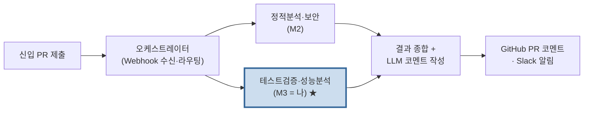
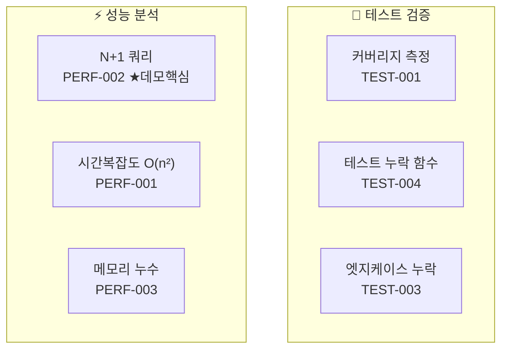
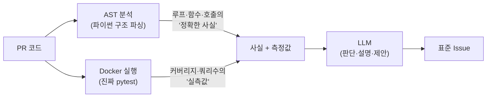
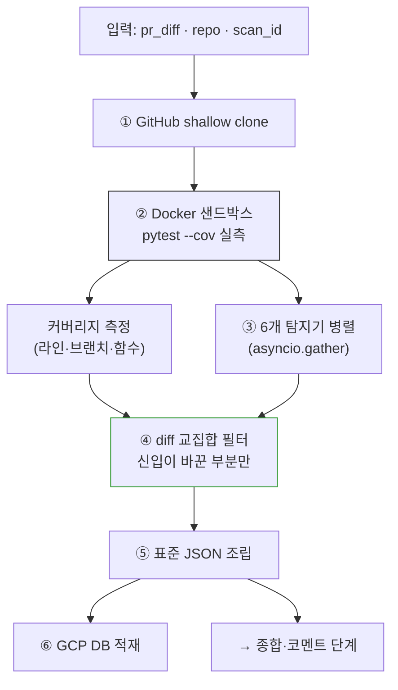
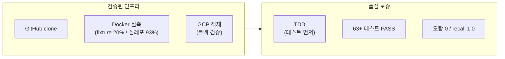
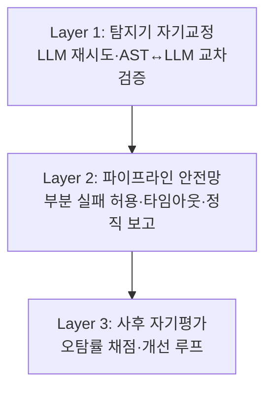
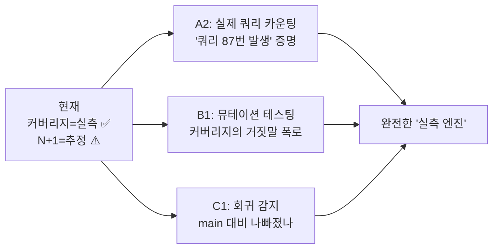

# 🎤 Dev3 발표 자료 — 테스트 검증 + 성능 분석 에이전트

> 발표자용 한 장 정리. 위에서 아래로 읽으면 그대로 발표 흐름.
> 각 섹션 = 슬라이드 1장 + 말할 거리(스피커 노트).
> Mermaid 다이어그램은 GitHub/VS Code/Notion에서 그림으로 렌더링됨.

---

## 슬라이드 0. 한 줄 정의 (오프닝)

> **"신입 개발자의 PR을 받아, 테스트가 충분한지·코드가 느린지를 *실제로 측정*해서
> 표준 리포트로 만드는 분석 에이전트입니다."**

🎙️ *말하기*:
"제가 맡은 Dev3는 코드 리뷰를 자동화하는 멀티 에이전트 중 하나예요. 핵심 한 가지만 기억하세요 — **다른 도구는 코드를 읽고 추측하지만, Dev3는 코드를 돌려서 측정합니다.**"

---

## 슬라이드 1. 어디에 있나 — 전체 파이프라인



🎙️ *말하기*:
"신입이 PR을 올리면 여러 분석 에이전트가 **동시에** 달려들어요. 저는 그중 **테스트와 성능**을 담당합니다. 보안·정적분석은 옆 팀(M2)이 하고요. 제 결과는 종합 단계로 넘어가서 사람이 읽을 코멘트가 됩니다."

**핵심 포인트**: 저는 판정(합격/불합격)을 안 합니다. **"리뷰 근거 데이터"만** 만들어요.

---

## 슬라이드 2. 무엇을 검사하나 — 6개 탐지기



🎙️ *말하기*:
"검사는 두 갈래예요. **테스트가 충분한가** — 커버리지 80% 넘는지, 테스트 없는 함수는 없는지, 빠진 엣지케이스(null·음수·빈 값)는 없는지. 그리고 **코드가 효율적인가** — N+1 쿼리, O(n²) 복잡도, 메모리 누수. 특히 **N+1 감지가 데모의 핵심**입니다."

---

## 슬라이드 3. 핵심 철학 — AST는 사실, LLM은 판단



🎙️ *말하기*:
"왜 LLM한테 코드를 통째로 안 던지냐면 — **환각** 때문이에요. 커버리지 20%, N+1 위치 같은 건 **정답이 정해진 사실**이라 추측하면 틀려요. 그래서 **사실은 도구(AST·실행)로 정확히 뽑고, 판단·설명만 LLM**한테 맡깁니다. 탐지견이 냄새로 위치를 짚으면 형사가 왜 문제인지 판단하는 식이죠."

---

## 슬라이드 4. 전체 워크플로우 (이게 메인 다이어그램)



🎙️ *말하기 (한 단계씩 손가락으로 짚으며)*:
1. "신입 코드를 GitHub에서 **통째로 받아요** — diff만으론 실행이 안 되니까."
2. "신뢰 못 하는 남의 코드라 **Docker 격리 컨테이너**에서 진짜 pytest를 돌립니다."
3. "6개 탐지기가 **동시에** 분석해요. 하나가 죽어도 나머지는 살아남고요."
4. "**여기가 중요** — 신입이 *바꾼 부분만* 지적해요. 레거시 코드까지 떠넘기지 않습니다."
5. "결과를 표준 JSON으로 조립하고"
6. "GCP 데이터베이스에 쌓아서 다음 단계로 넘깁니다."

---

## 슬라이드 5. 데모 — N+1 잡는 순간 (Before/After)

**입력 (신입이 올린 코드)**:
```python
def get_posts(post_ids):
    posts = []
    for pid in post_ids:                          # 루프
        post = db.query(f"SELECT * FROM posts WHERE id={pid}")  # 루프 안 쿼리 → N+1
        posts.append(post)
    return posts
```

**출력 (Dev3가 만든 리포트)**:
```
🧪 Test Verification                          Major 1 · Minor 2
🟧 TEST-001  (전체)      라인 커버리지 20% < 80%
🟨 TEST-004  posts.py:4  get_posts 테스트 없음

⚡ Performance Analysis                        Major 1 · Minor 1
🟧 PERF-002  posts.py:7  N+1 쿼리: 루프 안 DB 호출 반복
🟨 PERF-001  posts.py:16 O(n²) 중첩 루프
```

🎙️ *말하기*:
"실제로 결함을 심은 코드를 넣으면 — N+1, O(n²), 테스트 누락, 커버리지 부족을 다 잡아냅니다. 그리고 **diff 밖 레거시 파일에 똑같은 N+1을 심어놔도 그건 안 잡아요.** 신입 책임 범위만 지적하는 거죠."

---

## 슬라이드 6. 차별점 — "추정하는 도구" vs "측정하는 엔진"

| | 기존 도구 (SonarQube·Pylint) | **Dev3** |
|---|---|---|
| 분석 | 코드 읽고 **추측** | Docker에서 **실제 실행·측정** |
| 커버리지 | 정적 추정 | **진짜 pytest 실측** |
| 출력 | 사람용 리포트 | **다른 에이전트가 쓰는 표준 JSON** |
| 개인화 | 모두 동일 | skill_level·이전 실수 **맥락 반영** |
| 포지셔닝 | Standalone 도구 | **신입 학습 시스템의 측정 인프라** |

🎙️ *말하기*:
"솔직히 커버리지 측정·린팅은 세상에 이미 다 있어요. 그런데 그것들은 **혼자 쓰는 도구**고, **추측**해요. Dev3는 **실제로 돌려서 측정**하고, 그 결과를 **다른 에이전트가 받아 쓰는 표준 데이터**로 내놓습니다. 그래서 시간이 지나면 시스템이 신입을 더 잘 가르치게 돼요."

---

## 슬라이드 7. 기술적 성과 (어떻게 단단하게 만들었나)



🎙️ *말하기*:
"전부 **TDD**로 만들었어요 — 코드 짜기 전에 테스트부터 쓰고, 통과시키는 방식이요. 그래서 모든 기능에 **'진짜 된다'는 증거**가 붙어 있습니다. 실제 GitHub 레포를 Docker에서 돌려 **93% 커버리지를 실측**했고, GCP 데이터베이스 적재도 검증했습니다."

---

## 슬라이드 8. 자기검증 — 사람 개입 없이 스스로 교정



🎙️ *말하기*:
"Dev3는 사람이 중간에 안 끼어요. 30초 안에 **스스로 교정**하는 3층 안전망이 있어요. 탐지기 하나가 죽어도 나머지는 살고, 측정이 안 되면 숫자를 지어내지 않고 **'측정 불가'라고 정직하게** 보고합니다. 환각 방지가 설계에 박혀 있어요."

---

## 슬라이드 9. 다음 가지 — 추정을 실측으로 (미래)



🎙️ *말하기*:
"앞으로 방향은 명확해요 — **추정으로 남아있는 부분까지 실측으로.** 예를 들어 N+1을 '의심된다'가 아니라 **'쿼리 87번 발생'이라고 증명**하고요. 커버리지 100%여도 실제로 검증 안 하는 '껍데기 테스트'를 폭로하는 뮤테이션 테스팅, main 브랜치 대비 성능이 나빠졌는지 보는 회귀 감지까지. **전부 테스트·성능 영역 안에서** 더 날카로워지는 거예요."

---

## 슬라이드 10. 마무리 한 줄

> **"Dev3는 코드를 읽고 추측하지 않습니다. 돌려서 증명합니다.
> 그 증거를 신입이 바꾼 부분에만, 다른 에이전트가 쓸 수 있는 표준 형태로, 환각 없이 내놓습니다."**

🎙️ *말하기*:
"이 한 문장이 Dev3의 전부예요. 측정하고, 책임 범위를 지키고, 정직하게. 감사합니다."

---

# 📋 부록 — 발표 전 체크리스트

## 데모 라이브로 보여줄 거면 (터미널)
```powershell
cd test-performance-agent
py main.py                 # → 5 이슈 JSON
py validation/eval.py      # → recall 1.0 PASS
# (Docker 있으면) py validation/demo_showcase.py → 단계별 실측 화면
```

## 청중별 강조점
| 청중 | 어디에 시간 쓸지 |
|---|---|
| **개발자·시니어** | 슬라이드 3(AST/LLM), 6(차별점), 9(미래 가지) |
| **팀장·기획** | 슬라이드 1(위치), 5(데모), 6(포지셔닝) |
| **평가자·심사** | 슬라이드 7(TDD 성과), 8(자기검증), 10(마무리) |
| **5분 압축** | 0 → 4 → 5 → 6 → 10 |

## 예상 질문 & 답변
| 질문 | 답변 |
|---|---|
| "이거 SonarQube랑 뭐가 달라요?" | "그건 추측, 저는 Docker에서 실측. 그리고 다른 에이전트가 쓰는 표준 출력 (슬라이드 6)" |
| "LLM 안 쓰면 의미 없는 거 아닌가요?" | "오히려 반대. 사실은 도구로 정확히, LLM은 설명만. 환각 방지가 핵심 (슬라이드 3)" |
| "N+1 오탐 안 나요?" | "현재 AST는 날 수 있어요(정직). 그래서 다음 가지가 실제 쿼리 카운팅 — 실측으로 오탐 제거 (슬라이드 9)" |
| "지금 완성된 거예요?" | "탐지·측정·적재는 검증 완료. LLM·실연동은 API 키·다른 팀 준비되면 자동 활성화. 인프라는 다 깔려있음" |

---

## 🎯 핵심 메시지 3개 (이것만 외워도 됨)
1. **추측이 아니라 측정** (Docker 실측)
2. **신입이 바꾼 부분만** (diff 교집합)
3. **사람용 리포트가 아니라 시스템용 데이터** (표준 JSON · 학습 인프라)

---

*발표 자료 끝 · 연계: BRANCH_A2_실제쿼리카운팅.md(다음 가지 상세), DEV3_PRD.md(요구사항), DEV3_TECH_SPEC.md(구현)*
