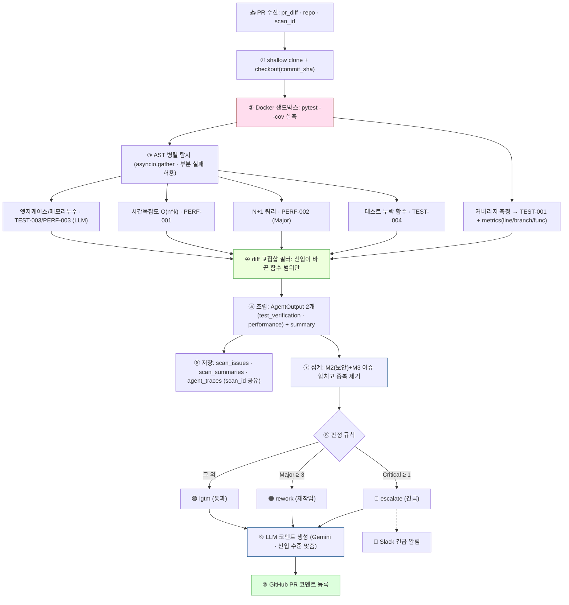
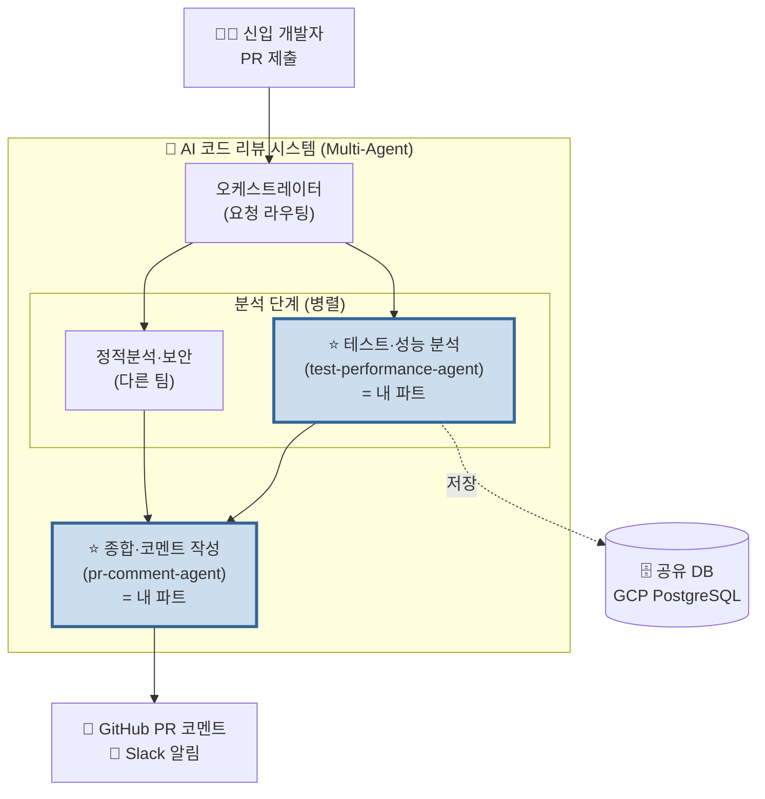
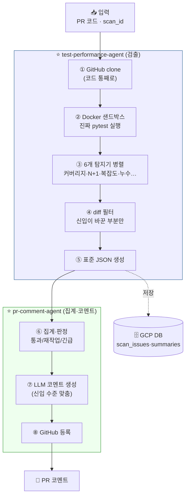
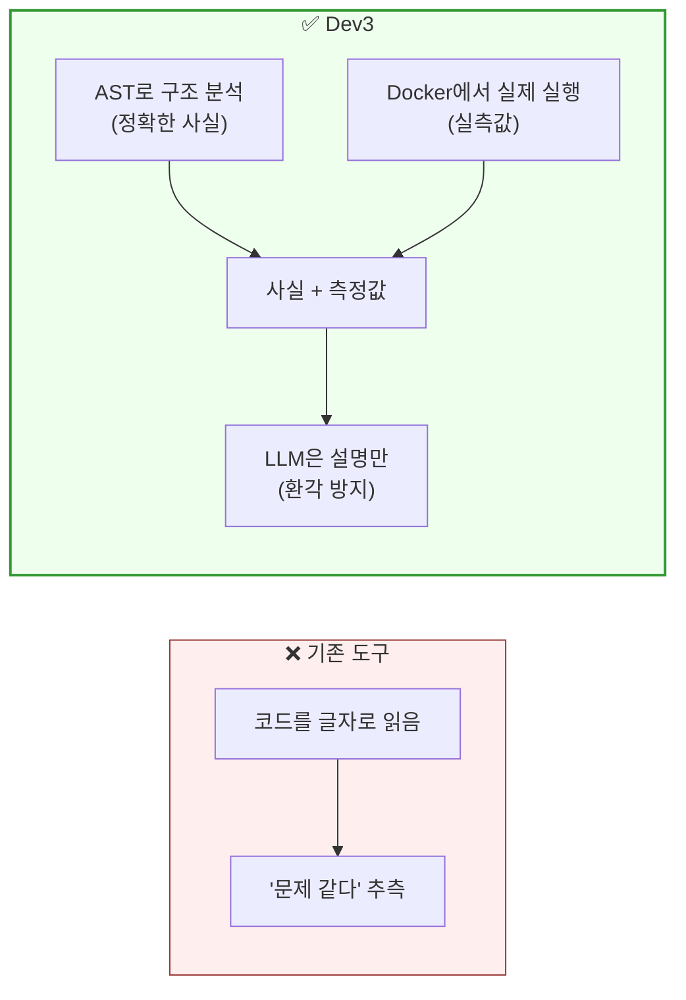
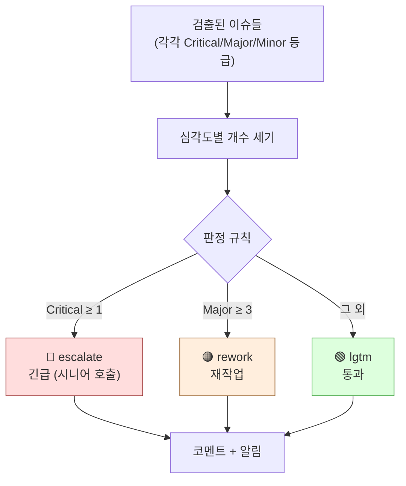
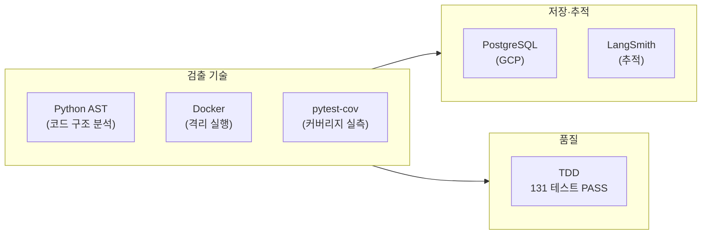
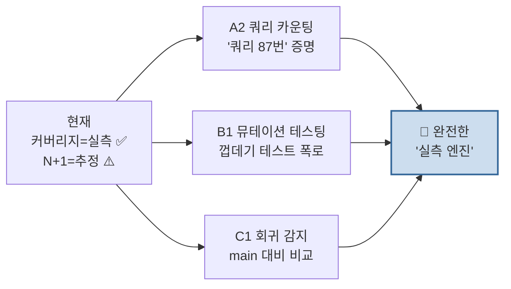

# 🏗️ Dev3 아키텍처 다이어그램 (PPT용)

> Mermaid 다이어그램 모음. VS Code 미리보기(Ctrl+Shift+V)로 보고 **캡처해서 PPT에 붙이세요.**
> 레벨별로 정리 — 청중·시간에 맞게 골라 쓰면 됩니다.

---

## 🎯 다이어그램 0. 상세 전체 흐름 — 검출 → 코멘트 (메인 ⭐⭐)

> **언제 쓰나**: 가장 핵심 슬라이드. "검출부터 코멘트까지 어떻게 흐르나" 전 과정.

🎙️ **말하기 (한 흐름으로)**:
"신입 PR이 들어오면 — ① 코드를 통째로 받아서 ② Docker에서 진짜 테스트를 돌려 커버리지를 재고 ③ 동시에 6개 탐지기로 N+1·복잡도 등을 찾아요. ④ 그중 신입이 바꾼 부분만 걸러서 ⑤ 표준 데이터로 조립하고 ⑥ DB에 저장합니다. 여기까지가 **검출**(test-performance-agent)이에요.
그 다음 ⑦ 보안 결과까지 합쳐서 ⑧ 통과·재작업·긴급을 자동 판정하고 ⑨ Gemini로 신입 수준에 맞춘 코멘트를 만들어 ⑩ GitHub에 등록합니다. 긴급이면 Slack 알림도 가고요. 이게 **코멘트**(pr-comment-agent) 단계입니다."

> **두 모듈 경계**: ①~⑥ = `test-performance-agent` (검출·저장) / ⑦~⑩ = `pr-comment-agent` (집계·코멘트). 둘 다 내 파트.

---

## 🎯 다이어그램 1. 전체 시스템 한눈에 (가장 큰 그림)

> **언제 쓰나**: 오프닝. "전체 중 내가 어디"를 보여줄 때.

🎙️ "전체 시스템에서 제가 만든 건 **파란 두 개** — 코드를 검사하는 분석 모듈과, 그 결과로 코멘트를 만드는 모듈입니다."

---

## 🎯 다이어그램 2. 내 모듈 상세 흐름 ⭐ (메인 아키텍처)

> **언제 쓰나**: 핵심 슬라이드. "내가 만든 게 어떻게 동작하는지".

🎙️ "왼쪽이 **검출**(코드 받아서 → 도커에서 실행 → 문제 찾기), 오른쪽이 **집계·코멘트**(문제 모아서 판정 → 코멘트 작성 → 등록). 이 8단계가 한 흐름으로 자동으로 돕니다."

---

## 🎯 다이어그램 3. "추정 vs 측정" 철학 (차별점)

> **언제 쓰나**: 차별점 강조할 때. 개발자·심사 대상.

🎙️ "기존 도구는 코드를 읽고 추측해요. Dev3는 **실제로 돌려서 측정**하고, 사실은 도구로 정확히 뽑은 다음 설명만 AI한테 맡깁니다."

---

## 🎯 다이어그램 4. 데이터 흐름 + 판정 로직 (집계 상세)

> **언제 쓰나**: "판정이 어떻게 나오나" 설명할 때.

🎙️ "문제를 심각도별로 센 다음, 정해진 규칙으로 통과·재작업·긴급을 자동 판정합니다."

---

## 🎯 다이어그램 5. 기술 스택 (한 장 요약)

> **언제 쓰나**: "뭘로 만들었나" 물어볼 때. 부록용.

🎙️ "검출은 AST·Docker·pytest로 실측하고, 결과는 GCP DB에 쌓고, 전 과정을 TDD로 검증했습니다."

---

## 🎯 다이어그램 6. 미래 로드맵 (확장 가지)

> **언제 쓰나**: 마무리. "여기서 더 발전한다".

🎙️ "지금은 커버리지만 실측인데, N+1·복잡도까지 전부 실측으로 확장하는 게 다음 단계예요."

---

# 📋 PPT 구성 추천 (다이어그램 어디에 쓸지)

| 슬라이드 | 다이어그램 | 한 줄 |
|---|---|---|
| 1. 전체 시스템 | **1번** | "전체 중 내가 어디" |
| 2. 내 모듈 흐름 | **2번** ⭐ | "8단계로 자동 동작" |
| 3. 차별점 | **3번** | "추측 아니라 측정" |
| 4. 판정 로직 | **4번** | "통과/재작업/긴급 자동" |
| 5. 기술·품질 | **5번** | "AST·Docker·TDD" |
| 6. 미래 | **6번** | "실측 엔진으로 확장" |

---

# 🖼️ PPT에 넣는 법

1. VS Code에서 이 파일 열기
2. `Ctrl + Shift + V` (미리보기)
3. 다이어그램이 그림으로 보임
4. **캡처(Win + Shift + S)** 해서 PPT에 붙이기

> 또는 다이어그램 코드를 [mermaid.live](https://mermaid.live)에 붙여넣으면 **고화질 PNG 다운로드** 가능 (PPT용으로 더 깔끔).

---

*아키텍처 다이어그램 끝 · 연계: 발표자료_DEV3.md, 발표자_검출집계_설명.md*
