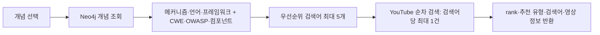

# M5 — 그래프 기반 기술 YouTube 추천

M6가 구축한 Neo4j 지식 그래프에서 개념·방어 메커니즘·코드 메타데이터를 조회하고, 사용자의 선택 맥락으로 YouTube 검색어를 구성합니다. 문서 추출·그래프 쓰기는 M6의 책임입니다. M5의 `POST /extract`는 호환용 스텁입니다.

## 처리 흐름



학습 모델의 개인화 점수가 아니라 규칙 기반 검색 우선순위입니다. 코드 언어 또는 프레임워크를 전달하면 구현 중심 검색어를, 없으면 개념·메커니즘·보안 표준 중심 검색어를 구성합니다.

## API

| 메서드 | 경로 | 동작 |
| --- | --- | --- |
| GET | `/health` | 서비스 응답 |
| GET | `/graph/overview` | 개념·메커니즘·도메인 요약 |
| GET | `/graph/concept?keyword=...` | 개념과 연결 정보, 없으면 404 |
| GET | `/graph/mechanism/{mechanism_name}` | 메커니즘과 코드 예제, 없으면 404 |
| POST | `/youtube/ranked` | 맥락 기반 영상 추천 |
| POST | `/extract` | accepted 응답만 반환하는 스텁 |

`/youtube/recommend`는 현재 라우트가 아닙니다.

```json
{
  "concept_name": "CsrfAttack",
  "mechanism_name": "CsrfMiddlewareProtection",
  "code_id": null,
  "code_lang": "Python",
  "code_framework": "Django"
}
```

`concept_name`만 필수입니다. 나머지는 선택값입니다. `code_id`는 계약상 수신하지만 현재 코드 노드 조회에 사용하지 않습니다. 언어·프레임워크는 호출자가 명시해야 합니다. 개념 이름은 실제 그래프에 존재하는 값으로 바꿔 사용하세요.

응답은 `concept_name`과 `videos` 배열입니다. 각 영상에는 `rank`, `recommendation_type`, `query_used`, `title`, `url`, `thumbnail`, `channel_title`이 포함됩니다.

## 실행과 설정

저장소 루트의 `.env`에 `YOUTUBE_API_KEY`, `NEO4J_PASSWORD`를 준비합니다. Compose는 `NEO4J_URI=bolt://neo4j_m6:7687`과 `NEO4J_USER=neo4j`를 설정합니다. `NEO4J_DATABASE` 기본값은 `neo4j`입니다. 컨테이너 밖에서 실행할 때 M5 기본 URI는 `bolt://localhost:7688`입니다.

```bash
docker compose up -d --build neo4j_m6 m5
curl http://localhost:8006/health
curl "http://localhost:8006/graph/overview"
```

빈 DB에는 먼저 [M6 시드 절차](../m6/README.md)를 적용합니다. YouTube 키 미설정 시 추천 API는 503을, 개념이 없으면 404를 반환합니다. 검색 실패·빈 검색 결과는 해당 순위를 생략하므로 0~5개 결과와 rank 공백이 가능합니다. 검색어는 중복 제거하지만 영상 ID는 중복 제거하지 않습니다. `relevanceLanguage=ko`는 한국어 관련성 힌트이며 언어 보장 조건이 아닙니다.

## 코드와 문서

- [라우트](app/main.py), [요청·응답 모델](app/schemas.py)
- [검색어 조립](app/keyword_builder.py), [YouTube 클라이언트](app/youtube_client.py)
- [그래프 조회](app/graph_query.py), [Neo4j 연결](app/neo4j_client.py)
- [통합 아키텍처·제약](../../docs/M5_M6_ARCHITECTURE.md)

`tests/test_contract.py`에는 이전 추천 경로가 남아 있습니다. 현재 계약의 근거는 라우트와 Pydantic 모델이며 기존 테스트를 그대로 최신 계약 검증으로 간주하지 않습니다.
