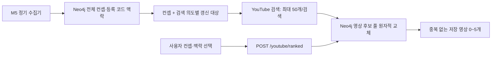

# M5 — 그래프 기반 기술 YouTube 추천

M6가 관리하는 Neo4j의 전체 Concept·Mechanism·CodeExample을 기준으로 학습 영상 후보를 미리 수집합니다. **사용자 추천 요청은 Neo4j만 조회하며 YouTube API를 호출하지 않습니다.** PostgreSQL이나 Redis에 영상 데이터를 중복 저장하지 않습니다.

## 처리 흐름



M6는 문서 추출·HITL·온톨로지 관리를, M5는 영상 수집·영상 노드와 관계 저장·추천을 담당합니다. 영상 풀은 M6의 4계층 온톨로지를 바꾸지 않는 부가 리소스입니다. LangGraph나 학습 기반 추천 모델을 추가하지 않습니다. `POST /extract`는 호환용 스텁입니다.

## API

| 메서드 | 경로 | 동작 |
| --- | --- | --- |
| GET | `/health` | DB 연결과 무관한 프로세스 응답 |
| GET | `/graph/overview` | 개념·메커니즘·도메인 요약 |
| GET | `/graph/concept?keyword=...` | 개념과 연결 정보, 없으면 404 |
| GET | `/graph/mechanism/{mechanism_name}` | 메커니즘과 코드 예제, 없으면 404 |
| POST | `/youtube/ranked` | 저장된 영상 후보만 조회하여 추천 |
| POST | `/extract` | accepted 응답만 반환하는 스텁 |

`/youtube/recommend`는 현재 라우트가 아닙니다. 추천 요청·응답 필드는 유지합니다.

```json
{
  "concept_name": "CsrfAttack",
  "mechanism_name": "CsrfMiddlewareProtection",
  "code_id": null,
  "code_lang": "Python",
  "code_framework": "Django"
}
```

`concept_name`만 필수입니다. `code_id`로 코드 노드를 역조회하지 않으므로 언어·프레임워크는 호출자가 전달해야 합니다. 응답은 `concept_name`과 `videos`이며 영상마다 `rank`, `recommendation_type`, `query_used`, `title`, `url`, `thumbnail`, `channel_title`을 포함합니다.

- 추천 순위는 기존 검색 의도의 우선순위이며 학습된 개인화 점수가 아닙니다.
- 각 검색 풀에서 아직 선택하지 않은 첫 영상을 고릅니다. 동일 영상 ID는 응답에서 중복되지 않습니다.
- 미수집·만료·미등록 코드 맥락은 결과가 적거나 비어 있을 수 있습니다. 조회 중 실시간 검색으로 대체하지 않습니다.
- 결과는 0~5개이며 원래 의도별 rank를 유지하므로 공백이 가능합니다.
- API 키는 수집기에만 필요합니다. 저장 데이터가 있으면 키 없이도 추천합니다.

## Neo4j 없이 실행·테스트

Neo4j 서버는 애플리케이션 시작 시 연결하지 않습니다. 서버가 없어도 시작과 `/health`, `/extract`, 기본 단위 테스트가 가능합니다. 실제 그래프 탐색·추천·저장에는 Neo4j가 필요하며 연결·인증 장애는 민감 정보를 제외한 `503` JSON 응답으로 반환합니다. 임의 데이터나 메모리 저장소로 자동 전환하지 않습니다. 연결 대기는 3초로 제한하고 드라이버 트랜잭션 자동 재시도를 끕니다.

PowerShell, 저장소 루트 기준:

```powershell
Set-Location backend/m5
uv run --extra test pytest
uv run uvicorn app.main:app --host 127.0.0.1 --port 8006
```

Python 3.12 이상과 uv가 필요합니다. Neo4j Python 드라이버는 의존성 설치 시 함께 설치되며 Neo4j 서버를 설치하는 것은 아닙니다. 단위 테스트는 YouTube에 접속하지 않습니다. 실 DB 통합 테스트는 기본 skip입니다.

## 실제 수집·추천 실행

루트 `.env`에 `YOUTUBE_API_KEY`, `NEO4J_PASSWORD`를 준비합니다. API 키를 소스·명령행 인자에 넣지 않습니다. Compose는 루트 `.env`를 주입하며, 로컬 `uv run`은 이를 자동으로 읽지 않습니다. 로컬 실행에서는 필요한 환경변수를 별도로 설정하세요.

```bash
docker compose up -d --build neo4j_m6 m5
# 빈 DB라면 먼저 M6 README의 시드 절차 실행
# 계획 확인: YouTube 호출 없음. 스키마 초기화·보존기간 정리는 수행함
docker compose run --rm --no-deps m5 uv run python -m app.collect_videos --dry-run
# 최초 수집 / 1회 갱신
docker compose run --rm --no-deps m5 uv run python -m app.collect_videos --max-searches 80 --daily-limit 80
# 선택 사항: 즉시 한 번 수집하고 24시간 간격으로 반복
docker compose --profile youtube-collector up -d --build m5-collector
```

정기 수집기는 명시적으로 켜야 합니다. 외부 cron/작업 스케줄러로 1회 명령을 매일 실행해도 됩니다. 둘을 함께 운영할 필요는 없습니다. 수집기 정상 운영을 확인한 뒤 추천 API를 사용하세요.

| 옵션 | 기본값 | 의미 |
| --- | --- | --- |
| `--refresh-days` | 7 | 검색 결과 갱신 간격, 1~27일 |
| `--max-searches` | 80 | 한 실행의 검색 최대 시도 수 |
| `--daily-limit` | 80 | 동일 Neo4j를 쓰는 M5 수집기 전체의 일일 검색 상한 |
| `--max-video-batches` | 10 | 실행당 메타데이터 검증 최대 배치 수, 배치당 50개 |
| `--watch` | 꺼짐 | 반복 수집 |
| `--interval-hours` | 24 | 반복 간격 |
| `--dry-run` | 꺼짐 | 검색 없이 대기 검색 수 확인; DB 쓰기 없는 모드는 아님 |

기본 DB는 `NEO4J_DATABASE=neo4j`입니다. Compose URI는 `bolt://neo4j_m6:7687`, 로컬 기본 URI는 `bolt://localhost:7688`입니다. M0용 Neo4j와 구분하세요.

수집 결과는 JSON 상태로 출력합니다. DB 미연결은 `database_unavailable`, 키 미설정은 `missing_api_key`이며 1회 명령은 종료 코드 2로 끝납니다. watch 모드는 상태를 출력하고 다음 주기에 재시도합니다. 수집기 중복 실행은 `busy`, 검색 예산 또는 임대 소진은 `budget_or_lease_exhausted`입니다. 이것을 전체 컨셉 수집 완료로 해석하지 마세요.

## 저장·갱신·할당량

상세 설계·멱등성·운영 제약은 [M5 영상 수집 설계](../../docs/M5_VIDEO_COLLECTION.md)를 따릅니다.

- `Concept → HAS_VIDEO_POOL → YouTubeSearchPool → HAS_CANDIDATE → YouTubeVideo` 구조입니다.
- 풀 키는 정규화 컨셉명과 최종 검색어의 SHA-256입니다. 같은 검색어를 만드는 여러 코드 맥락은 풀을 공유합니다.
- 영상은 `video_id` 고유 제약과 MERGE로 재사용하며, 검색 순위는 풀과 영상 사이의 관계에 저장합니다.
- 신규·7일 경과 검색을 우선 처리하되 일일 예산을 넘으면 다음 실행으로 넘깁니다. 컨셉에 등록된 메커니즘·코드 맥락을 순회하므로 컨셉 수 × 5보다 많은 검색이 생길 수 있습니다.
- 메타데이터가 24시간 이상 된 영상을 오래된 순으로 최대 500개씩 `videos.list`로 검증합니다. 삭제·비공개 영상은 DB에서 제거합니다. 실행 주기와 적체량에 따라 실제 검증 간격은 늘어날 수 있습니다.
- 풀과 메타데이터는 28일 경과 시 조회에서 제외하고 수집 실행 시 정리합니다. 수집기를 계속 중단하면 물리 삭제도 중단되므로 운영 감시가 필요합니다.
- 검색·메타데이터 갱신 실패 시 기존 유효 데이터와 성공 시각을 유지합니다. 성공한 빈 검색은 빈 목록으로 교체합니다.
- YouTube 인증·할당량·속도 제한(401/403/429)은 해당 실행을 중단합니다. 실패 호출도 검색 예산에 포함하며 자동 재시도하지 않습니다.

현재 공식 기본 할당량은 검색 100회/일과 그 외 API 10,000유닛/일을 별도로 안내합니다. 실제 프로젝트 콘솔을 기준으로 설정하세요. M5 밖에서 사용하는 검색 호출은 M5 예산에 잡히지 않습니다. `maxResults=50`은 후보 확보량을 늘리지만 검색 가능 횟수를 늘리지 않습니다. 반환 수·고유 영상 50개를 보장하지 않습니다.

- [공식 할당량](https://developers.google.com/youtube/data/getting-started)
- [검색 API](https://developers.google.com/youtube/data/docs/search/list)
- [API 데이터 저장 정책: 30일 이내 갱신 또는 삭제](https://developers.google.com/youtube/terms/developer-policies)

## 검증 범위

`uv run --extra test pytest`는 HTTP 계약·실제 미연결 DB의 503 처리·수집 예산·실패 보존·코드 맥락·영상 중복·공개 상태 갱신을 검증합니다. 실제 YouTube 호출·성능·추천 품질 측정 결과는 아닙니다.

실제 트랜잭션 통합 테스트는 다른 서비스가 사용하지 않는 **전용 Neo4j DB**에 대해 `M5_TEST_NEO4J_URI`, `M5_TEST_NEO4J_PASSWORD`를 설정한 뒤 실행합니다. 사용자·DB가 기본값과 다르면 `M5_TEST_NEO4J_USER`, `M5_TEST_NEO4J_DATABASE`도 설정합니다. 테스트용 제약을 생성하고 전역 수집 임대를 사용하므로 운영 DB에 연결하지 마세요.

```bash
uv run --extra test pytest tests/test_video_store_integration.py -q
```

## 코드와 문서

- [라우트](app/main.py), [요청·응답 모델](app/schemas.py), [검색어 정책](app/keyword_builder.py)
- [수집 명령](app/collect_videos.py), [수집 흐름](app/video_collection.py), [영상 저장소](app/video_store.py)
- [YouTube 클라이언트](app/youtube_client.py), [Neo4j 연결](app/neo4j_client.py)
- [M5 모듈 설명](../../docs/MODULE_5_GRAPH_YOUTUBE_RULE.md), [M5·M6 연결 아키텍처](../../docs/M5_M6_ARCHITECTURE.md)

## 오프라인 Mock 데모

Gemini는 M6의 기존 `USE_MOCK_LLM=true` 설정을 사용합니다. M5는 아래처럼 별도로 실행합니다. M5 mock 모드는 Neo4j·YouTube API·PostgreSQL 없이 그래프 조회와 추천 UI를 검증합니다. M6 전체 파이프라인은 여전히 PostgreSQL/Redis 등이 필요합니다.

저장소 루트 PowerShell:

```powershell
$env:M5_MOCK_MODE="true"
uv run --directory backend/m5 uvicorn app.main:app --host 127.0.0.1 --port 8006
```

- `GET /graph/overview`: 16개 샘플 개념.
- `GET /graph/concept?keyword=SQLi`: 메커니즘·코드 메타데이터.
- `POST /youtube/ranked`, body `{"concept_name":"SQLi"}`: 최대 5개 mock 카드.
- 모든 mock 카드에 `is_mock=true`, 제목에 `[MOCK]` 표시. URL은 YouTube 검색 페이지이며 실제 수집·재생 확인된 영상 URL이 아닙니다.
- 수집 CLI는 `mock_mode_read_only`로 종료하여 외부 API 호출과 DB 기록을 방지합니다.
- fixture `backend/m5/app/fixtures/concepts.json`은 M6 시드 JSON의 데모용 스냅샷입니다. M6 런타임 Python 모듈을 직접 import하지 않습니다.

실제 연결 테스트 단계에서는 `M5_MOCK_MODE=false`로 전환한 뒤 Aura 시드 → 제한된 YouTube 수집 → DB 재조회 순서로 검증합니다. Aura export의 `NEO4J_USERNAME`도 지원하며 `NEO4J_USER`를 함께 지정하면 USER가 우선합니다. `.env`를 사용할 때는 M5 디렉터리에서 `uv run --env-file ../../.env ...`로 실행합니다. 2026-11-12 Aura 실제 시드 적재와 M5 영상 수집·DB 재조회 검증을 완료했습니다. 상세 결과는 `docs/M5_M6_AURA_VERIFICATION.json`을 참고하세요.
