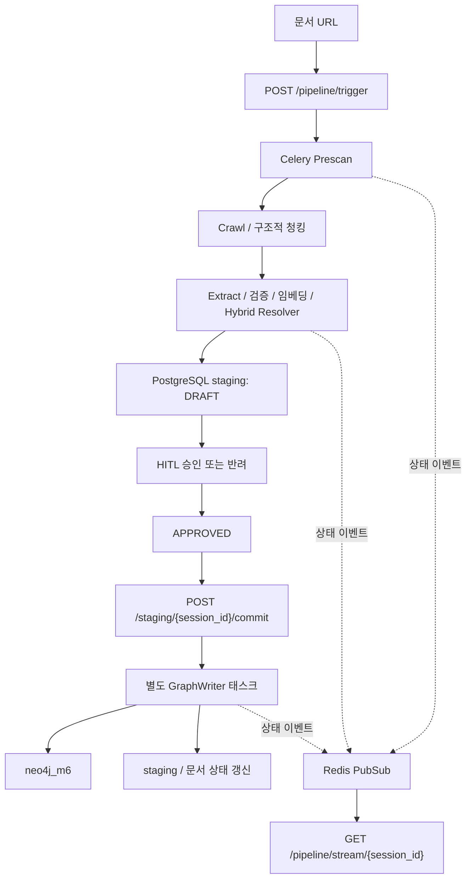

# M6 — 온톨로지 기반 지식 그래프

외부 문서 URL을 수집하고 개념을 추출한 뒤, 기존 지식과의 중복·유사성을 판정하여 사람이 검수할 staging에 저장합니다. 승인된 항목만 별도 commit 요청으로 Neo4j에 반영합니다. M5는 이 그래프를 조회해 학습 영상을 추천합니다.

## 아키텍처와 액션 흐름



Resolver는 extract 태스크 내부 단계입니다. GraphWriter는 최초 Celery chain에 포함되지 않습니다. 프레임워크 메타데이터가 부족하면 입력을 기다리고 `/documents/metadata/resume`으로 crawl→extract를 재개합니다.

## 실행 준비

저장소 루트에서 실행합니다. Python 3.12 기반 컨테이너, Redis, APOC가 활성화된 Neo4j, pgvector 확장과 M6 테이블이 준비된 PostgreSQL이 필요합니다. 로컬 BGE-M3 모델의 최초 다운로드와 메모리·디스크 사용량을 고려하세요.

루트 `.env`에 다음 값을 실제 환경에 맞게 설정합니다. 현재 `.env.example`은 제공되지 않습니다.

| 설정 | 용도 |
| --- | --- |
| `NEO4J_USER`, `NEO4J_PASSWORD` | 그래프 인증; USER는 neo4j로 맞춤 |
| `DATABASE_URL` 또는 `DB_HOST/DB_PORT/DB_NAME/DB_USER/DB_PASSWORD` | PostgreSQL 연결 |
| `GOOGLE_ADC_PATH`, `CLOUD_SQL_INSTANCE_CONNECTION_NAME` | Compose Cloud SQL Proxy 인증·인스턴스 |
| `USE_MOCK_LLM` | 기본 true; 실제 추출은 false |
| `GOOGLE_API_KEY`, `GEMINI_MODEL` | 실제 추출 시 Gemini; 기본 모델 gemini-2.5-flash |
| `EMBEDDING_MODEL` | 실제 임베딩 구현 기본값 BAAI/bge-m3 |
| `LOCAL_DEBUG` | true면 Celery eager 실행; 비동기 worker 검증 시 false |

Compose는 M6와 worker의 `NEO4J_URI=bolt://neo4j_m6:7687`, `NEO4J_DATABASE=neo4j`, `REDIS_URL=redis://redis:6379/0`를 지정합니다. Proxy 사용 시 컨테이너 DB 호스트는 `cloud-sql-proxy:5432`, 호스트 머신에서는 `localhost:15432`입니다. 별도 PostgreSQL을 사용하면 연결값과 실행 서비스를 조정하세요.

```bash
docker compose config --quiet
docker compose up -d --build redis neo4j_m6 cloud-sql-proxy m6 celery_worker_m6 m5
curl http://localhost:8007/health
curl http://localhost:8006/health
docker compose logs -f --tail 100 m6 celery_worker_m6
```

## 스키마와 시드

DB 관리 도구에서 [script/schema.sql](script/schema.sql)을 검토해 M6 전용 테이블·확장·인덱스를 준비합니다. 공유 DB에서는 기존 스키마와 충돌 여부를 먼저 확인하세요. `seed_postgres.py`의 스키마 적용 호출은 현재 주석 처리되어 있어 시드 실행만으로 테이블이 생성되지 않습니다.

두 시드가 실제 읽는 파일은 다음과 같습니다. 총 16개 입력 레코드이며 이는 DB의 실측 적재 건수가 아닙니다.

- [보안 12개](script/seed/security/security_concepts.json)
- [성능 4개](script/seed/performance/performance_concepts.json)

```bash
docker compose run --rm m6 python script/seed_neo4j.py
docker compose run --rm m6 python script/seed_postgres.py
```

PostgreSQL 시드는 mock 설정과 무관하게 실제 BGE-M3를 로드합니다. 시드의 `DATABASE_URL`은 `postgresql://` 형식을 사용하세요. 런타임과 달리 `postgresql+asyncpg://`를 변환하지 않으며, DB_HOST 미설정 기본값도 localhost입니다. Neo4j 시드는 항목별 오류 후 계속 진행할 수 있으므로 종료 코드뿐 아니라 로그와 그래프를 확인해야 합니다.

Compose의 `neo4j_m6_seed` command에는 `&&`가 있으나 명시적 셸 실행이 없습니다. 두 명령의 연속 실행을 보장하는 진입점으로 사용하지 말고 위처럼 각각 실행하세요. 일반 종료는 `docker compose down`이며 볼륨 삭제를 초기 실행 절차에 포함하지 않습니다.

## API와 사용 순서

| 메서드 | 경로 | 설명 |
| --- | --- | --- |
| GET | `/health` | 서비스 응답 |
| POST | `/pipeline/trigger` | URL 처리 시작, 202 + session_id |
| GET | `/pipeline/stream/{session_id}` | SSE 진행 이벤트 |
| POST | `/documents/check-duplicate` | 같은 URL의 최신 미배제 문서가 COMMITTED인지 확인 |
| POST | `/documents/metadata/learn` | 프레임워크 URL 패턴·언어 등록 |
| POST | `/documents/metadata/resume` | 메타데이터 보정 후 재개 |
| GET | `/staging/{session_id}` | DRAFT·APPROVED 항목 조회 |
| POST | `/staging/{id}/approve` | 항목 또는 세션 승인 |
| POST | `/staging/{id}/reject` | 항목 또는 세션 반려 |
| POST | `/staging/{session_id}/commit` | 승인 항목 그래프 반영 태스크 등록, 202 |
| GET | `/staging/{session_id}/diff` | 상태별 집계 |
| GET | `/graph/topology` | 전체 그래프; session_id 지정 시 DRAFT 노드 추가 |

1. 필요하면 중복 확인 후 `POST /pipeline/trigger`에 아래 JSON을 전송합니다. 이름이 doc_id이지만 값은 UUID가 아닌 HTTP(S) URL입니다.
2. 반환된 session_id로 SSE를 구독하고 staging을 조회합니다.
3. 내용을 확인하여 승인·반려합니다. 세션 전체 승인과 개별 승인을 구분하세요.
4. 승인 후 별도로 commit을 요청합니다. 202는 완료가 아니므로 staging/diff와 그래프를 다시 확인합니다.

```json
{"doc_id": "https://docs.example.org/security"}
```

위 URL은 형식 예시이며 실제 수집 가능한 문서 URL로 교체해야 합니다. `POST /graph/ingest`, `GET /graph/status/{task_id}`, `POST /graph/query`는 기존 스텁입니다. 실제 파이프라인과 조회에는 위의 trigger·topology를 사용합니다.

## 상세 문서·검증

[통합 아키텍처](../../docs/M5_M6_ARCHITECTURE.md)에 해소 기준·데이터 모델·트랜잭션 제약을 정리했습니다. [현재 파이프라인 안내](docs/pipeline.md)와 [현재 스키마 안내](docs/schema.md)도 참고하세요. 나머지 docs의 PRD·이관·프론트 설계 문서는 당시의 제안과 요구사항을 포함하므로 구현 근거는 실행 코드로 확인해야 합니다.

테스트는 `docker compose run --rm m6 python -m pytest`로 실행합니다. DB·Neo4j·모델 의존성을 테스트별로 확인하세요. 문서 정비 과정에서는 외부 서비스 통합 테스트와 실제 Gemini 추출을 실행하지 않았습니다.

2026-11-12 실제 Aura에서 `script/seed_neo4j.py`를 두 번 실행해 각 16개 입력 적재 및 노드·관계 수 유지(멱등성)를 확인했습니다. 스키마는 `script/init_db.cypher`를 사용했습니다. [검증 결과](../../docs/M5_M6_AURA_VERIFICATION.json)를 참고하세요.
