# KMS 문서 구조화 모듈 — MAS 상세 워크플로우

> 버전: v1.0 | 브랜치: 3rd-project-final-plan | 작성일: 2026-05-27

---

## 1. 시스템 개요

KMS 문서 구조화 파이프라인은 **LangGraph StateGraph** 기반이다.
7개 노드 중 **3개 노드만 LLM을 호출하는 AI 에이전트**이고, 나머지 4개는 순수 Python 함수(도구)다.
모든 노드는 `AgentHarness`로 감싸져 LangSmith 추적과 PostgreSQL `agent_traces` 기록이 자동 처리된다.

| 노드 | 종류 | LLM |
|------|------|-----|
| Stage 1 (Convert) | **도구** | 없음 — python-docx, pdfplumber |
| Stage 2 (Validate) | **AI 에이전트** | Gemini 2.5 Flash |
| Stage 3 (Chunk) | **도구** | 없음 — tiktoken 알고리즘 |
| Stage 4 (ChunkValidate) | **도구** | 없음 — 규칙 기반 검증 |
| Stage 5 (MetadataExtract) | **AI 에이전트** | Gemini 2.5 Flash |
| Stage 5b (MetadataValidate) | **AI 에이전트** | Gemini 2.5 Flash |
| Stage 6 (Store) | **도구** | 없음 — DB/Storage I/O |

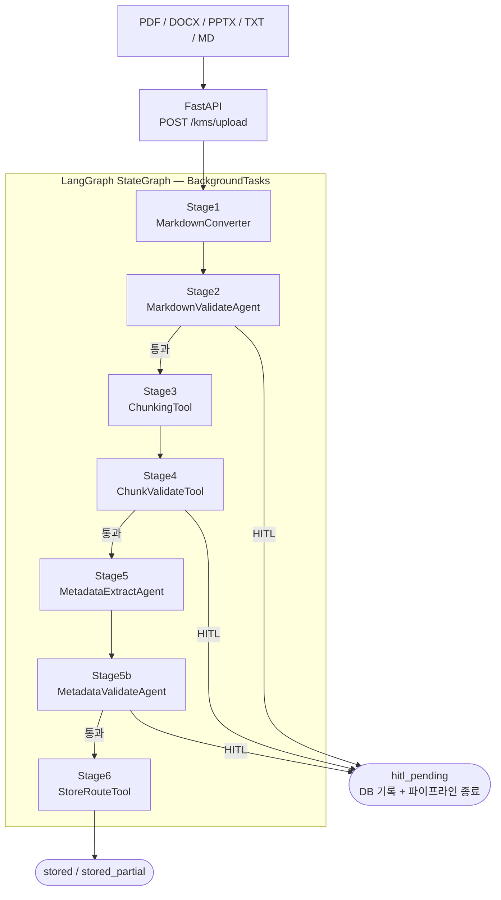

---

## 2. 공유 상태 (DocPipelineState)

LangGraph 전 노드가 읽고 쓰는 TypedDict. 단방향으로 채워진다.

```python
class DocPipelineState(TypedDict):
    # 입력
    doc_id: str              # UUID str
    source: str              # "upload | notion | confluence | slack"
    file_path: str
    file_type: str           # "pdf | docx | pptx | txt | md"
    original_filename: str

    # Stage 1 출력
    raw_markdown: str | None
    markdown_storage_path: str | None

    # Stage 2 출력
    validated_markdown: str | None
    quality_score: float | None    # 0.0 ~ 1.0
    quality_issues: list[str] | None
    hitl_required: bool

    # Stage 3 출력
    chunks: list[ChunkItem] | None

    # Stage 4 출력
    chunk_validation_passed: bool
    chunk_validation_issues: list[str] | None

    # Stage 5 출력
    metadata: DocumentMetadata | None
    neo4j_entities: list[dict] | None
    neo4j_relations: list[dict] | None

    # Stage 5b 출력
    metadata_valid: bool | None
    metadata_score: float | None
    metadata_issues: list[str] | None

    # Stage 6 출력
    stored: bool
    neo4j_stored: bool | None     # None=미실행, True=성공, False=실패
    storage_paths: StoragePaths | None

    # 파이프라인 제어
    status: str              # "processing|validated|stored|stored_partial|failed|hitl_pending"
    error: str | None
    current_stage: str
```

---

## 3. 노드별 상세 워크플로우

### Stage 1: MarkdownConverter — 도구 (trc_0001)

**역할:** 원본 파일을 Markdown으로 변환하고 스토리지에 저장

**입력:** `file_path`, `file_type`, `doc_id`

**처리 흐름:**
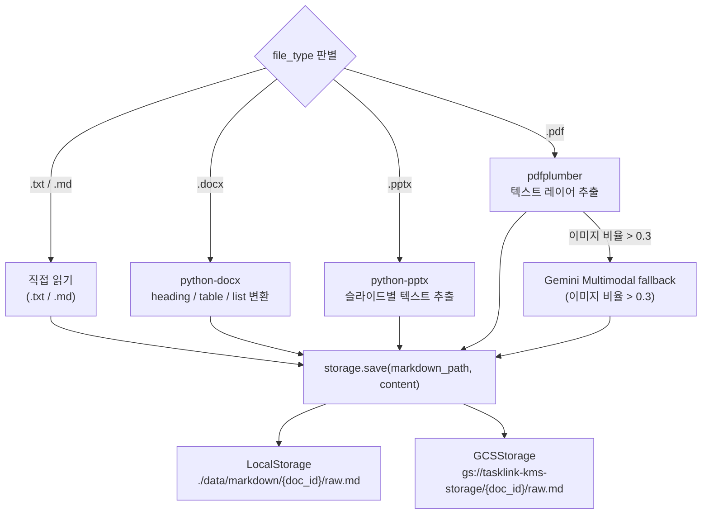

**출력:** `raw_markdown`, `markdown_storage_path`

**에러 처리:** 변환 실패 시 `status="failed"`, `error=` 메시지 반환. 파이프라인 END.

---

### Stage 2: MarkdownValidateAgent — AI 에이전트 (trc_0002)

**역할:** Gemini 2.5 Flash로 Markdown 품질 점수화, HITL 분기 결정

**입력:** `raw_markdown`

**처리 흐름:**
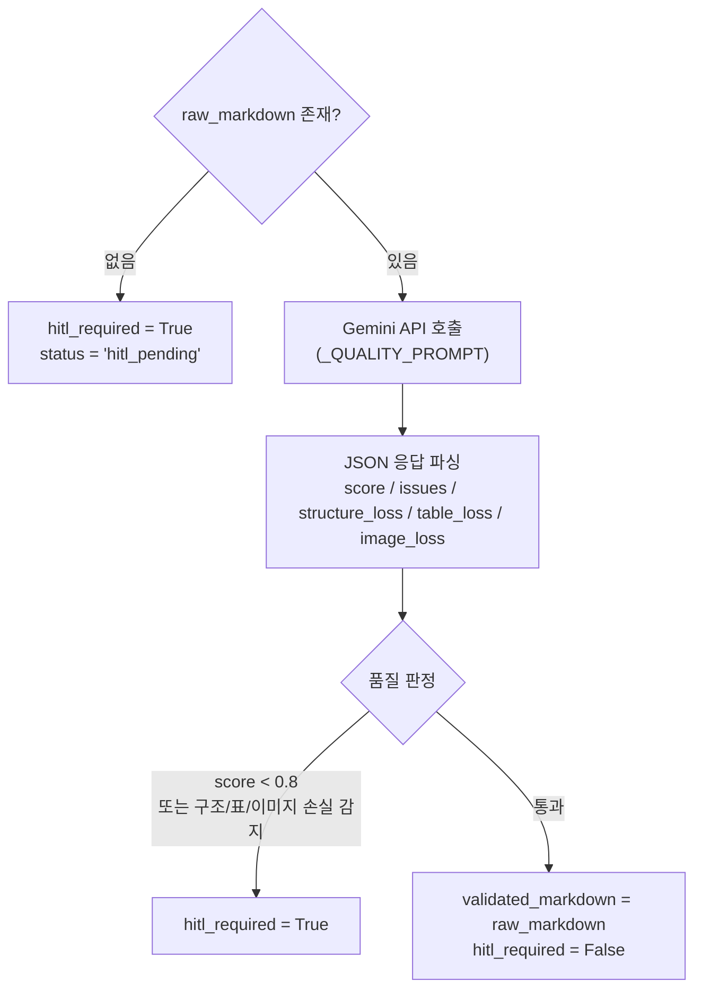

**HITL 트리거 조건:**
| 조건 | 임계값 |
|------|--------|
| 품질 점수 미달 | score < 0.8 |
| 구조 손실 감지 | structure_loss = True |
| 표 변환 실패 | table_loss = True |
| 이미지 설명 누락 | image_loss = True |

**라우터 (`_route_after_validate`):**
```python
if hitl_required or status == "hitl_pending" → "hitl_pending"
if status == "failed"                         → END
else                                          → "stage3_chunk"
```

**출력:** `validated_markdown`, `quality_score`, `quality_issues`, `hitl_required`

---

### Stage 3: ChunkingTool — 도구 (trc_0003)

**역할:** Markdown을 Parent-Child 계층 청크로 분할

**입력:** `validated_markdown`

**처리 흐름:**
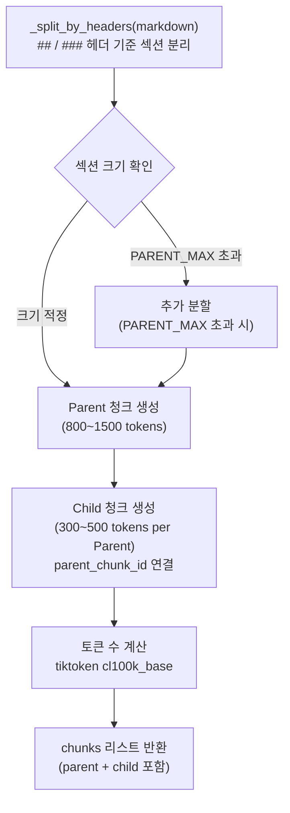

**청크 크기 기준:**
| 타입 | 최소 tokens | 최대 tokens | 용도 |
|------|-------------|-------------|------|
| Parent | 800 | 1500 | RAG 상위 컨텍스트, 의미 완결성 |
| Child | 300 | 500 | pgVector 임베딩 단위, 정밀 검색 |

**출력:** `chunks` (parent + child 모두 포함한 리스트)

---

### Stage 4: ChunkValidateTool — 도구 (trc_0004)

**역할:** 청크 구조 품질 검증, HITL 분기 결정

**입력:** `chunks`

**처리 흐름:**
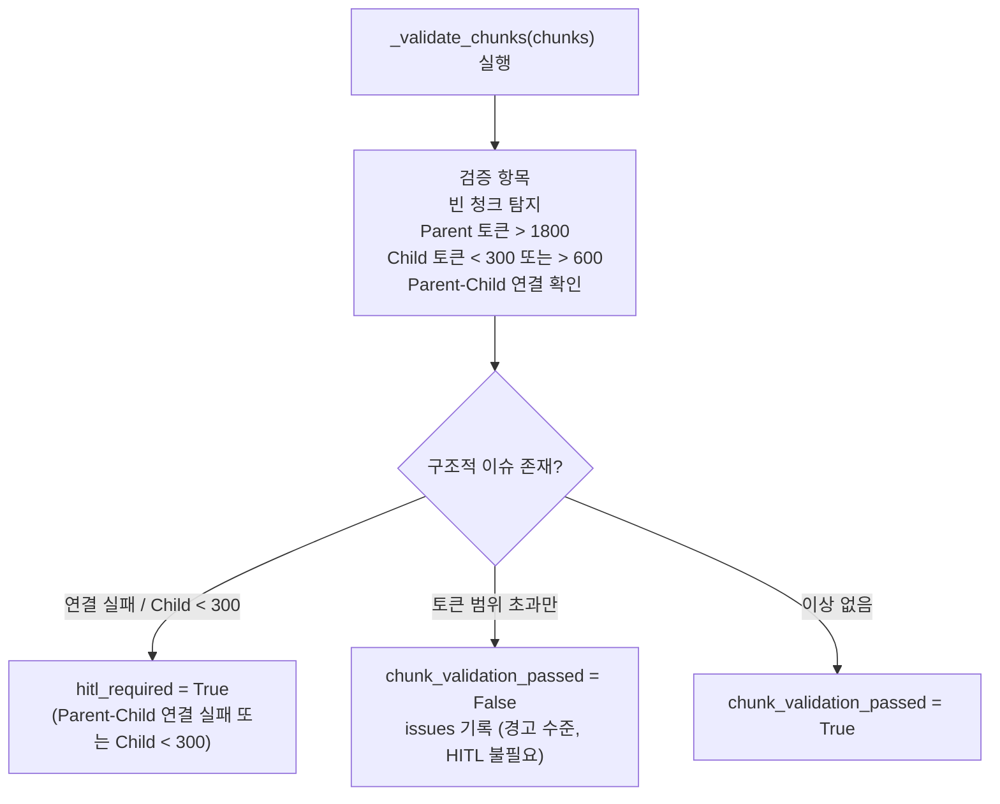

**HITL 트리거 조건:**
| 조건 | 판별 함수 |
|------|-----------|
| `parent_chunk_id` 관련 오류 | `_is_structural_issue()` |
| "연결" 키워드 포함 | `_is_structural_issue()` |
| Child 토큰 < 300 | 직접 감지 |

**라우터 (`_route_after_chunk_validate`):**
```python
if hitl_required or status == "hitl_pending" → "hitl_pending"
if status == "failed"                         → END
else                                          → "stage5_metadata"
```

**출력:** `chunk_validation_passed`, `chunk_validation_issues`

---

### Stage 5: MetadataExtractAgent — AI 에이전트 (trc_0005)

**역할:** Gemini로 문서 메타데이터 + Neo4j 엔티티 추출

**입력:** `validated_markdown`, `chunks`

**처리 흐름:**
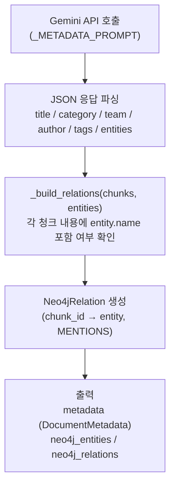

**출력:** `metadata` (DocumentMetadata), `neo4j_entities`, `neo4j_relations`

---

### Stage 5b: MetadataValidateAgent — AI 에이전트 (trc_0005b)

**역할:** 추출된 메타데이터가 문서 내용과 일치하는지 재검증, HITL 분기

**입력:** `metadata`, `validated_markdown`

**처리 흐름:**
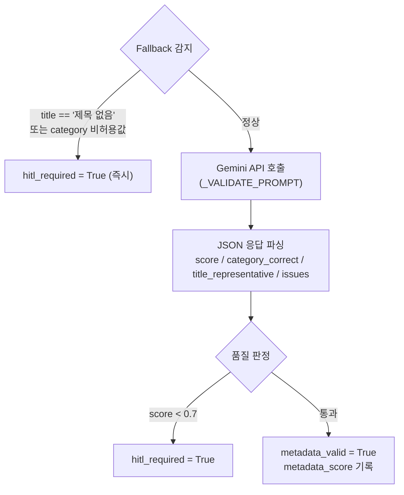

**HITL 트리거 조건:**
| 조건 | 임계값 |
|------|--------|
| 메타데이터 정확도 점수 미달 | score < 0.7 |
| title fallback 감지 | title == "제목 없음" |
| 유효하지 않은 category | VALID_CATEGORIES 외 |

**라우터 (`_route_after_metadata_validate`):**
```python
if hitl_required or status == "hitl_pending" → "hitl_pending"
if status == "failed"                         → END
else                                          → "stage6_store"
```

**출력:** `metadata_valid`, `metadata_score`, `metadata_issues`

---

### Stage 6: StoreRouteTool — 도구 (trc_0006)

**역할:** 전체 처리 결과를 4개 스토리지에 분산 저장

**입력:** 파이프라인 전체 State

**처리 흐름:**
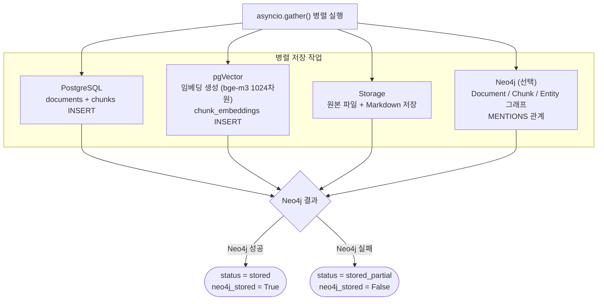

**출력:** `stored=True`, `storage_paths`, `status="stored" | "stored_partial"`

---

## 4. HITL (Human-in-the-Loop) 워크플로우

### 4.1 HITL 진입 경로

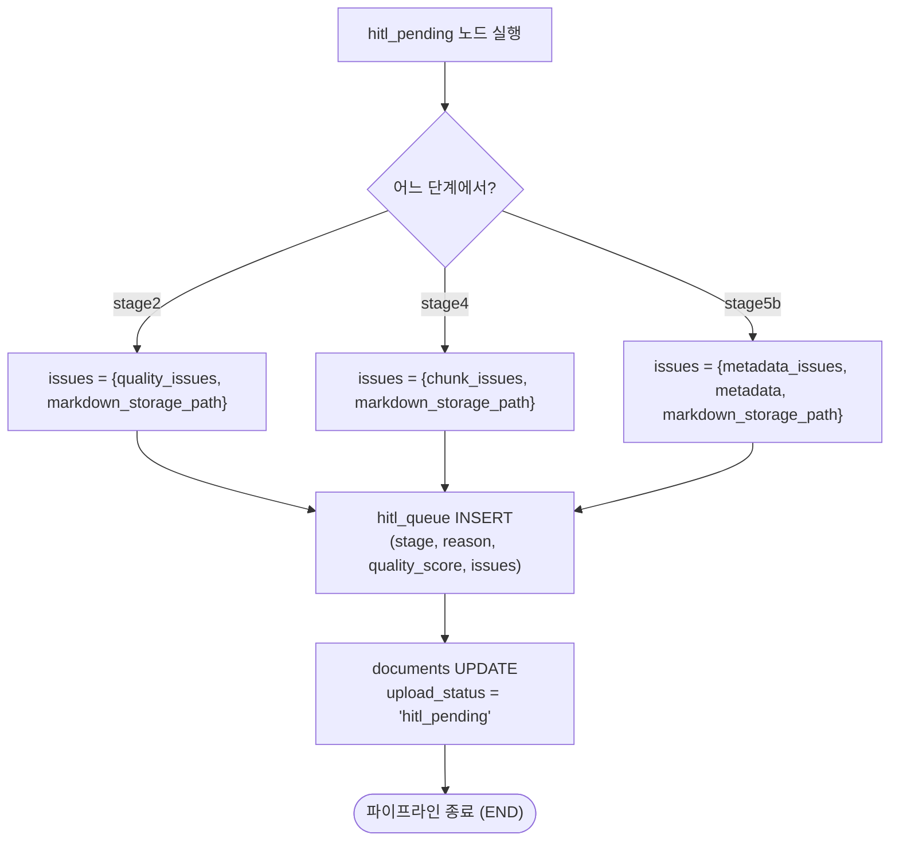

### 4.2 HITL 큐 관리 API

| 엔드포인트 | 역할 |
|-----------|------|
| `GET /hitl/queue` | 대기 중인 항목 목록 조회 |
| `GET /hitl/queue/{queue_id}` | 항목 상세 조회 |
| `POST /hitl/queue/{queue_id}/approve` | 승인 (선택적 자동 재처리) |
| `POST /hitl/queue/{queue_id}/reject` | 거부 (upload_status = 'rejected') |
| `POST /hitl/queue/{queue_id}/reprocess` | 수동 재처리 트리거 |

### 4.3 승인 후 재처리 워크플로우

```
POST /hitl/queue/{queue_id}/approve (auto_reprocess=True)
   │
   ├── hitl_queue UPDATE status = 'approved'
   ├── documents UPDATE upload_status = 'approved'
   └── BackgroundTask: _reprocess_document()
           │
           ├── documents UPDATE upload_status = 'reprocessing'   ← Bug 1 수정
           │
           ├── markdown 로드 결정:
           │   ├── corrected_markdown 제공 → 그대로 사용 (start_validated=False)
           │   ├── issues.markdown_storage_path 있음 → storage.load()
           │   └── 없으면 → _mark_reprocess_failed() → 종료
           │
           ├── make_reprocess_state() 생성
           │
           └── 직접 에이전트 실행 (LangGraph 없이 AgentHarness 사용):
               │
               ├── [corrected_markdown 있는 경우]
               │   Stage2 → Stage3 → Stage4 → Stage5 → Stage5b → Stage6
               │
               └── [skip_validation=True 또는 markdown만 로드한 경우]
                   Stage3 → Stage4 → Stage5 → Stage5b → Stage6

재처리 중 HITL 재트리거:
   └── _abort_reprocess_with_hitl()
       ├── hitl_queue INSERT (새 항목)
       └── _mark_reprocess_failed()
```

### 4.4 HITL 상태 전이 다이어그램

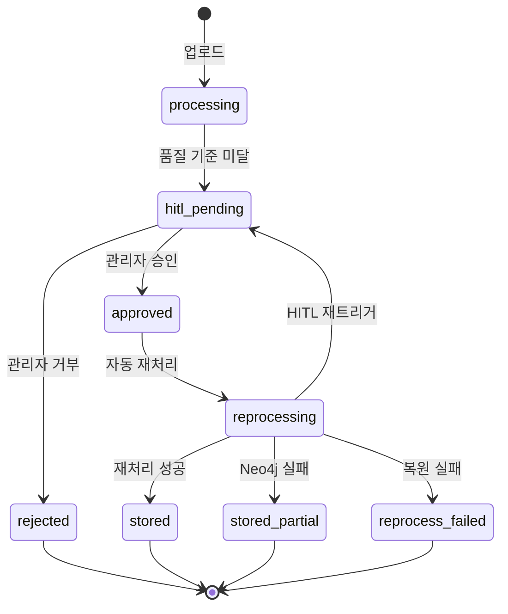

---

## 5. AgentHarness & 추적 체계

### 5.1 Trace ID 체계

```
문서 파이프라인:
  trc_0001_{doc_id_8hex}  Stage1 Markdown 변환
  trc_0002_{doc_id_8hex}  Stage2 Markdown 검증
  trc_0003_{doc_id_8hex}  Stage3 청킹
  trc_0004_{doc_id_8hex}  Stage4 Chunk 검증
  trc_0005_{doc_id_8hex}  Stage5 메타데이터 추출
  trc_0005b_{doc_id_8hex} Stage5b 메타데이터 검증
  trc_0006_{doc_id_8hex}  Stage6 저장
```

### 5.2 AgentHarness 실행 흐름

```python
async with AgentHarness(
    trace_id=trace_id,
    agent_name="MarkdownValidateAgent",
    db_pool=pool,
    doc_id=doc_id,
) as harness:
    result = await harness.run(stage2_validate, state)

# __aenter__:
#   INSERT agent_traces (status='running')
#   LangSmith trace_metadata 주입 (config['metadata'])

# harness.run():
#   fn(state, config={metadata: {trace_id, agent_name, doc_id}}) 호출
#   30초 타임아웃 강제

# __aexit__:
#   UPDATE agent_traces SET status='success'|'fail', execution_ms=N
```

### 5.3 PostgreSQL agent_traces 스키마

```sql
CREATE TABLE agent_traces (
    trace_id      TEXT PRIMARY KEY,
    task_id       UUID,            -- PR 리뷰 파이프라인용
    agent_name    TEXT NOT NULL,
    doc_id        UUID,
    status        TEXT NOT NULL,   -- 'running' | 'success' | 'fail'
    started_at    TIMESTAMPTZ,
    ended_at      TIMESTAMPTZ,
    execution_ms  INTEGER,
    error_message TEXT
);
```

---

## 6. 스토리지 구조

### 6.1 파일 저장 경로

| 백엔드 | 원본 파일 | Markdown |
|--------|-----------|----------|
| LocalStorage | `./data/originals/{doc_id}/{filename}` | `./data/markdown/{doc_id}/raw.md` |
| GCSStorage | `gs://{bucket}/originals/{doc_id}/{filename}` | `gs://{bucket}/markdown/{doc_id}/raw.md` |

### 6.2 환경변수 전환

```bash
STORAGE_BACKEND=local  # 또는 gcs
GCS_BUCKET=tasklink-kms-storage
GOOGLE_APPLICATION_CREDENTIALS=/path/to/adc.json
```

---

## 7. 전체 파이프라인 시퀀스 다이어그램

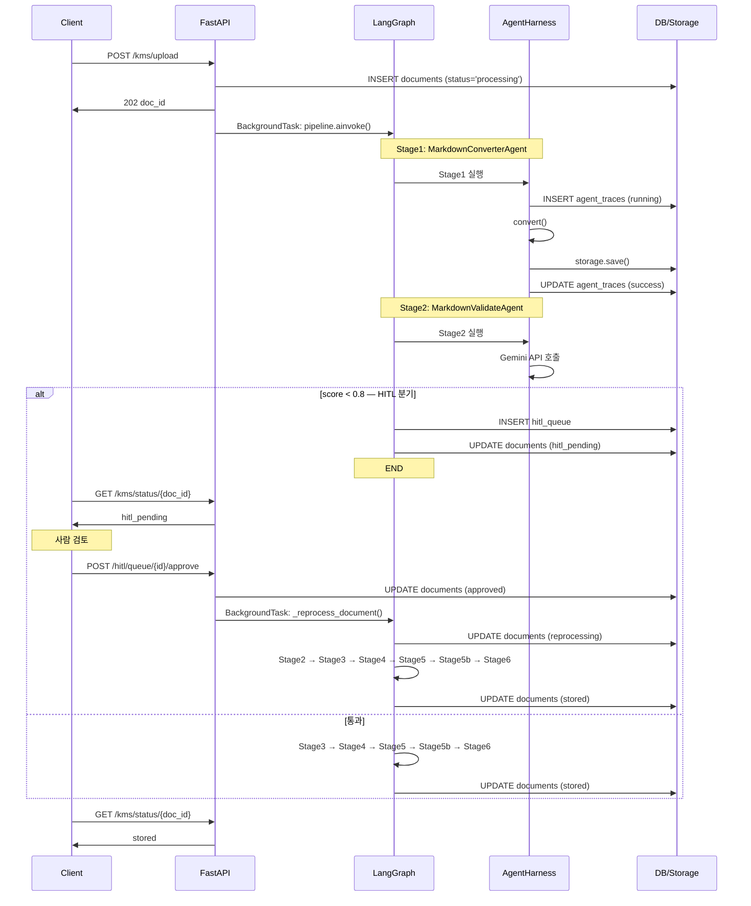
