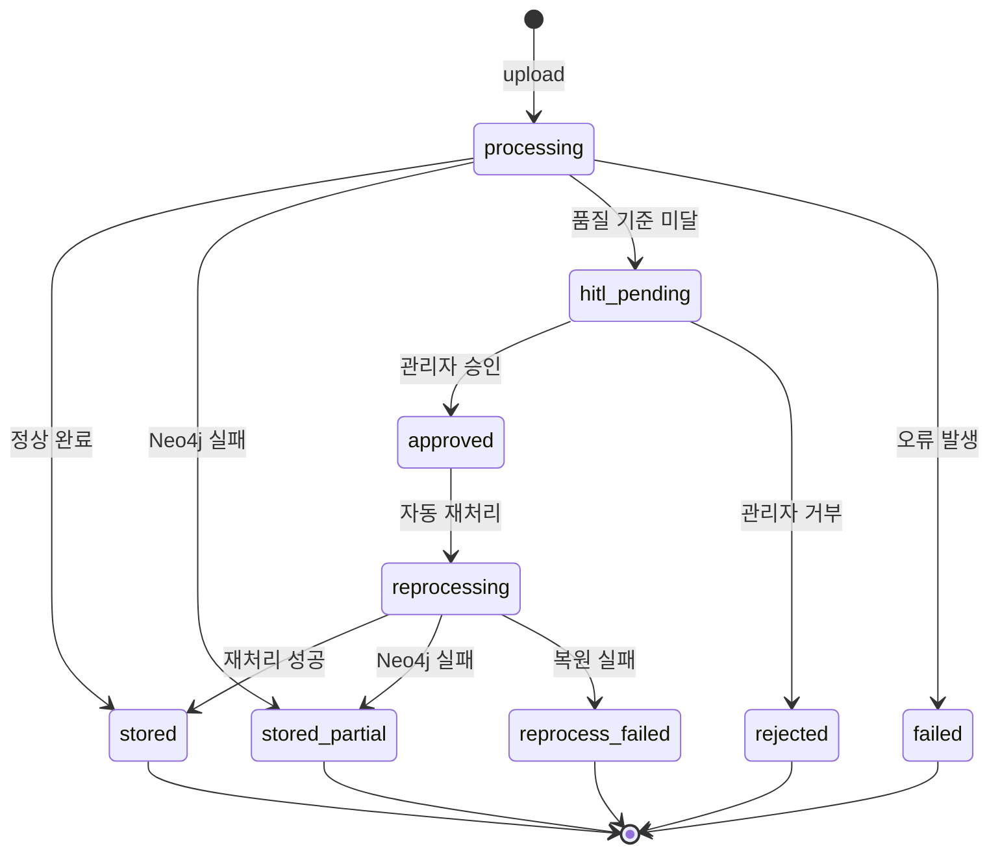
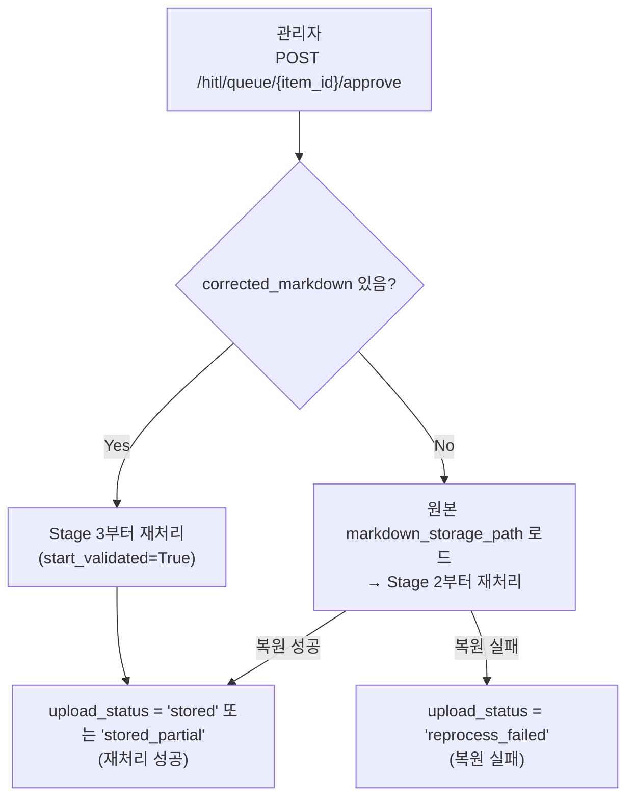

# KMS 문서 구조화 모듈 — 상세 PRD

**버전**: v1.0  
**작성일**: 2026-05-27  
**담당**: Dev1  
**상태**: 구현 완료 (MVP)

---

## 1. 제품 개요

### 1.1 한 줄 정의

사내 비정형 문서(PDF · DOCX · PPTX · TXT · MD)를 AI가 자동 구조화하여 pgVector 기반 의미 검색이 가능한 지식 베이스로 변환하는 자동화 파이프라인.

### 1.2 배경과 필요성

- 사내 지식이 Google Drive, Confluence, Notion, Slack 등 여러 곳에 분산 → 신입 개발자가 필요한 가이드를 찾는 데 평균 30분 이상 소요
- 문서 형식이 통일되지 않아 검색 결과 품질 저하 (키워드 검색 한계)
- PR 코드 리뷰 시 관련 아키텍처 문서를 수동으로 첨부해야 하는 비효율
- 문서 품질 검증 없이 저장하면 LLM 검색 맥락 오염 발생

### 1.3 목표

| 목표 | 측정 지표 | 목표값 |
|------|-----------|--------|
| 문서 처리 성공률 | stored + stored_partial / 전체 업로드 | ≥ 90% |
| 검색 정확도 (Recall@5) | 관련 문서 상위 5개 내 포함 비율 | ≥ 80% |
| 처리 레이턴시 | 문서 업로드 → stored 완료 | ≤ 60초 (5MB 이하 PDF) |
| HITL 재처리 성공률 | 승인 후 stored 완료 비율 | ≥ 95% |

---

## 2. 사용자 스토리

### P0 — 필수 (MVP)

```
US-KMS-01: 직원이 PDF/DOCX 사내 문서를 웹 UI에 업로드하면
           시스템이 자동으로 Markdown으로 변환하고 의미 검색 가능하게 저장한다.

US-KMS-02: Dev1 오케스트레이터가 PR diff를 분석할 때
           KMS에서 관련 아키텍처 문서를 자동 검색하여 코드 리뷰 컨텍스트로 제공한다.

US-KMS-03: 품질 기준 미달 문서는 관리자에게 HITL 검토 큐로 전달되고
           승인 시 파이프라인이 자동 재개된다.

US-KMS-04: 업로드된 문서의 처리 상태를 실시간으로 확인할 수 있다.
```

### P1 — 다음 단계

```
US-KMS-05: 문서에서 추출된 엔티티 간 관계를 Neo4j 그래프로 시각화한다.

US-KMS-06: Notion / Confluence 연동으로 문서를 자동 수집한다.

US-KMS-07: 카테고리별 문서 통계 및 커버리지 대시보드를 제공한다.
```

---

## 3. 기능 요구사항

### 3.1 문서 업로드 (F-KMS-UPLOAD)

| ID | 요구사항 | 우선순위 |
|----|----------|----------|
| F-KMS-UPLOAD-01 | PDF · DOCX · PPTX · TXT · MD 5가지 형식 지원 | P0 |
| F-KMS-UPLOAD-02 | 최대 50MB 파일 크기 제한 | P0 |
| F-KMS-UPLOAD-03 | 업로드 즉시 고유 doc_id(UUID v4) 발급 | P0 |
| F-KMS-UPLOAD-04 | 드래그 앤 드롭 + 파일 선택 다이얼로그 지원 | P0 |
| F-KMS-UPLOAD-05 | 업로드 즉시 비동기 파이프라인 실행 (HTTP 202 반환) | P0 |

### 3.2 문서 변환 — Stage 1: MarkdownConverter 도구 (F-KMS-CONVERT)

| ID | 요구사항 | 우선순위 |
|----|----------|----------|
| F-KMS-CONVERT-01 | DOCX: python-docx로 heading 구조 보존 Markdown 변환 | P0 |
| F-KMS-CONVERT-02 | PPTX: python-pptx로 슬라이드별 Markdown 변환 | P0 |
| F-KMS-CONVERT-03 | PDF: pdfplumber로 텍스트 추출 → 실패 시 Gemini 멀티모달 폴백 | P0 |
| F-KMS-CONVERT-04 | TXT/MD: 인코딩 자동 감지 (UTF-8 → EUC-KR 폴백) | P0 |
| F-KMS-CONVERT-05 | 변환 결과를 Storage에 `.md` 파일로 보관 | P0 |

### 3.3 품질 검증 — Stage 2: MarkdownValidateAgent AI 에이전트 (F-KMS-VALIDATE)

| ID | 요구사항 | 우선순위 |
|----|----------|----------|
| F-KMS-VALIDATE-01 | Gemini 2.5 Flash로 Markdown 품질 점수 산출 (0.0~1.0) | P0 |
| F-KMS-VALIDATE-02 | 품질 점수 < 0.8이면 HITL 큐 등록 및 파이프라인 중단 | P0 |
| F-KMS-VALIDATE-03 | 표·이미지 구조 손실 감지 시 HITL 큐 등록 | P0 |
| F-KMS-VALIDATE-04 | 품질 이슈 목록 (`quality_issues`) 명시적 기록 | P0 |

### 3.4 청킹 — Stage 3: ChunkingTool 도구 (F-KMS-CHUNK)

| ID | 요구사항 | 우선순위 |
|----|----------|----------|
| F-KMS-CHUNK-01 | Parent 청크: 800~1500 토큰 (검색 컨텍스트용) | P0 |
| F-KMS-CHUNK-02 | Child 청크: 300~500 토큰 (pgVector 임베딩 단위) | P0 |
| F-KMS-CHUNK-03 | `section_header`로 각 청크의 소속 섹션 기록 | P0 |
| F-KMS-CHUNK-04 | `page_number` 추적 (원본 참조 지원) | P0 |
| F-KMS-CHUNK-05 | Parent-Child UUID 연결 (`parent_chunk_id`) | P0 |

### 3.5 청크 검증 — Stage 4: ChunkValidateTool 도구 (F-KMS-CHUNK-VALIDATE)

| ID | 요구사항 | 우선순위 |
|----|----------|----------|
| F-KMS-CHUNK-VALIDATE-01 | Parent 청크 길이 범위 벗어나면 HITL 큐 등록 | P0 |
| F-KMS-CHUNK-VALIDATE-02 | Child 청크 길이 범위 벗어나면 HITL 큐 등록 | P0 |
| F-KMS-CHUNK-VALIDATE-03 | Parent-Child 연결 실패 감지 및 HITL 큐 등록 | P0 |
| F-KMS-CHUNK-VALIDATE-04 | `chunk_validation_issues` 목록으로 이슈 분류 기록 | P0 |

### 3.6 메타데이터 추출 — Stage 5: MetadataExtractAgent AI 에이전트 (F-KMS-META)

| ID | 요구사항 | 우선순위 |
|----|----------|----------|
| F-KMS-META-01 | Gemini로 title, category, team, author, tags 추출 | P0 |
| F-KMS-META-02 | category 허용값: 코딩컨벤션 / 아키텍처 / 온보딩 / 운영 / 보안 / 기타 | P0 |
| F-KMS-META-03 | Neo4j 엔티티/관계 추출 (기술, 패턴, 개념 타입) | P1 |
| F-KMS-META-04 | LLM 응답 JSON 파싱 실패 시 1회 재시도 후 기본값 적용 | P0 |

### 3.7 메타데이터 검증 — Stage 5b: MetadataValidateAgent AI 에이전트 (F-KMS-META-VALIDATE)

| ID | 요구사항 | 우선순위 |
|----|----------|----------|
| F-KMS-META-VALIDATE-01 | 메타데이터 품질 점수 < 0.7이면 HITL 큐 등록 | P0 |
| F-KMS-META-VALIDATE-02 | title 누락 시 원본 파일명으로 자동 보완 | P0 |
| F-KMS-META-VALIDATE-03 | category 비허용값 감지 시 이슈 기록 | P0 |

### 3.8 저장 & 라우팅 — Stage 6: StoreRouteTool 도구 (F-KMS-STORE)

| ID | 요구사항 | 우선순위 |
|----|----------|----------|
| F-KMS-STORE-01 | PostgreSQL `documents` + `chunks` 테이블 저장 | P0 |
| F-KMS-STORE-02 | Ollama bge-m3 (1024차원) 임베딩 → `chunk_embeddings` (pgVector) | P0 |
| F-KMS-STORE-03 | 임베딩 동시성 제어: 최대 5개 병렬 (`_EMBED_SEM`) | P0 |
| F-KMS-STORE-04 | Neo4j 저장 실패 시 `stored_partial`로 부분 성공 처리 | P0 |
| F-KMS-STORE-05 | Storage (Local / GCS) 원본 파일 보관 | P0 |

### 3.9 HITL 검토 API (F-KMS-HITL)

| ID | 요구사항 | 우선순위 |
|----|----------|----------|
| F-KMS-HITL-01 | `GET /hitl/queue/pending` — 대기 중인 검토 항목 목록 | P0 |
| F-KMS-HITL-02 | `GET /hitl/queue/{item_id}` — 검토 항목 상세 (이슈, 점수 포함) | P0 |
| F-KMS-HITL-03 | `POST /hitl/queue/{item_id}/approve` — 승인 + 파이프라인 재개 | P0 |
| F-KMS-HITL-04 | `POST /hitl/queue/{item_id}/reject` — 거부 (문서 상태 `rejected`) | P0 |
| F-KMS-HITL-05 | 승인 시 `corrected_markdown` 선택적 전달 가능 | P0 |

### 3.10 검색 API (F-KMS-SEARCH)

| ID | 요구사항 | 우선순위 |
|----|----------|----------|
| F-KMS-SEARCH-01 | pgVector 코사인 유사도 검색 (`<=>` 연산자) | P0 |
| F-KMS-SEARCH-02 | `limit` 파라미터 (1~20, 기본 5) | P0 |
| F-KMS-SEARCH-03 | `category` 필터 파라미터 | P0 |
| F-KMS-SEARCH-04 | 결과에 유사도 점수, 문서 제목 포함 | P0 |
| F-KMS-SEARCH-05 | `stored` / `stored_partial` 문서만 검색 대상 | P0 |

---

## 4. 비기능 요구사항

### 4.1 성능

| 항목 | 요구사항 |
|------|----------|
| 파이프라인 처리 시간 | ≤ 60초 (5MB PDF 기준, LLM 제외) |
| 검색 API 레이턴시 | ≤ 500ms (p95, pgVector HNSW 인덱스 기준) |
| 임베딩 처리 | 동시 5개 청크 병렬화, Ollama 로컬 서비스 |
| 업로드 API 응답 | ≤ 200ms (파이프라인은 백그라운드 실행) |

### 4.2 가용성

| 항목 | 요구사항 |
|------|----------|
| Neo4j 장애 | `stored_partial`로 부분 성공, 전체 파이프라인 중단 없음 |
| Ollama 장애 | 503 에러 반환 (검색 API), 파이프라인 stage6 실패 처리 |
| LLM API 장애 | `agent_traces`에 오류 기록, `failed` 상태로 종료 |
| Storage 장애 | 파이프라인 `failed` 처리, 임시 파일 정리 보장 |

### 4.3 보안

| 항목 | 요구사항 |
|------|----------|
| 파일 확장자 검증 | 허용 확장자 외 업로드 거부 (422) |
| 파일 크기 제한 | 50MB 초과 거부 (413) |
| SQL 인젝션 방지 | asyncpg 파라미터 바인딩만 사용 ($1, $2, ...) |
| LLM 응답 검증 | DB 저장 전 Pydantic 파싱/검증 필수 |
| GCS 인증 | ADC 또는 서비스 계정 키 (환경변수 `GOOGLE_APPLICATION_CREDENTIALS`) |

### 4.4 관찰 가능성

| 항목 | 요구사항 |
|------|----------|
| LangSmith 추적 | 모든 에이전트 실행 자동 추적 |
| PostgreSQL 로그 | `agent_traces` 테이블: 시작/종료 시각, 실행 시간, 오류 메시지 |
| 상태 폴링 API | `GET /kms/status/{doc_id}` — 실시간 상태 + agent_traces 반환 |
| 로그 레벨 | logger.info (정상 흐름), logger.warning (HITL), logger.error (실패) |

---

## 5. 데이터 모델

### 5.1 핵심 테이블

```sql
-- 문서 원본 정보
documents (
    doc_id          UUID PRIMARY KEY,
    title           TEXT,
    source          TEXT,           -- 'upload | notion | confluence | slack'
    file_type       TEXT,
    upload_status   TEXT,           -- 'processing | stored | stored_partial | hitl_pending
                                    --  | approved | reprocessing | reprocess_failed
                                    --  | rejected | failed'
    created_at      TIMESTAMPTZ DEFAULT NOW()
)

-- Parent-Child 청크
chunks (
    chunk_id        UUID PRIMARY KEY,
    doc_id          UUID REFERENCES documents(doc_id),
    parent_chunk_id UUID,           -- NULL이면 Parent 청크
    chunk_type      TEXT,           -- 'parent | child'
    content         TEXT,
    token_count     INTEGER,
    section_header  TEXT,
    page_number     INTEGER
)

-- pgVector 임베딩 (Ollama bge-m3, 1024차원)
chunk_embeddings (
    chunk_id        UUID PRIMARY KEY REFERENCES chunks(chunk_id),
    embedding       vector(1024),   -- HNSW 인덱스
    content         TEXT,
    metadata        JSONB
)

-- 에이전트 실행 로그
agent_traces (
    trace_id        TEXT PRIMARY KEY,
    task_id         UUID,           -- PR 파이프라인 연결 (NULL = 문서 파이프라인)
    agent_name      TEXT,
    doc_id          UUID REFERENCES documents(doc_id),
    status          TEXT,           -- 'success | fail | review'
    started_at      TIMESTAMPTZ,
    ended_at        TIMESTAMPTZ,
    execution_ms    INTEGER,
    error_message   TEXT
)

-- HITL 검토 큐
hitl_queue (
    id              UUID PRIMARY KEY DEFAULT gen_random_uuid(),
    doc_id          UUID REFERENCES documents(doc_id),
    stage           TEXT,           -- 'stage2_validate | stage4_chunk_validate | stage5b_metadata_validate'
    reason          TEXT,
    quality_score   FLOAT,
    issues          JSONB,
    status          TEXT DEFAULT 'pending',  -- 'pending | approved | rejected'
    created_at      TIMESTAMPTZ DEFAULT NOW(),
    reviewed_at     TIMESTAMPTZ,
    reviewer_note   TEXT
)
```

### 5.2 문서 상태 전이



---

## 6. API 계약

### 6.1 업로드

```
POST /kms/upload
Content-Type: multipart/form-data

Body:
  file    : File (required)
  source  : string (default: "upload")

Response 202:
  {
    "doc_id": "uuid-string",
    "status": "processing",
    "message": "Document upload accepted. Check /kms/status/{doc_id} for progress.",
    "hitl_required": false,
    "chunk_count": 0
  }

Errors:
  422 — 지원하지 않는 형식
  413 — 파일 크기 초과 (50MB)
```

### 6.2 상태 조회

```
GET /kms/status/{doc_id}

Response 200:
  {
    "doc_id": "uuid-string",
    "status": "processing | stored | stored_partial | hitl_pending | ...",
    "current_stage": null,
    "error": null,
    "agent_traces": [
      {
        "trace_id": "trc_0001_3a9f1c2b",
        "agent_name": "MarkdownConverterAgent",
        "status": "success",
        "started_at": "2026-05-27T10:00:00.000Z",
        "ended_at": "2026-05-27T10:00:05.200Z",
        "execution_ms": 5200,
        "error_message": null
      }
    ]
  }

Errors:
  404 — 문서 없음
  422 — 잘못된 doc_id 형식
```

### 6.3 검색

```
GET /kms/search?q={query}&limit={n}&category={category}

Parameters:
  q        : string (required, min_length=1)
  limit    : integer (default=5, min=1, max=20)
  category : string (optional) — "코딩컨벤션 | 아키텍처 | 온보딩 | ..."

Response 200:
  {
    "query": "N+1 쿼리 방지 방법",
    "results": [
      {
        "chunk_id": "uuid-string",
        "content": "for 루프 안에서 DB 쿼리 반복 호출 금지...",
        "score": 0.94,
        "metadata": { "category": "코딩컨벤션" },
        "doc_title": "N+1 쿼리 방지 가이드"
      }
    ],
    "total": 1
  }

Errors:
  503 — 임베딩 서비스(Ollama) 오류
```

### 6.4 문서 상세 (에이전트 트레이스 + 청크)

```
GET /kms/docs/{doc_id}/details

Response 200:
  {
    "doc_id": "uuid-string",
    "title": "사내 N+1 쿼리 방지 가이드",
    "file_type": "pdf",
    "status": "stored",
    "created_at": "2026-05-27T10:00:00.000Z",
    "agent_traces": [...],
    "chunks": [
      {
        "chunk_id": "uuid-string",
        "chunk_type": "parent",
        "content": "...",
        "token_count": 950,
        "section_header": "2. 쿼리 최적화 패턴",
        "page_number": 3
      }
    ]
  }
```

---

## 7. HITL 워크플로우 상세

### 7.1 HITL 트리거 조건

| 단계 | 트리거 조건 | issues 구조 |
|------|-------------|-------------|
| stage2_validate | quality_score < 0.8 또는 구조 손실 감지 | `{"quality_issues": [...], "markdown_storage_path": "..."}` |
| stage4_chunk_validate | 청크 길이 범위 초과 또는 Parent-Child 연결 실패 | `{"chunk_issues": [...], "markdown_storage_path": "..."}` |
| stage5b_metadata_validate | metadata_score < 0.7 | `{"metadata_issues": [...], "metadata": {...}, "markdown_storage_path": "..."}` |

### 7.2 승인 흐름



### 7.3 HITL API 엔드포인트

```
GET  /hitl/queue/pending                 대기 목록 (pagination: limit, offset)
GET  /hitl/queue/{item_id}              항목 상세
POST /hitl/queue/{item_id}/approve      승인 + 파이프라인 재개
POST /hitl/queue/{item_id}/reject       거부
GET  /hitl/queue/{doc_id}/history       문서별 HITL 이력
```

---

## 8. 운영 요구사항

### 8.1 환경변수

| 변수 | 기본값 | 설명 |
|------|--------|------|
| `POSTGRES_URL` | (필수) | asyncpg 연결 문자열 |
| `PGVECTOR_DIMENSION` | `1024` | bge-m3 임베딩 차원 |
| `OLLAMA_BASE_URL` | `http://localhost:11434` | Ollama API 주소 |
| `OLLAMA_EMBEDDING_MODEL` | `bge-m3` | 임베딩 모델 |
| `GOOGLE_CLOUD_PROJECT` | (GCS 사용 시) | GCS 프로젝트 ID |
| `GCS_BUCKET` | (GCS 사용 시) | GCS 버킷명 |
| `GOOGLE_APPLICATION_CREDENTIALS` | (GCS 사용 시) | ADC 인증 파일 경로 |
| `STORAGE_LOCAL_ROOT` | `/tmp/kms_storage` | 로컬 스토리지 루트 |
| `NEO4J_URI` | `bolt://localhost:7687` | Neo4j 주소 |
| `MARKDOWN_QUALITY_THRESHOLD` | `0.8` | Stage 2 HITL 임계값 |
| `METADATA_QUALITY_THRESHOLD` | `0.7` | Stage 5b HITL 임계값 |
| `PARENT_MIN` | `800` | Parent 청크 최소 토큰 |
| `PARENT_MAX` | `1500` | Parent 청크 최대 토큰 |
| `CHILD_MIN` | `300` | Child 청크 최소 토큰 |
| `CHILD_MAX` | `500` | Child 청크 최대 토큰 |
| `USE_MOCK_LLM` | `true` | 개발 중 Mock LLM 사용 |

### 8.2 의존 서비스

| 서비스 | 역할 | 장애 대응 |
|--------|------|-----------|
| PostgreSQL + pgVector | 메타데이터, 청크, 임베딩 저장 | 필수 — 장애 시 파이프라인 중단 |
| Ollama (bge-m3) | 임베딩 생성 | Stage 6 실패 → `failed` 처리 |
| Gemini 2.5 Flash | 품질 검증, 메타데이터 추출 | 실패 시 재시도 1회 후 `failed` |
| Neo4j | 지식 그래프 저장 | 선택적 — 실패 시 `stored_partial` |
| GCS / Local Storage | 원본 파일, Markdown 보관 | GCS 실패 시 Local 폴백 (개발) |

---

## 9. 마일스톤

| 주차 | 목표 | 완료 기준 |
|------|------|-----------|
| Week 2~3 | 파이프라인 7단계 구현 | Mock LLM으로 단위 테스트 통과 |
| Week 4 | 실제 LLM 연결 + Storage 연동 | 실제 PDF → pgVector 저장 확인 |
| Week 4 (현재) | HITL 완전 구현 + 버그 수정 | 3가지 HITL 트리거 + 재처리 E2E 확인 |
| Week 5 | 통합 테스트 | PR 코드 리뷰 시 KMS 컨텍스트 자동 주입 확인 |
| Week 6 | 데모 준비 | 신입 온보딩 시나리오 전체 동작 |

---

## 10. 범위 밖 (Out of Scope)

- 실시간 문서 동기화 (Notion/Confluence webhook) — P1
- 문서 버전 관리 및 변경 이력 추적 — P1
- 멀티테넌트 / 접근 권한 제어 — 향후 검토
- 문서 삭제 API — 향후 검토
- 임베딩 모델 자동 재학습 — 범위 외
