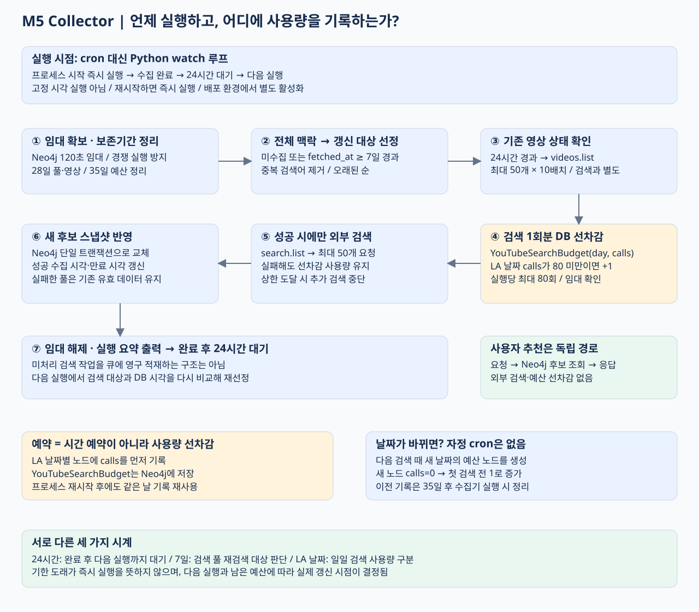

# M5 영상 수집기 · 실행 주기와 호출 제한 관리

## 실행 방식과 주기

수집기는 Python 비동기 반복 루프의 watch 모드로 실행됩니다. **프로세스 시작 시 수집 작업을 실행하고, 작업 완료 후 24시간이 지나면 다음 작업을 시작하는 고정 지연(fixed delay) 방식**입니다.

예를 들어 09:00에 시작한 작업이 09:10에 완료되면 다음 실행은 다음 날 09:10경입니다. 프로세스를 재시작하면 수집 작업을 즉시 실행합니다. 고정 시각 실행이 필요하면 외부 cron 또는 Windows 작업 스케줄러에서 단발 실행 명령을 호출하도록 구성할 수 있습니다.

현재 Compose 구성은 선택형 youtube-collector 프로필에서 watch 모드를 사용합니다. 운영 환경의 실행 여부는 프로세스·컨테이너 상태로 확인해야 합니다.

## 수집 작업 처리 흐름

| 단계 | 처리 내용 |
| --- | --- |
| 1. 초기화 및 분산 락 획득 | 고유 제약을 생성하고 Neo4j 관리 노드에 소유자 토큰과 120초 유효기간을 기록합니다. 다른 수집기가 락을 보유하면 작업을 종료합니다. |
| 2. 보존기간 정리 | 28일 이상 경과한 검색 풀·영상과 참조가 없는 데이터를 삭제합니다. 호출 사용량 기록은 35일간 보관합니다. |
| 3. 검색 대상 생성 | Concept·Mechanism·CodeExample의 언어·프레임워크를 기준으로 검색어를 생성하고 중복을 제거합니다. |
| 4. 갱신 대상 선정 | 미수집 풀 또는 마지막 성공 수집 후 7일 이상 경과한 풀을 선택하고, 수집 시각이 오래된 순으로 정렬합니다. |
| 5. 영상 메타데이터 갱신 | 마지막 확인 후 24시간 이상 경과한 영상을 videos.list로 조회합니다. 최대 50개씩 10배치를 처리하고, 응답에 포함되지 않은 영상은 삭제합니다. |
| 6. 호출 제한 확인 | 각 검색 직전에 락 소유권·유효기간과 일일 사용량을 검사합니다. 상한 미만이면 DB 트랜잭션에서 호출 카운터를 1 증가시킵니다. |
| 7. YouTube 검색 | 카운터 갱신에 성공한 경우 search.list를 호출해 최대 50개를 요청합니다. 기본 상한은 실행당 80회, 일일 80회입니다. |
| 8. 검색 결과 저장 | 검색 풀·영상·후보 관계를 단일 Neo4j 트랜잭션으로 갱신합니다. 기존 후보 목록을 교체하고 수집·갱신·만료 시각을 기록합니다. |
| 9. 작업 종료 | 분산 락을 해제하고 처리 결과를 로그로 출력합니다. watch 모드는 24시간 대기 후 다음 작업을 시작합니다. |

분산 락은 만료 시간(TTL)을 갖는 lease 방식입니다. API 호출 전에 유효기간을 갱신하고 저장 직전에 소유권을 검사합니다. 만료된 락을 가진 프로세스가 결과를 저장하지 않도록 제어합니다.

일반 검색 실패 시 기존의 유효한 후보를 유지합니다. HTTP 401·403·429, 메타데이터 조회 실패, 호출 제한 도달 또는 락 유효성 검사 실패 시 추가 검색을 중단합니다. 정상 응답의 빈 검색 결과는 유효한 스냅샷으로 저장합니다.

미처리 검색어는 별도 작업 큐에 저장하지 않습니다. 다음 실행에서 현재 지식 그래프와 검색 풀의 수집 시각을 다시 비교해 처리 대상을 계산합니다. 따라서 7일은 갱신 대상 선정 기준이며 실제 완료 시각은 실행 주기와 호출 한도에 따라 달라집니다.

## 일일 API 호출 제한

### DB 기반 사용량 카운터

Neo4j의 YouTubeSearchBudget 노드에 날짜별 검색 시도 수를 저장합니다. 동일한 DB를 사용하는 수집기들이 이 값을 공유합니다.

~~~text
YouTubeSearchBudget {
  day: "2026-11-12",
  calls: 23,
  created_at: ...,
  revision: ...
}
~~~

검색 요청 전에 다음 처리를 하나의 DB 트랜잭션에서 수행합니다.

1. 수집기 락의 소유권과 유효기간을 확인합니다.
2. 해당 날짜의 사용량 노드를 조회하거나 생성합니다.
3. calls가 설정 상한보다 작은 경우에만 calls를 1 증가시킵니다.
4. 트랜잭션이 성공하면 YouTube 검색을 실행합니다.

호출 실패나 카운터 증가 직후 프로세스 종료가 발생해도 카운터를 감소시키지 않습니다. 외부 API 사용량을 과소 집계하지 않기 위한 보수적인 처리입니다. 이 카운터는 애플리케이션 내부 제한이며 Google Cloud의 실제 할당량 조회 결과가 아닙니다. 다른 DB나 별도 스크립트에서 발생한 호출은 포함하지 않습니다.

### 집계 기준 시간대와 일자 전환

집계 키인 day는 **America/Los_Angeles 시간대의 날짜**로 생성합니다. 해당 시간대에서 일자가 변경되면 다음 검색 요청 시 새 날짜의 노드를 생성해 집계를 시작합니다. 이전 날짜의 카운터를 초기화하는 별도 스케줄 작업은 없습니다.

일일 한도가 새로 적용되어도 수집 작업을 즉시 실행하지는 않습니다. 다음 실행 시 변경된 날짜를 기준으로 호출 가능 여부를 판단합니다. 이전 날짜의 기록은 유지되며, 35일이 지난 기록은 수집기의 정리 단계에서 삭제합니다.

videos.list 메타데이터 조회는 이 검색 카운터에 포함하지 않습니다. 별도의 API 호출이며, 실행당 배치 수로 처리 범위를 제한합니다.

## 데이터 저장과 운영 로그

| 구분 | 저장 위치 | 용도 |
| --- | --- | --- |
| 분산 락 | Neo4j YouTubeCollectionControl | 동시 실행 제어, 소유자·만료 시각 관리 |
| 일일 검색 사용량 | Neo4j YouTubeSearchBudget | 호출 횟수 집계와 상한 검사 |
| 검색 풀 | Neo4j YouTubeSearchPool | 검색어·수집 시각·만료 시각 관리 |
| 영상 | Neo4j YouTubeVideo | ID·URL·제목·채널·메타데이터 저장 |
| 후보 순서 | HAS_CANDIDATE.position | 검색별 후보 정렬 |
| 실행 결과 | 프로세스 표준 출력 | 검색·갱신·실패·미처리 건수 기록 |

## 운영 설정

저장소 루트에서 Compose 수집기를 활성화합니다.

~~~powershell
docker compose --profile youtube-collector up -d m5-collector
~~~

기본 Compose 서비스는 로컬 neo4j_m6에 연결합니다. Aura를 사용할 경우 서비스의 DB 접속 설정을 변경하거나, Aura 접속 정보가 있는 루트 .env로 CLI를 실행합니다.

~~~powershell
uv run --directory backend/m5 --env-file ../../.env python -m app.collect_videos --watch
~~~

외부 스케줄러에서 호출할 단발 실행 명령은 다음과 같습니다.

~~~powershell
uv run --directory backend/m5 --env-file ../../.env python -m app.collect_videos
~~~

구현 근거: backend/m5/app/collect_videos.py, video_collection.py, video_store.py.
