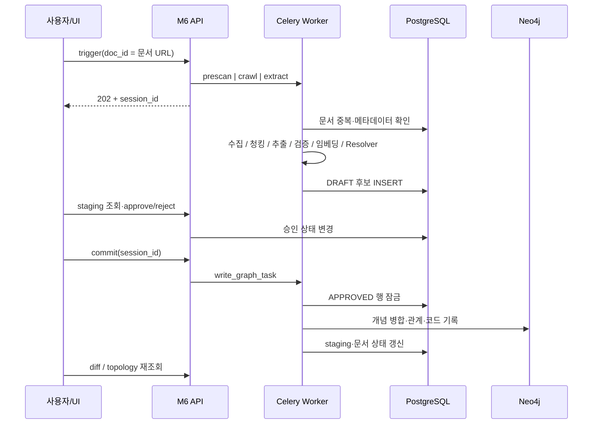
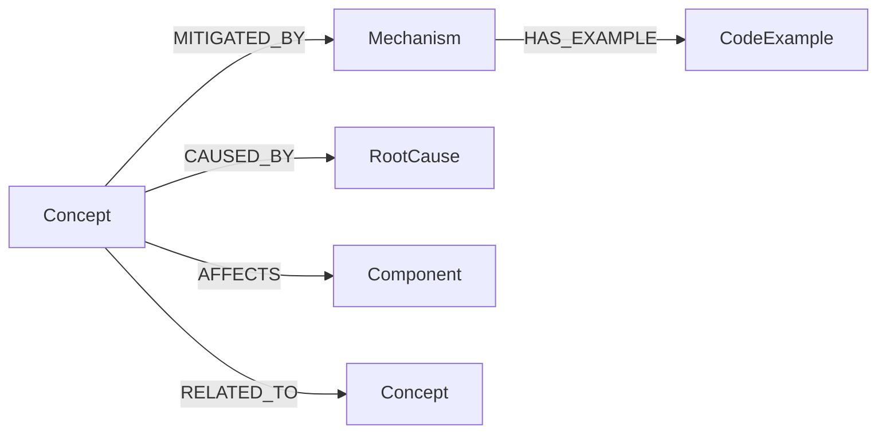
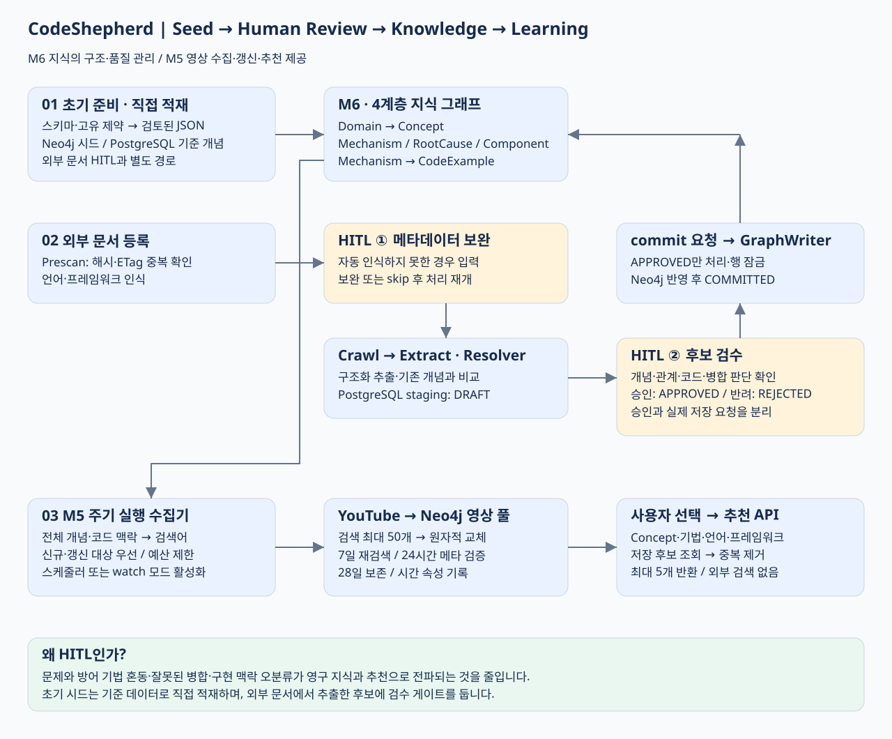

# Module 5 ↔ Module 6 연결 아키텍처

이 문서는 서로 다른 두 서비스의 연결과 구현 근거를 함께 설명합니다. 기능을 하나의 Module 5로 통합한 명세가 아닙니다.

- [Module 5 — YouTube 추천](MODULE_5_GRAPH_YOUTUBE_RULE.md)
- [Module 6 — 온톨로지 지식 그래프 관리](MODULE_6_ONTOLOGY_KNOWLEDGE_GRAPH.md)

기준: 2026-11-11 저장소 실행 코드. 설계 목표와 현재 구현을 구분하며 실측하지 않은 성능·정확도·운영 안정성을 주장하지 않습니다.

## 책임과 배치

| 구성요소 | 책임 | 저장소 / 외부 연동 |
| --- | --- | --- |
| M6 API :8007 | URL 접수, 메타데이터 보정, HITL, topology, SSE | PostgreSQL·Redis·Neo4j |
| M6 Celery worker | Prescan→Crawl→Extract, 승인 후 별도 GraphWriter | queue m6_graph |
| PostgreSQL / pgvector | 문서 상태·메타데이터·개념 마스터·검수 후보 | Cloud SQL Proxy 또는 별도 PostgreSQL |
| neo4j_m6 | 개념·메커니즘·원인·컴포넌트·코드 그래프 | 컨테이너 7687, 호스트 7688 / Browser 7475 |
| M5 API :8006 | 개념 조회·맥락별 저장 영상 추천 | neo4j_m6 읽기, 외부 검색 없음 |
| M5 수집기 | 전체 컨셉·등록 코드 맥락별 영상 수집·갱신 | YouTube API·neo4j_m6 영상 풀 쓰기 |

M0의 KMS 그래프용 `neo4j`(호스트 7687 / Browser 7474)와 M5·M6 그래프는 분리되어 있습니다. 이 문서는 두 그래프 간 자동 동기화를 전제하지 않습니다.

## 문서에서 그래프까지

진행 이벤트는 Redis `pipeline:{session_id}` PubSub에서 SSE로 전달됩니다. 연결·heartbeat 이벤트와 finished 종료를 제공하지만 영속 이벤트 로그와 재접속 replay는 없습니다. 연결 전에 발행된 이벤트는 놓칠 수 있으므로 최종 상태는 DB 기반 API로 확인합니다.

## 추출·해소 정책

- Prescan은 본문 해시 또는 URL+ETag의 기존 COMMITTED 문서를 확인합니다. 미완료 문서까지 무조건 중복으로 건너뛰는 정책이 아닙니다.
- 본문 청크는 기본 30,000~40,000자, overlap 2,500자이며 헤더·문단 경계를 고려합니다. Gemini 프롬프트는 청크 앞 30,000자만 사용하므로 청크 전체를 추출한다고 보장할 수 없습니다.
- Pydantic 스키마 검증과 이름·노이즈 필터를 적용합니다. 도메인 레지스트리와 프레임워크 메타데이터는 프롬프트 구성에 쓰지만 기존 개념의 벡터 Top-K를 주입하는 RAG는 현재 구현되어 있지 않습니다.
- 개념명·별칭과 설명을 각각 1024차원 벡터로 표현합니다. 실제 임베딩은 SentenceTransformer의 BAAI/bge-m3를 기본으로 L2 정규화합니다.

Hybrid Resolver는 비활성화되지 않은 PostgreSQL 개념 전체를 읽고 비교합니다. HNSW 인덱스가 스키마에 있어도 현재 해소 경로는 DB Top-K 검색이 아닙니다.

| 판단 순서 | 현재 resolve 경로 |
| --- | --- |
| 정규화 이름·별칭 일치 | 소문자화·공백 제거 후 일치하면 MERGE, confidence 1 |
| 이름 cosine ≥ 0.8 AND 설명 cosine ≥ 0.8 | MERGE; confidence 최소 0.88 |
| 그 외 가중 점수 ≥ 0.72 | RELATED_TO |
| 그 외 | NEW |

가중 점수는 `0.4 × Jaro-Winkler + 0.3 × 이름 cosine + 0.3 × 설명 cosine`입니다. 후보 선택은 MERGE > RELATED_TO > NEW 우선 후 점수를 비교합니다. 단순히 종합 점수 0.88 이상이면 모두 MERGE라고 설명하면 실제 분기와 다릅니다.

## 데이터와 온톨로지

PostgreSQL의 `knowledge_documents`는 문서 출처·상태, `framework_metadata`는 URL 패턴·언어, `concepts`는 기준 개념·별칭·두 벡터, `staging_concepts`는 추출 JSON·해소 결과·대상 개념·검수 상태를 보관합니다. 상세 DDL은 [M6 schema.sql](../backend/m6/script/schema.sql)을 확인하세요.

Topology 응답은 L1 Domain → L2 Concept → L3 Mechanism/RootCause/Component → L4 CodeExample의 계층을 구성합니다. Domain 연결은 응답에서 domains 속성으로 합성하며, 시드가 저장하는 Concept→Domain BELONGS_TO 방향과 시각화 응답의 Domain→Concept 방향은 다릅니다. session_id 조회 시 추가하는 DRAFT는 노드만 포함하며 후보 관계까지 시각화하지 않습니다.

GraphWriter는 MERGE 후보를 기존 개념으로 흡수하고 별칭 풀을 재임베딩합니다. RELATED_TO 중 방어책 이름으로 분류되는 후보는 Mechanism으로 이관하며, 나머지는 개념·관계를 저장합니다. CodeExample 키는 메커니즘명과 공백 정규화 코드의 MD5 앞 8자리로 구성하므로 언어·프레임워크가 다른 같은 코드의 충돌 가능성이 있습니다.

시드 입력은 security 12개 + performance 4개입니다. 실제 사용 파일과 실행 절차는 [M6 README](../backend/m6/README.md)를 따릅니다. 다른 위치의 과거 concept.json을 현재 시드 진입점으로 혼동하지 마세요.

## 그래프에서 추천까지

1. M5는 선택한 concept_name으로 Neo4j 메타데이터를 조회합니다.
2. 호출자가 전달한 mechanism_name·code_lang·code_framework와 CWE·OWASP·영향 컴포넌트를 조합합니다.
3. 중복 검색어를 제거하여 최대 5개를 정해진 우선순위로 생성합니다.
4. 컨셉명과 최종 검색어로 Neo4j의 유효한 영상 후보 풀을 조회합니다. 사용자 요청에서 YouTube API를 호출하지 않습니다.
5. 의도별 첫 미선택 영상을 골라 영상 ID 중복을 제거합니다. rank·추천 유형을 유지하고 미수집·만료 결과는 생략하므로 0~5개·rank 공백이 가능합니다.

별도 M5 수집기는 전체 컨셉과 등록 메커니즘·코드 맥락을 순회합니다. 기본 7일 주기·일일 검색 80회로 최대 50개씩 수집하고, 24시간 이상 된 영상 메타데이터·공개 상태를 배치 검증합니다. 28일 보존 정리와 원자적 풀 교체·영속 예산·임대를 제공합니다. 정기 실행은 선택형 Compose 프로필 또는 외부 스케줄러로 켭니다. 영상 저장은 Neo4j에만 하며 M6의 4계층 온톨로지 노드를 수정하지 않습니다. [수집 설계·실패 처리·검증 한계](M5_VIDEO_COLLECTION.md)를 참고하세요.

`code_id`로 코드 노드를 자동 조회하지 않습니다. `/extract`는 M5의 호환용 스텁이며 M6 수집 파이프라인으로 연결되지 않습니다. [M5 API 계약](../backend/m5/README.md)을 참고하세요.

## 구현 제약과 운영 확인

- 승인·GraphWriter의 PostgreSQL 행 잠금에는 FOR UPDATE SKIP LOCKED를 사용합니다. 이는 PostgreSQL과 Neo4j의 분산 트랜잭션을 제공하지 않습니다.
- 그래프 기록과 PostgreSQL 상태 변경이 별도 트랜잭션이므로 중간 실패 시 부분 반영이 가능합니다. 정확히 한 번 처리·완전한 멱등성을 보장한다고 표현하지 않습니다.
- 추출 staging은 일반 INSERT이며 재추출 후보의 완전한 중복 제거가 아닙니다.
- 신규 그래프 개념의 PostgreSQL concepts 마스터 동기화는 GraphWriter에서 완결되어 있지 않습니다. 이후 해소 시 Neo4j에만 있는 신규 개념을 놓칠 수 있습니다.
- 별칭 재임베딩은 별도 PostgreSQL 연결을 사용합니다. 그래프·검수 상태·벡터 갱신의 원자적 동시 완료를 보장하지 않습니다.
- metadata/learn은 URL 패턴을 누적하지만 supported_langs는 전달값으로 교체합니다.
- LOCAL_DEBUG=true는 eager 실행이므로 API 응답 시간이 비동기 배치 환경과 달라집니다.
- health 응답, 시드 입력 개수, 기존 산출물은 실제 운영 통합 검증·성능 수치의 대체 증거가 아닙니다.

## 구현 근거

- [M6 API 진입점](../backend/m6/app/main.py), [파이프라인 API](../backend/m6/app/api/pipeline.py), [문서 API](../backend/m6/app/api/documents.py), [검수 API](../backend/m6/app/api/staging.py)
- [태스크·청킹·추출·쓰기](../backend/m6/app/worker/tasks.py), [Hybrid Resolver](../backend/m6/app/infrastructure/graph/hybrid_resolver.py)
- [그래프 저장소](../backend/m6/app/adapters/db/neo4j_repo.py), [임베딩](../backend/m6/app/infrastructure/embeddings.py)
- [M5 라우트](../backend/m5/app/main.py), [검색어 정책](../backend/m5/app/keyword_builder.py), [YouTube 클라이언트](../backend/m5/app/youtube_client.py)
- [M5 수집 흐름](../backend/m5/app/video_collection.py), [영상 저장소](../backend/m5/app/video_store.py), [수집 명령](../backend/m5/app/collect_videos.py)
- [Compose](../docker-compose.yml), [Compose override](../docker-compose.override.yml)

## 시드·HITL·영상 DB 갱신 산출물

[엔지니어링 문제와 해결](M5_YOUTUBE_ENGINEERING_PORTFOLIO.md) · [Aura 조회 쿼리](M5_M6_AURA_QUERIES.md)

