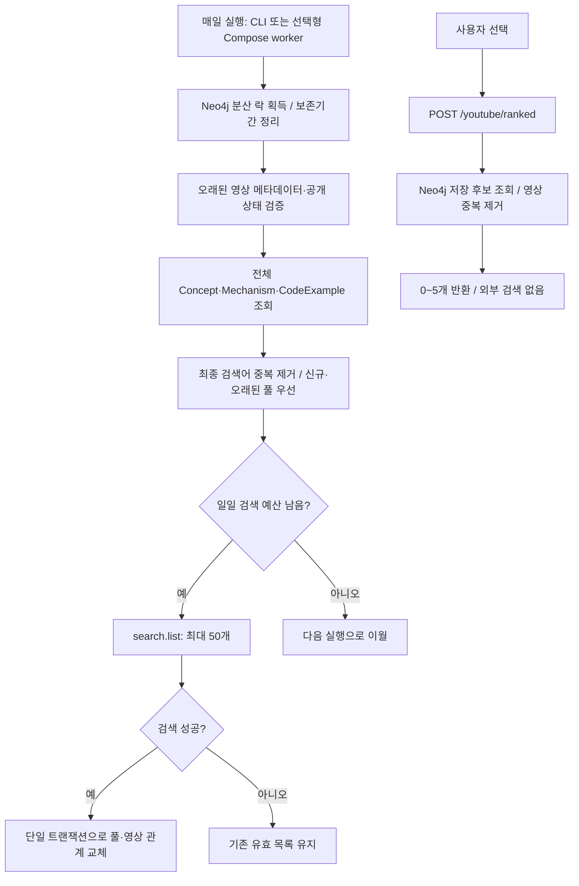
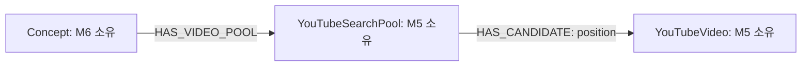
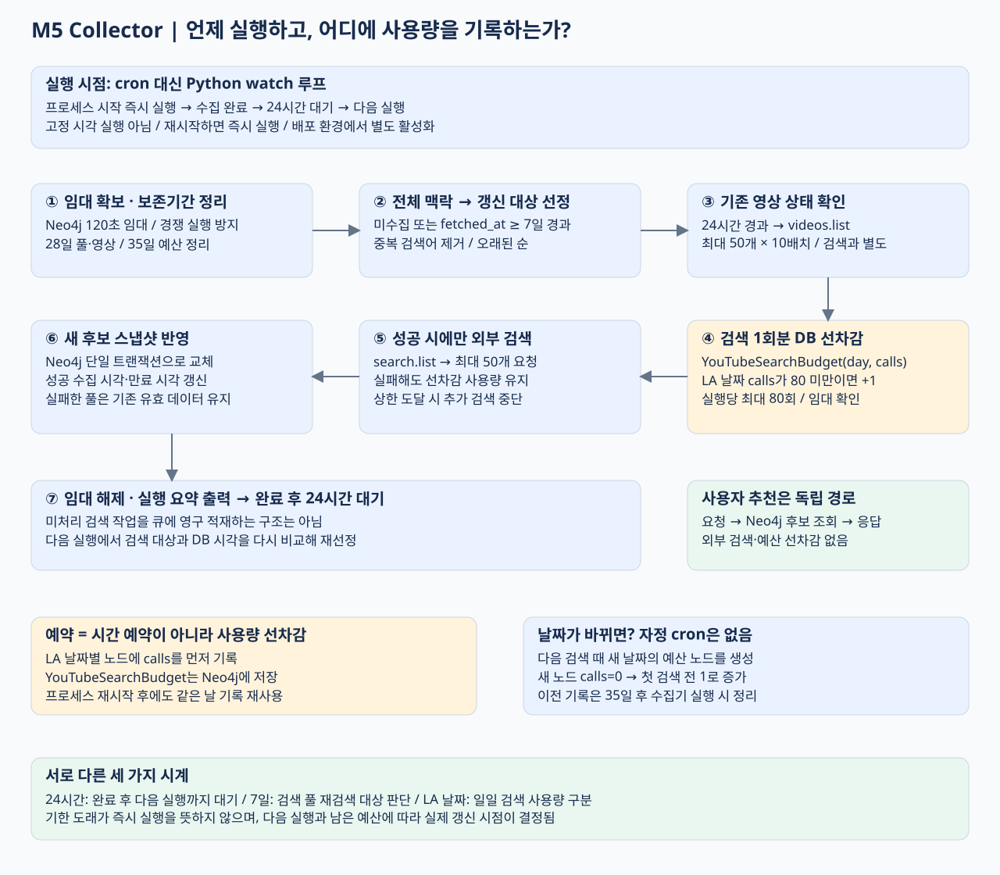

# M5 컨셉별 YouTube 영상 수집·갱신

## 목적과 변경점

추천 조회마다 외부 검색을 수행하던 구조를 **정기 수집과 DB 조회로 분리**한다. M5 수집기가 Neo4j의 전체 컨셉과 등록 코드 맥락을 검색 대상으로 만들며, 사용자 수가 증가해도 추천 API 자체는 YouTube 할당량을 사용하지 않는다. PostgreSQL·Redis 영상 이중 저장이나 LangGraph는 도입하지 않는다.

## 아키텍처 / 액션 플로우

실제 구현에서는 전체 타깃과 대기 검색 수를 계산한 뒤 메타데이터 검증을 수행한다. 위 그림은 수집 단계의 책임과 의존성을 표현하며 정확한 함수 실행 순서는 [video_collection.py](../backend/m5/app/video_collection.py)를 따른다.

## 저장 구조와 책임 경계

| 데이터 | 식별자 / 속성 |
| --- | --- |
| YouTubeSearchPool | key 고유; query, fetched_at, expires_at |
| YouTubeVideo | video_id 고유; title, url, thumbnail, channel_title, fetched_at |
| HAS_CANDIDATE | position: 해당 검색의 원래 순서 |
| YouTubeCollectionControl | name 고유; owner, expires_at, revision |
| YouTubeSearchBudget | day 고유; calls, created_at, revision |

풀 key는 `[concept_name.casefold(), final_query]` JSON의 SHA-256이다. 언어·프레임워크·메커니즘이 검색어에 반영되므로 다른 검색 의도는 분리되고, 같은 컨셉에서 같은 최종 검색어가 나오면 풀을 재사용한다. 추천 유형과 rank는 현재 요청의 검색어 정책에서 계산한다. 풀·영상 노드는 온톨로지의 L1~L4에 포함하지 않으며 M6 topology API도 해당 라벨을 조회하지 않는다.

컨셉명 변경·병합 시 검색 키도 달라질 수 있다. 소스 컨셉 삭제로 고립된 풀은 다음 정리에서 제거되고, 현재 컨셉의 풀을 새로 수집한다. 기존 영상 연결을 병합 대상 컨셉으로 즉시 자동 이전하는 기능은 없다.

## 수집 대상과 갱신 정책

1. 기본 컨셉 검색, 각 메커니즘 검색, 등록된 코드의 언어·프레임워크 검색을 생성한다. 코드 맥락은 메커니즘 포함/미포함 양쪽을 지원한다.
2. 기존 keyword_builder로 각 맥락의 검색어를 최대 5개 생성하고 최종 검색어 단위로 중복을 제거한다. 임의의 모든 언어·프레임워크 조합을 선수집하지 않는다.
3. 새 검색 또는 마지막 성공 수집에서 기본 7일 지난 풀을 대상으로, 미수집·오래된 순으로 수집한다.
4. 검색당 50개까지 요청하며 실제 결과가 더 적거나 검색 간 중복될 수 있다.
5. 성공한 결과만 기존 풀을 교체한다. 성공한 빈 결과도 오래된 추천을 제거하는 유효한 스냅샷이다.
6. 24시간 이상 된 영상은 videos.list로 기본 실행당 최대 10배치 × 50개를 검증한다. 공개 영상 메타데이터를 갱신하고 응답에서 빠진 영상·비공개 영상은 제거한다. 신규 검색과 메타데이터 검증은 별도 호출이며, 메타데이터 검증은 검색 예산을 사용하지 않는다.

활성 풀 수를 Q라 하면 주간 재검색만으로 평균 Q/7회의 검색/일이 필요하다. 기본 일일 80회 상한에서 Q가 560을 넘거나 신규·실패 요청이 많으면 주간 갱신 목표를 지키기 어렵다. pending, failed 상태와 실제 할당량을 확인해 갱신 주기·수집 범위·승인된 할당량을 조정해야 한다. 자동 증설·할당량 우회는 하지 않는다.

## 멱등성·동시성·실패 처리

- 영상 video_id와 풀 key 고유 제약 + MERGE로 재수집 중복을 방지한다. 같은 영상은 여러 컨셉/검색 풀에서 참조할 수 있다.
- 한 풀의 성공 시각·만료 시각·후보 관계 삭제·신규 후보 저장을 단일 Neo4j 트랜잭션으로 반영한다. 실패하면 기존 스냅샷을 롤백하고, 조회자에게 중간 빈 목록을 노출하지 않는다.
- 검색 결과 순서대로 첫 동일 ID만 보존하고, 추천 응답도 동일 영상 ID를 한 번만 선택한다.
- 수집기는 DB에 저장한 120초 분산 락을 사용한다. 매 API 호출 전에 분산 락을 연장하고 저장 직전에 소유권·만료를 확인한다. 프로세스 종료 시 락은 만료되어 재실행할 수 있다.
- 검색 호출 전 DB 사용량 카운터를 증가한다. HTTP 실패·호출 직전 프로세스 종료도 보수적으로 사용량에 포함한다. 일자는 America/Los_Angeles 기준이며 서버 타임존과 무관하다.
- 노드 revision 증가로 쓰기 잠금을 확보한 뒤 소유권·한도를 검사한다. 여러 인스턴스가 같은 DB를 사용하면 락·예산을 공유한다. 서로 다른 DB·외부 호출은 공유하지 않는다.
- 조회 API는 DB 오류 시 503을 반환한다. 수집 CLI는 안전한 JSON 상태와 종료 코드로 보고하며 인증 정보·API 키가 있는 예외 URL을 출력하지 않는다.
- YouTube 401/403/429는 실행을 중단한다. 다른 검색 실패는 해당 풀의 성공 시각·데이터를 바꾸지 않고 다음 검색으로 진행한다. 영상 메타데이터 검증 실패도 기존 데이터를 보존하고 실행을 중단한다.

DB 저장은 원자적이지만 외부 API 호출과 DB 쓰기는 하나의 트랜잭션이 아니다. 검색 성공 후 저장 전에 프로세스가 종료되면 다음 실행에서 검색을 다시 할 수 있다. 외부 호출 exactly-once를 보장하지 않는다.

## 보존기간과 운영

풀과 영상 메타데이터의 보존 상한은 28일이다. 추천 조회에서 만료 풀·오래된 메타데이터를 제외하고 수집 시작 시 오래된 풀·영상과 고립 영상을 물리 삭제한다. 메타데이터만 갱신해도 검색 풀의 성공 시각은 연장하지 않는다. 예산 장기 부족 시 오래된 풀은 삭제되어 결과가 줄어들 수 있다.

YouTube 정책은 공개 API 데이터도 30일 이내 갱신 또는 삭제하도록 요구한다. 28일은 작업 실패에 대비한 여유이며, 스케줄러를 중단하면 삭제 자체도 실행되지 않는다. 따라서 수집기 운영과 데이터 정리 성공을 감시해야 한다. DB에 무기한 저장해도 된다는 의미가 아니다.

현재 공식 기본 할당량 안내는 search.list 100회/일과 나머지 API 10,000유닛/일을 구분한다. 예전 검색 100유닛 계산을 고정 로직으로 사용하지 않는다. 일일 기본 80회는 M5 내부 운영 상한이며 실제 Cloud Console 할당량이나 외부 검색 사용량을 자동 조회하지 않는다.

## 운영과 확인 결과

수집기는 youtube-collector 프로필 또는 별도 스케줄러를 활성화해야 합니다. 상세 명령과 옵션은 [서비스 README](../backend/m5/README.md)를 참고합니다.

2026-11-12 Aura에 고유 검색 풀 11개와 영상 139개를 적재했습니다. UI 계약의 세 요청에 HTTP 200과 추천 3/3/5개를 확인했고, DB 재조회 시 추가 검색은 0회였습니다. 영상·풀의 created_at, updated_at, fetched_at 및 풀의 expires_at을 확인했습니다.

[전체 엔지니어링 사례·시드·HITL](M5_YOUTUBE_ENGINEERING_PORTFOLIO.md) · [조회 쿼리](M5_M6_AURA_QUERIES.md) · [실측 근거](M5_M6_AURA_VERIFICATION.json)

공식 참고: [할당량](https://developers.google.com/youtube/data/determine_quota_cost), [검색 API](https://developers.google.com/youtube/data/docs/search/list), [저장 정책](https://developers.google.com/youtube/terms/developer-policies).

## 수집기 실행 시점과 호출 횟수 관리

[정확한 실행 순서·DB 저장·시각화](M5_COLLECTOR_SCHEDULE.md)

