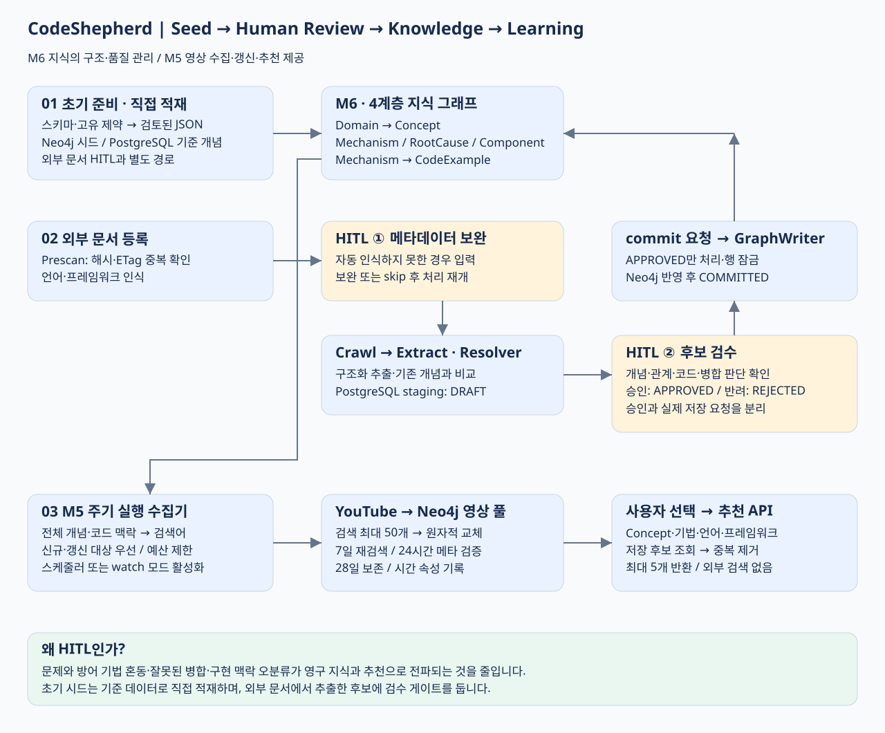
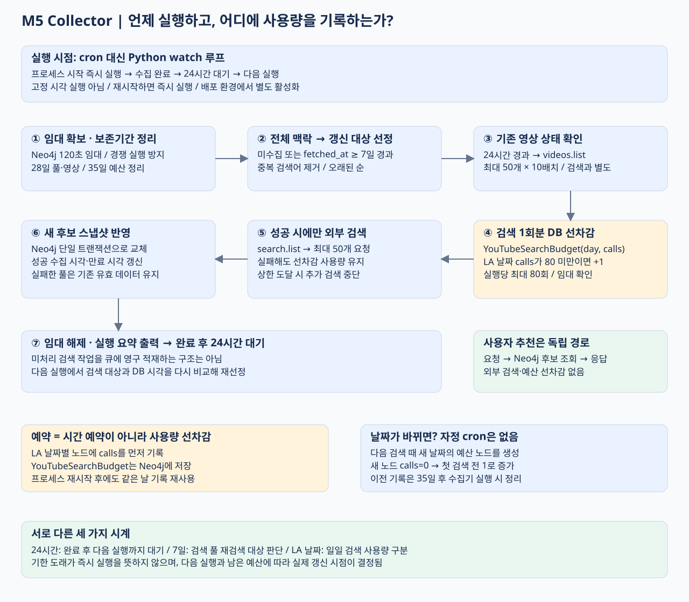

# CodeShepherd · M5/M6 Engineering Portfolio

> 외부 기술 문서를 사람이 검수할 수 있는 지식 그래프로 만들고, 같은 기술 맥락의 영상 추천을 DB 조회로 제공했습니다.

팀은 4명이며 My Role은 **M5 기술 특화 YouTube 추천**과 **M6 온톨로지 기반 지식 그래프 관리**입니다. M6는 지식의 구조와 검수 책임을, M5는 학습 자료 수집·갱신과 추천 제공 책임을 가집니다.

## 한눈에 보는 흐름

- **초기 준비:** 스키마와 검토된 시드로 지식 그래프의 기준 구조를 적재합니다.
- **지식 확장:** 외부 문서에서 추출한 후보는 사람이 검토한 후 별도 반영합니다.
- **학습 연결:** 지식 그래프의 기술 맥락으로 영상을 수집하고, 사용자는 저장된 후보를 조회합니다.

## 프로젝트 배경과 목적

기술 문서에는 문제 개념, 대응 기법, 원인, 코드 예시가 섞여 있습니다. 문서 단위로만 보관하면 서로 다른 자료의 동일 개념을 연결하거나 실제 구현 맥락에 맞는 학습 자료를 찾기 어렵습니다. 이를 관계 중심의 지식으로 구조화하고, 사용자가 선택한 개념·메커니즘·언어·프레임워크를 학습 자료 탐색에 재사용하는 것이 목적입니다.

## 사용 데이터와 4계층 모델

| 구분 | 데이터 | 사용 목적 |
| --- | --- | --- |
| 초기 지식 | security_concepts.json 12개, performance_concepts.json 4개 | 초기 분류와 그래프 탐색 기준 |
| 확장 지식 | 등록한 외부 기술 문서 URL·본문·메타데이터 | 개념·메커니즘·원인·코드 후보 추출 |
| 검수 데이터 | PostgreSQL 문서·세션·staging 상태 | 사람이 검토하고 승인한 결과 추적 |
| 영상 데이터 | YouTube 검색 결과·영상 메타데이터 | Neo4j 후보 풀 저장과 기술 맥락별 추천 |

| 계층 | 역할 | 연결 예 |
| --- | --- | --- |
| L1 Domain | 지식 영역 | security, performance |
| L2 Concept | 문제 또는 기술 개념 | SQLi |
| L3 Mechanism / RootCause / Component | 대응 기법·원인·영향 지점 | parameterized_query |
| L4 CodeExample | 구현 예시와 언어·프레임워크 | python / django |

L3는 병렬 분류입니다. Concept에서 MITIGATED_BY, CAUSED_BY, AFFECTS가 각각 연결되고, Mechanism에서 HAS_EXAMPLE로 코드 예시에 연결됩니다. YouTubeSearchPool과 YouTubeVideo는 M5의 부가 데이터이며 온톨로지의 다섯 번째 계층이 아닙니다. URL은 YouTubeVideo 노드에, 검색별 후보 순서는 HAS_CANDIDATE 관계에 저장합니다.

## 시드 데이터 설정과 초기화

### 두 DB의 역할을 구분한 초기 준비

1. M6의 PostgreSQL schema.sql로 문서·개념 기준·검수 테이블을 준비합니다.
2. seed_neo4j.py가 init_db.cypher의 제약조건·인덱스를 적용합니다.
3. security/performance JSON을 모델 검증한 뒤 키 기반 MERGE로 Domain·Concept·L3·CodeExample과 관계를 적재합니다.
4. seed_postgres.py는 Resolver가 비교할 PostgreSQL 기준 개념과 임베딩을 준비합니다. Neo4j 시드와 별도 단계입니다.
5. M5 수집기가 그래프에 등록된 개념과 코드 맥락에서 검색 대상을 생성해 영상 풀을 적재합니다.

Docker Compose의 neo4j_m6_seed 서비스는 Neo4j 시드 이후 PostgreSQL 시드 명령을 순서대로 실행하도록 구성되어 있습니다. Aura는 클라우드 DB이므로 로컬 Docker 초기화 볼륨을 자동 적용하지 않으며, 해당 접속 환경변수를 사용해 시드 스크립트를 실행해야 합니다.

저장소 루트에서, 루트 .env에 접속 정보가 설정된 경우의 수동 명령:

~~~powershell
uv run --directory backend/m6 --env-file ../../.env python script/seed_neo4j.py
uv run --directory backend/m6 --env-file ../../.env python script/seed_postgres.py
~~~

PostgreSQL 초기 스키마와 각 명령의 의존 서비스가 먼저 준비되어 있어야 합니다. 두 명령은 서로 다른 저장소를 초기화하며 하나의 원자적 작업이 아닙니다.

**Aura 적재 근거:** 2026-11-12 Neo4j 시드를 두 번 실행한 뒤 Concept 16개, Domain 2개, Mechanism 27개, CodeExample 29개, RootCause 16개, Component 37개의 수가 유지됐습니다. 동일 키 재적재에 따른 노드·관계 중복 증가가 없음을 확인했습니다. 초기 시드는 사전 준비된 기준 데이터의 직접 적재이고, 외부 문서의 HITL 승인 경로를 거치지 않습니다.

## [질문1] 엔지니어링 문제들은 어떤 것이 있었는가?

| 문제 | 서비스에 미치는 영향 |
| --- | --- |
| 추천 조회마다 외부 검색 | 동일한 의도로 다시 조회해도 호출을 소비해 일일 제한과 사용자 트래픽이 결합 |
| 추출 결과를 곧바로 지식으로 확정 | 문제와 방어 기법 혼동, 잘못된 병합, 언어·프레임워크 오분류가 그래프와 추천으로 전파 |
| 반복 실행과 동시 처리 | 같은 문서·개념·영상이 중복되거나 여러 worker가 동일 검수·수집 작업을 경쟁 |
| 저장 후 데이터 노후화 | 신규 영상 미반영, 비공개·삭제 영상 노출, 생성 시각만으로는 재수집 시점 판단 불가 |
| 개념별 캐시만 사용 | 동일 개념에서도 메커니즘·언어·프레임워크가 다른 요청의 후보가 섞임 |

## [질문2] 해당 문제들을 어떻게 풀어갔는가?

### 1. YouTube 수집과 사용자 조회 분리

**기존:** 사용자 추천 요청 → YouTube 검색 → 응답.

**개선:** 주기 실행 수집기 → YouTube 검색 → Neo4j 저장 / 사용자 추천 요청 → Neo4j 후보 조회 → 응답.

최종 검색어와 개념 이름으로 SHA-256 풀 키를 만들어 같은 검색 의도를 재사용합니다. 사용자 요청에서는 외부 검색으로 우회하지 않습니다. 저장 후보가 없으면 해당 결과를 생략하며 최대 5개의 서로 다른 영상을 반환합니다. 빈 검색 결과도 성공한 스냅샷으로 저장해 같은 빈 검색을 매 요청마다 반복하지 않습니다.

| 정책 | 기본값과 의미 |
| --- | --- |
| 수집기 실행 간격 | watch 모드 24시간; Compose 프로필 또는 외부 스케줄러 활성화 필요 |
| 검색 풀 재수집 | 마지막 성공 수집 후 7일; 신규·오래된 순 우선 |
| 검색 결과 확보 | search.list 한 번에 최대 50개 요청 |
| 내부 검색 상한 | 실행당 80회 및 DB 공유 일일 80회 |
| 메타데이터 재검증 | 24시간 이상 된 영상, videos.list 최대 50개씩 배치 |
| 보존 상한 | 28일; 만료 데이터 조회 제외와 수집기 정리 |

일일 검사는 매일 모든 검색어를 다시 호출한다는 뜻이 아닙니다. 수집 시점이 지난 풀만 갱신합니다. 검색 예산은 America/Los_Angeles 날짜 기준으로 호출 전에 사용량을 기록하며, 실제 프로젝트 할당량에 맞춰 조정합니다. 검색 대상이 많으면 갱신 작업은 다음 실행으로 이월될 수 있습니다.

### 2. HITL을 지식 확정 전 품질 게이트로 사용

HITL(Human-in-the-loop)은 **자동 추출 결과를 사람이 검토하는 절차**입니다. 사람이 모든 문서를 처음부터 입력하는 대신, 자동 처리 결과에서 중요한 판단을 확인합니다.

| 개입 지점 | 사람이 확인하는 내용 | 필요한 근거 |
| --- | --- | --- |
| 메타데이터 보완 | 자동 인식하지 못한 언어·프레임워크 정보 입력 또는 건너뛰기 | 잘못된 구현 맥락이 추출 결과와 M5 검색어로 전파되는 것을 줄임 |
| DRAFT 후보 검수 | 개념, 대응 기법, 코드 예시, 기존 개념과의 NEW / MERGE / RELATED_TO 판단 확인 | 의미가 비슷해도 다른 개념일 수 있고 방어 기법을 문제 개념으로 추출할 수 있음 |
| 승인 후 반영 요청 | 승인한 후보만 그래프 반영 대상으로 전달 | 검토 결정과 실제 저장 실행을 분리해 반영 범위를 명확히 함 |

**액션 플로우:** URL 등록 → Prescan 중복·메타데이터 확인 → 필요한 경우 사람의 메타데이터 보완 → Crawl → Extract·Resolver → PostgreSQL DRAFT → 승인 또는 반려 → APPROVED 항목의 commit 요청 → GraphWriter → COMMITTED.

승인 API는 DRAFT를 APPROVED로 바꿉니다. **승인 자체가 즉시 Neo4j 저장은 아닙니다.** commit API가 별도로 worker를 요청하고, GraphWriter는 APPROVED 행만 읽어 반영합니다. REJECTED 후보는 이 저장 대상에서 제외됩니다. 진행과 입력 대기는 Redis/SSE로 전달합니다.

Resolver의 유사도 점수는 자동 판단의 근거이며 정답 보증이 아닙니다. 잘못 병합된 지식은 코드 예시와 추천 검색 맥락까지 영향을 주기 때문에, 영구 반영 전에 검수 경계를 둔 것입니다. 이 HITL은 M6 지식 후보 검수이며 YouTube 영상별 수동 승인 기능을 의미하지 않습니다.

### 3. 단계별 멱등성과 동시성 제어

| 구간 | 처리 |
| --- | --- |
| 문서 | 콘텐츠 해시 또는 URL+ETag로 완료 문서 재처리 감소, doc_id upsert |
| 개념 | 이름·별칭 및 의미 유사도 비교 후 해소, 그래프 키 기반 MERGE |
| 검수 | 상태 조건 확인, 단일 승인과 Writer의 FOR UPDATE SKIP LOCKED |
| 코드 예시 | 메커니즘과 공백 정규화 코드 해시로 키 생성 |
| 영상 | video_id와 풀 key 고유 제약, MERGE로 재수집 노드 재사용 |
| 후보 교체 | 풀 시각 갱신과 후보 관계 교체를 한 Neo4j 트랜잭션으로 수행 |
| 수집 경쟁 | DB 락·소유권 검사와 DB 공유 검색 예산 |

이 장치들은 같은 키의 반복 처리와 경쟁을 줄입니다. PostgreSQL과 Neo4j, 외부 API까지 묶인 분산 트랜잭션은 아니므로 전체 exactly-once를 보장한다고 표현하지 않습니다.

### 4. 시간 속성으로 갱신 책임 명확화

| 속성 | 용도 |
| --- | --- |
| created_at | 최초 생성 이력; MERGE 재실행 시 유지 |
| updated_at | 저장·메타데이터 갱신 시각 |
| fetched_at | 마지막 성공 수집 시각; 재수집 판단 기준 |
| expires_at | 검색 풀 만료 시각; 오래된 추천 제외 기준 |

M5 시간은 epoch seconds이며 Cypher datetime 변환으로 표시합니다. M6의 datetime 속성과 표현이 다릅니다. 영상 메타데이터만 갱신해도 검색 풀의 재검색 기준 시각은 연장하지 않습니다.

## 구현 결과와 근거

2026-11-12 Aura에서 SQLi의 개념 선택, parameterized_query 선택, python/django 코드 맥락 선택에 맞춘 요청을 확인했습니다.

| 확인 항목 | 결과 |
| --- | --- |
| 초기 지식 | 16개 개념, 시드 2회 실행 후 노드·관계 수 유지 |
| 영상 저장 | 고유 검색 풀 11개, 고유 영상 139개 |
| 추천 API | 세 시나리오 HTTP 200, 추천 각각 3 / 3 / 5개 |
| DB 재조회 | 확인한 재조회에서 추가 YouTube 검색 0회 |
| 시간 속성 | 영상 139개·풀 11개의 생성·갱신·수집 시각, 풀 만료 시각 확인 |

이는 해당 시점의 적재·API 동작 결과이며 전체 개념의 영상 수집 완료나 추천 정확도·응답 시간 벤치마크를 뜻하지 않습니다. 수집기는 배포 환경에서 별도로 활성화해야 합니다.

## My Role

- **Module 6:** 4계층 지식 모델, 문서 처리·개념 해소, 검수 staging과 승인 후 반영, 반복 처리 방지, SSE 진행 전달.
- **Module 5:** 그래프 맥락 기반 검색어 정책, 영상 DB 모델과 수집·갱신 정책, 예산·동시성 제어, 저장 후보 기반 추천 API.
- **기술 선택:** M5의 고정 조회 흐름과 M6의 Celery + DB 상태·재개 API로 현재 요구를 표현했습니다. LangGraph를 추가하지 않고 상태 관리 책임을 기존 구조에 유지했습니다.

## 상세 산출물

- [Aura 조회 쿼리 안내](M5_M6_AURA_QUERIES.md)
- [복사해서 실행하는 Cypher](M5_M6_AURA_QUERIES.cypher)
- [수집·갱신 상세 설계](M5_VIDEO_COLLECTION.md)
- [실제 적재·API 확인 결과](M5_M6_AURA_VERIFICATION.json)
- [M5 전용 설명](MODULE_5_GRAPH_YOUTUBE_RULE.md)
- [M6 전용 설명](MODULE_6_ONTOLOGY_KNOWLEDGE_GRAPH.md)

구현 근거: backend/m6/script/seed_neo4j.py, script/init_db.cypher, script/seed_postgres.py, app/api/staging.py, app/worker/tasks.py 및 backend/m5/app/video_collection.py, video_store.py, main.py.

## 수집기 실행 시점과 호출 횟수 관리

[정확한 실행 순서·DB 저장·시각화](M5_COLLECTOR_SCHEDULE.md)

