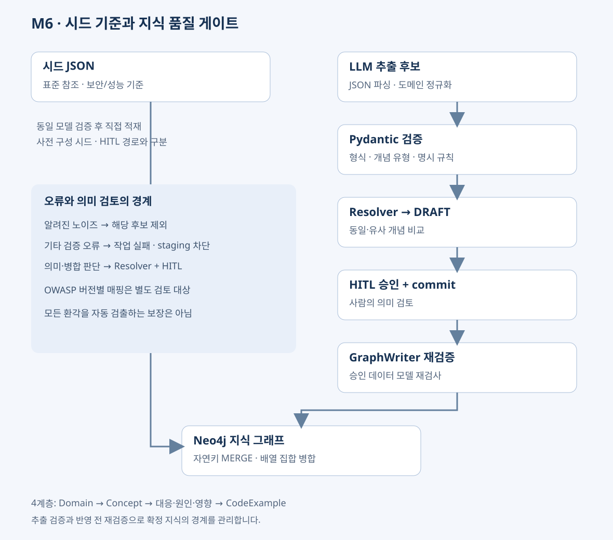

# M6 — 시드 기준과 온톨로지 품질 관리

M6는 보안·성능 지식의 기준 구조를 시드로 준비하고, 외부 문서에서 추출한 후보를 검증·개념 해소·사람 검수 후 그래프에 반영한다. **My Role**은 이 온톨로지 모델과 적재 파이프라인 설계·구현이다.

## 시드 데이터 구성 기준

| 기준 | 설계 의도와 적용 |
| --- | --- |
| OWASP Top 10·CWE | 보안 개념을 공통 분류에 연결하고 취약점 이름의 표기 차이를 줄인다. OWASP 식별자는 버전을 함께 관리한다. |
| Security / Performance | 보안 시드와 성능 시드를 분리하고 동일한 ConceptExtractionSchema로 검증한다. 성능 개념에 OWASP 분류를 강제로 부여하지 않는다. |
| 문제·대응 기법 분리 | 문제는 Concept, 대응 기법은 Mechanism으로 표현해 방어책을 취약점의 별칭으로 혼합하지 않는다. |
| 구현 맥락 | CodeExample에 언어·프레임워크·버전 정보를 저장해 M5의 선택 기반 추천에 재사용한다. |
| 프레임워크 메타데이터 | framework_metadata의 URL 패턴·지원 언어 등으로 문서 맥락을 보완한다. |
| 허용 지식 도메인 | domain_registry 기반 allowed_domains는 security·performance 같은 지식 분류다. URL 호스트 허용 목록을 뜻하지 않는다. |

초기화는 init_db.cypher의 제약조건·인덱스 적용 → Domain 준비 → 보안·성능 JSON 파싱 및 Pydantic 검증 → 키 기반 MERGE → BELONGS_TO 연결 순서다. 시드 직접 적재는 사전 구성한 기준 데이터를 넣는 경로이며, 외부 문서의 DRAFT·HITL 경로와 구분한다. 시드에서 검증·저장에 실패한 항목은 오류를 출력하고 다음 항목을 처리한다.

**표준 버전 검토:** [OWASP 2025 공식 분류](https://top10.owasp.org/2025/)에서 Injection은 A05:2025, Authentication Failures는 A07:2025다. 기존 security_concepts.json에는 SQLi의 A03:2025 등 공식 2025 분류와 다른 값이 남아 있다. 따라서 현재 시드 전체의 표준 매핑이 검증됐다고 주장하지 않는다. 형식 검증과 표준 식별자의 의미 검증은 별개다.

## 4계층 관계 모델

| 계층 | 엔티티 | 관계·역할 |
| --- | --- | --- |
| L1 | Domain | Concept의 domains 배열과 시드의 BELONGS_TO로 분류 |
| L2 | Concept | 핵심 문제·취약점·안티패턴, RELATED_TO로 연관 개념 연결 |
| L3 | Mechanism / RootCause / Component | MITIGATED_BY / CAUSED_BY / AFFECTS로 대응·원인·영향 지점을 병렬 표현 |
| L4 | CodeExample | Mechanism에서 HAS_EXAMPLE로 연결하는 구현 예시 |

추출 프롬프트의 Layer 0~3과 위 L1~L4는 같은 네 계층이다. Property는 스키마 확장 여지가 있으나 현재 merge_concept의 독립 Property 적재 경로로 설명하지 않는다. domains 배열과 Neo4j 도메인 라벨로 한 개념을 여러 분야에서 재사용한다. YouTubeSearchPool·YouTubeVideo는 M5의 부가 데이터이며 다섯 번째 온톨로지 계층이 아니다.

## LLM 결과를 확정 지식으로 바꾸는 품질 게이트

1. **JSON 파싱:** LLM 응답의 JSON 배열을 추출하고 json.loads로 파싱한다. 현재 경로는 PydanticOutputParser를 사용하지 않는다.
2. **도메인 정규화:** allowed_domains에 없는 값을 제거한다. 유효한 값이 없으면 첫 허용 도메인을 사용하므로 올바른 의미 분류를 보증하는 검사는 아니다.
3. **Pydantic v2 검증:** ConceptExtractionSchema의 필드 타입·개념명 패턴과 field_validator의 concept_type 허용값을 검사한다. model_validator는 description_ko의 알려진 레이아웃 문구와 concept 유형의 빈 mechanism을 검사한다.
4. **오류 분기:** 알려진 노이즈 오류는 해당 후보를 제외한다. 그 외 ValidationError는 전파해 추출 작업을 실패 처리하고 해당 결과의 staging 적재를 막는다.
5. **개념 해소:** 이름·별칭 일치 및 Jaro-Winkler·이름 cosine·설명 cosine을 비교해 NEW / MERGE / RELATED_TO 후보를 만든다.
6. **HITL:** PostgreSQL staging_concepts에 DRAFT로 저장한 후 사람이 분류·대응 기법·병합 대상을 확인한다. APPROVED 후 별도 commit 요청으로 GraphWriter를 실행한다.
7. **반영 전 재검증:** GraphWriter가 승인 행의 concept_json을 같은 Pydantic 모델로 다시 검증하고 Neo4j 키 기반 MERGE를 수행한다.

이중 검증은 **추출 후보의 staging 저장 전 검사와 승인 데이터의 그래프 반영 전 재검사**를 뜻한다. 형식·명시된 규칙 위반을 차단하고 의미 오류는 Resolver와 HITL로 보완한다. 모든 환각·노이즈·잘못된 표준 매핑을 자동 검출한다는 의미는 아니다. 빈 코드나 임의의 CWE 문자열까지 모두 거부하는 모델도 아니다.

## 멱등성과 중복 제어

| 대상 | 구현 | 보장 범위 |
| --- | --- | --- |
| Concept 등 | name 자연키와 고유 제약·MERGE | 같은 키의 노드 재사용 |
| 관계 | 양 끝 노드와 관계 유형 기준 MERGE | 같은 관계의 반복 생성 완화 |
| aliases / domains | apoc.coll.toSet | 배열 중복 제거 |
| CodeExample | 메커니즘명 + 공백 정규화 코드의 짧은 MD5 해시를 unq_id로 사용 | 공백 차이로 인한 중복 완화 |
| 의미 중복 | Hybrid Resolver 및 사람 검수 | 유사 개념의 무분별한 생성·병합 완화 |
| 동시 반영 | 승인 상태 조건과 FOR UPDATE SKIP LOCKED | 같은 staging 행의 처리 경쟁 완화 |

CodeExample의 언어·프레임워크 버전은 속성으로 저장하지만 **현재 고유 키에는 포함되지 않는다**. 버전별 독립 노드를 보장한다고 표현하지 않는다. staging 후보는 일반 INSERT이며, 짧은 해시의 충돌 가능성과 PostgreSQL·Neo4j 사이 부분 실패도 남아 있다. 전체 exactly-once·분산 원자성을 달성했다고 주장하지 않는다.

## 엔지니어링 문제와 해결

- **문제:** LLM이 페이지 메뉴를 개념 설명으로 추출하거나 대응 기법을 별개 문제로 생성할 수 있다. **해결:** 규칙 검증, 후보 해소, DRAFT 검수와 반영 전 재검증으로 확정 지식의 경계를 나눴다.
- **문제:** 반복 수집·시드 재실행으로 같은 지식과 배열 원소가 누적될 수 있다. **해결:** 자연키·제약조건·MERGE·집합 병합과 코드 정규화 키를 적용했다.
- **문제:** 의미가 비슷한 개념을 무조건 병합하면 원인·해결책·코드 관계가 잘못 전파된다. **해결:** 이름과 설명을 나눠 비교하고 RELATED_TO와 HITL을 통해 병합 결정을 구분했다.

포트폴리오 표현: “표준 분류를 참조한 시드와 4계층 온톨로지를 설계하고, Pydantic 검증·하이브리드 개념 해소·HITL·키 기반 MERGE를 결합해 비정형 추출 결과의 정형화와 반복 적재 시 중복 제어를 구현했습니다.”

## 구현 근거

- backend/m6/script/seed_neo4j.py · script/init_db.cypher · script/seed/
- backend/m6/app/domain/models.py
- backend/m6/app/worker/tasks.py: _ensure_domains, _validate_concepts, _write_graph_async
- backend/m6/app/adapters/db/neo4j_repo.py
- backend/m6/app/infrastructure/graph/hybrid_resolver.py

## 기술서 핵심 메시지와 청킹 범위

LLM이 생성한 결과를 단순 응답으로 소비하지 않고, 검증·승인·개념 해소를 거쳐 재사용 가능한 지식으로 전환하는 백엔드 시스템을 설계했다. 장시간 실행되는 추출·그래프 반영 작업은 Celery worker로 웹 서버와 분리하고, PostgreSQL의 문서·검수 상태와 Redis 진행 이벤트, 외부 API 호출 제한을 관리한다. PostgreSQL 상태 관리를 워크플로 Checkpointer 구현으로 표현하지 않는다.

M6는 외부 URL의 정제 본문을 제목·문단 경계 우선으로 나눈다. 현재 기본값은 최소 탐색 위치 20,000자, 최대 30,000자, 겹침 2,500자다. 청크 전체를 모델 입력에 전달하며 별도 30,000자 절단은 제거했다. 이는 문자 기준 정책이며 모델별 토큰 한도와 프롬프트·출력 여유까지 자동 계산하는 토큰 예산 제어는 아니다.

청킹 평가는 내용 누락·코드와 설명의 분리·추출 개념 및 관계의 정확성과 재현율·중복 후보·문서당 비용을 기준으로 수행해야 한다. 현재 길이를 품질 평가로 최적화했다고 주장하지 않는다. 대규모 트래픽 처리, API 성공률 향상, LLM 추출 정확도 개선, 자동 복구 완성을 입증할 수치가 없으면 성과로 기재하지 않는다.
