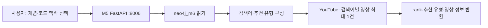

# Module 5 — 기술 맥락 기반 YouTube 추천

Module 5는 **지식 그래프를 읽어 학습 영상을 추천하는 서비스**다. 온톨로지 구축·외부 문서 추출·HITL·그래프 저장은 [Module 6](MODULE_6_ONTOLOGY_KNOWLEDGE_GRAPH.md)이 담당한다. 두 기능을 하나의 Module 5로 묶지 않는다.

## 목적과 책임

개념·대응 기법·언어·프레임워크 선택을 검색 의도로 바꾸어 관련 영상을 찾는다. M5는 FastAPI :8006에서 독립 실행하며, neo4j_m6를 조회하고 YouTube Data API v3를 호출한다. 학습된 추천 모델이나 LangGraph를 사용하지 않는다.

## 아키텍처와 액션 흐름

1. GET /graph/overview, /graph/concept, /graph/mechanism/{mechanism_name}로 탐색한다.
2. POST /youtube/ranked에 concept_name과 선택 맥락을 전달한다.
3. 개념의 CWE·OWASP·영향 컴포넌트와 호출자가 전달한 메커니즘·언어·프레임워크를 조합한다.
4. 언어·프레임워크가 있으면 구현 중심, 없으면 개념·메커니즘·보안 표준 중심으로 최대 5개 검색어를 구성한다.
5. 검색어 중복을 제거하고 순차 검색한 결과를 반환한다.

## 입력·출력·예외

concept_name만 필수다. mechanism_name, code_id, code_lang, code_framework는 선택값이다. code_id를 서버에서 해석해 언어·프레임워크를 찾지는 않는다.

영상 응답에는 rank, recommendation_type, query_used, title, url, thumbnail, channel_title이 포함된다. API 키가 없으면 503, 개념이 없으면 404를 반환한다. 검색 실패는 해당 결과만 생략하므로 0~5개·rank 공백이 가능하며 동일 영상 ID를 중복 제거하지 않는다.

## 책임 경계와 문서

- M5가 소유: 그래프 조회·검색어 정책·YouTube 조회·추천 응답.
- M6가 소유: URL 수집·청킹·추출·개념 해소·검수·Neo4j 쓰기·4계층 온톨로지.
- 공유 데이터: M6가 관리하는 neo4j_m6. M5와 M6 사이의 직접 함수 호출은 없다.
- POST /extract는 호환용 스텁이다. 기존 파일 업로드·Module5Document·Module5State·source_system 고정값·Aura 필수 사용 규칙은 현행 M5 계약이 아니다.
- /youtube/recommend는 현행 라우트가 아니다.

[서비스 실행·설정](../backend/m5/README.md) · [현행 API 계약](MODULE_CONTRACT.md#module-5--기술-맥락-기반-youtube-추천) · [모듈 연결 구조](M5_M6_ARCHITECTURE.md)

이전 통합 설계는 Git 이력에서 확인할 수 있다. 이 문서는 문서 정정이며 런타임 API 변경이 아니다.
