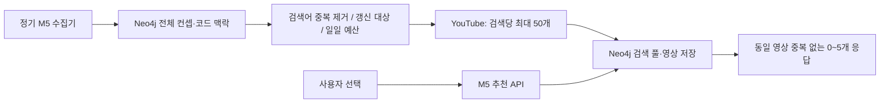

# Module 5 — 기술 맥락 기반 YouTube 추천

Module 5는 **지식 그래프를 기준으로 학습 영상을 수집·저장하고 추천하는 서비스**다. 외부 문서 추출·HITL·4계층 온톨로지 관리는 [Module 6](MODULE_6_ONTOLOGY_KNOWLEDGE_GRAPH.md)의 책임이다.

## 목적과 책임

M5 API(:8006)는 컨셉·메커니즘·언어·프레임워크를 검색 의도로 변환해 Neo4j의 저장 후보에서 0~5개를 추천한다. 사용자 요청에서는 YouTube를 호출하지 않는다. 별도 M5 수집 명령이 전체 컨셉과 등록 코드 맥락을 순회하며 영상을 갱신한다. LangGraph나 학습 기반 추천 모델은 사용하지 않는다.

## 아키텍처 / 액션 플로우

## 계약과 예외

- POST /youtube/ranked: concept_name 필수; mechanism_name, code_id, code_lang, code_framework 선택. code_id를 서버에서 역조회하지 않는다.
- 응답 필드는 concept_name, videos이며 각 영상은 rank, recommendation_type, query_used, title, url, thumbnail, channel_title을 포함한다.
- 저장 후보를 읽으므로 추천에 API 키는 필요하지 않다. 개념이 없으면 404, Neo4j 연결·인증 장애는 503이다.
- 미수집·만료·지원하지 않는 코드 맥락은 빈 배열 또는 일부 결과다. 실시간 외부 검색으로 보충하지 않는다. 의도별 rank는 유지한다.
- GET /graph/overview, /graph/concept, /graph/mechanism/{mechanism_name} 탐색 계약은 유지한다.
- POST /extract는 accepted 호환 스텁이다. /youtube/recommend와 Module5Document/Module5State는 현행 계약이 아니다.

## 저장·갱신

M5는 기존 neo4j_m6의 Concept에 YouTubeSearchPool과 YouTubeVideo를 연결한다. PostgreSQL·Redis에 영상 데이터를 복제하지 않는다. 고유 제약·MERGE·원자적 풀 교체·임대·영속 일일 예산을 사용한다. 기본 검색 갱신 7일, 일일 검색 80회, 24시간 이상 된 영상의 상태 검증, 28일 보존 정리를 제공한다. 매일 실행은 선택형 Compose 수집기나 외부 스케줄러로 켠다.

영상 노드·관계 쓰기는 M5 책임이며 M6의 문서·온톨로지 쓰기와 구분한다. 공유 DB를 사용하되 M5↔M6 직접 Python import는 없다.

[수집 설계·멱등성·운영 제약](M5_VIDEO_COLLECTION.md) · [실행·테스트](../backend/m5/README.md) · [API 계약](MODULE_CONTRACT.md#module-5--기술-맥락-기반-youtube-추천) · [연결 아키텍처](M5_M6_ARCHITECTURE.md)

## M5·M6 포트폴리오 산출물

[시드·HITL·엔지니어링 문제와 해결](M5_YOUTUBE_ENGINEERING_PORTFOLIO.md) · [Aura 조회 쿼리](M5_M6_AURA_QUERIES.md)
