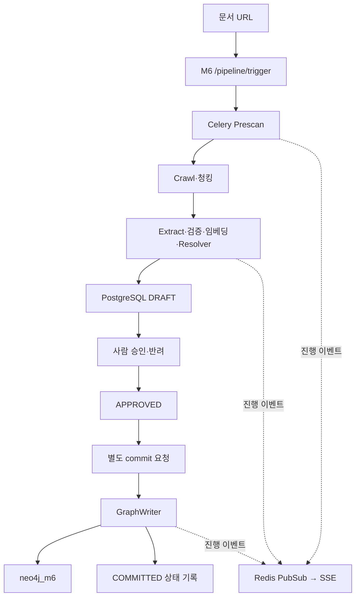
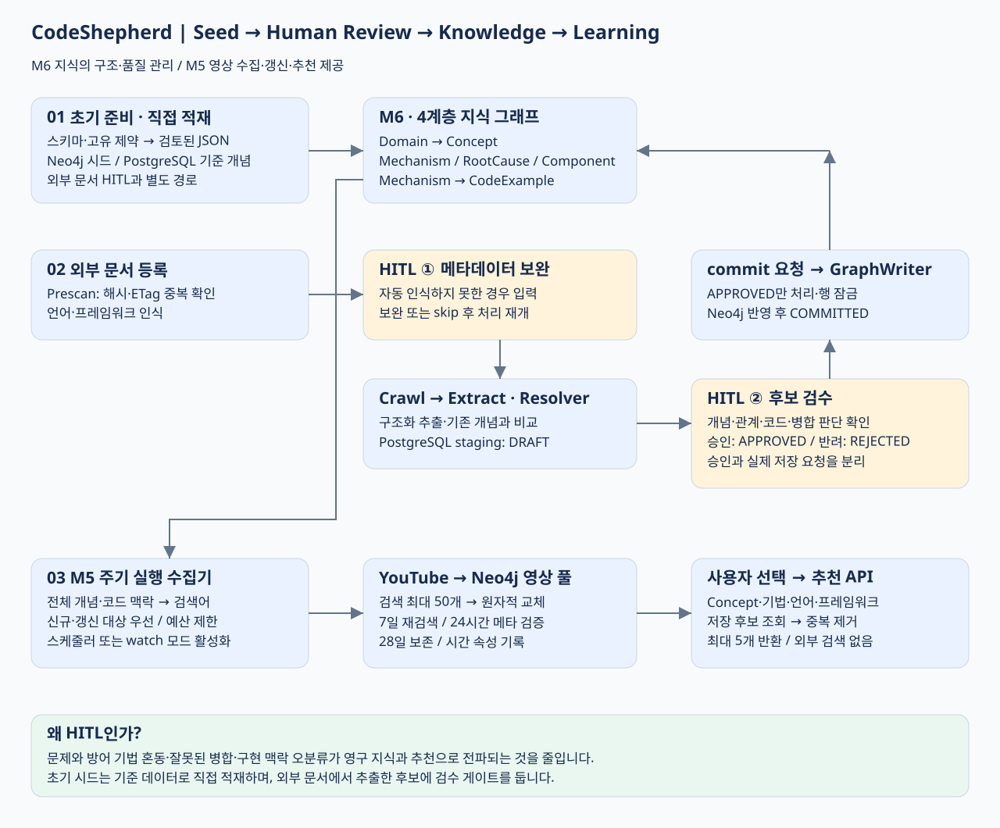

# Module 6 — 온톨로지 기반 지식 그래프 관리

Module 6는 **외부 기술 문서를 검수 가능한 지식 그래프로 구축·관리하는 서비스**다. [Module 5](MODULE_5_GRAPH_YOUTUBE_RULE.md)는 이 그래프를 조회해 YouTube 영상을 추천하는 별도 모듈이다.

## 목적과 책임

외부 URL 수집, 구조적 청킹, LLM 개념 추출·검증, 기존 개념과의 해소, 사람의 검수, Neo4j 반영을 담당한다. FastAPI :8007, Celery m6_graph queue, Redis, PostgreSQL/pgvector, Neo4j/APOC로 구성한다. 고정된 처리 순서와 명시적인 승인·재개 API를 사용하며 LangGraph는 사용하지 않는다.

## 아키텍처와 액션 흐름

Prescan·Crawl·Extract는 최초 chain이며 Resolver는 Extract 내부다. 메타데이터가 부족하면 입력 후 resume API로 crawl→extract를 제출한다. GraphWriter는 자동으로 chain에 연결되지 않으며 승인 이후 별도 commit 요청으로 시작한다.

## 4계층 온톨로지

| 계층 | 데이터 | 의미 |
| --- | --- | --- |
| L1 | Domain | security·performance 등 분야 |
| L2 | Concept | 문제·취약점·안티패턴 |
| L3 | Mechanism / RootCause / Component | 대응 기법 / 발생 원인 / 영향 지점 |
| L4 | CodeExample | 메커니즘에 연결된 코드·언어·프레임워크 |

관계는 MITIGATED_BY, CAUSED_BY, AFFECTS, HAS_EXAMPLE, RELATED_TO를 사용한다. L3는 병렬 분류다. topology는 domains 속성으로 Domain을 합성하며 시드의 Concept→Domain 저장 방향과 응답의 Domain→Concept 방향은 다르다. domain_registry는 분류 메타데이터이며 다섯 번째 지식 계층이 아니다.

## 개념 해소와 HITL

이름·별칭을 정규화해 정확 매칭을 먼저 적용한다. 의미 비교에서 이름·설명 cosine이 각각 0.8 이상이면 MERGE, 그 외 0.4×Jaro-Winkler + 0.3×이름 cosine + 0.3×설명 cosine이 0.72 이상이면 RELATED_TO, 나머지는 NEW다. 현재 비활성화되지 않은 PostgreSQL concepts 전체를 비교하며 Top-K 검색을 사용하지 않는다.

추출 결과는 DRAFT로 저장하고 승인·반려한다. GraphWriter는 APPROVED만 처리한다. 방어책 명칭으로 분류한 RELATED_TO 후보를 Mechanism으로 이관하는 분기도 있다.

## 중복 방지·멱등성의 범위

- 콘텐츠 해시 또는 URL+ETag로 기존 COMMITTED 문서를 찾으면 건너뛴다.
- 문서 레코드는 doc_id 기준 ON CONFLICT로 갱신한다.
- 단일 승인·GraphWriter의 상태 확인과 FOR UPDATE SKIP LOCKED로 동시 처리 경쟁을 줄인다.
- Neo4j 노드·관계는 MERGE하며 별칭·도메인을 보강한다.
- CodeExample은 메커니즘명 + 공백 정규화 코드의 MD5 앞 8자리 키를 재사용한다.
- 개념 시드는 concept_name 기준 upsert하며 누적 별칭을 보존해 임베딩을 갱신한다.

문서·코드의 짧은 해시는 충돌 가능성이 있다. staging은 일반 INSERT이고, 신규 개념의 PostgreSQL 마스터 동기화는 미완결이다. PostgreSQL 상태·별칭 벡터·Neo4j 쓰기는 하나의 분산 트랜잭션이 아니다. 따라서 전체 멱등성·exactly-once·DB 간 원자적 커밋을 보장한다고 표현하지 않는다.

## 사용 데이터·API·실행

시드 입력은 security 12개 + performance 4개다. 2026-11-12 Aura에서 Concept 16개를 확인했고 두 번 적재 후 노드·관계 수가 유지됐다. 문서 추출은 Gemini, 개념 해소는 로컬 BGE-M3 1024차원 벡터를 사용하는 구조다. [시드·HITL 전체 흐름과 설계 근거](M5_YOUTUBE_ENGINEERING_PORTFOLIO.md)를 참고한다.

[실행·설정·시드·API 목록](../backend/m6/README.md) · [현행 API 계약](MODULE_CONTRACT.md#module-6--온톨로지-기반-지식-그래프-관리)

M6는 영상 검색 API를 소유하지 않는다. M5는 M6의 Python 코드나 내부 태스크를 호출하지 않고 공유 그래프를 조회한다.

## M5 영상 리소스와의 경계

M5 수집기는 같은 Neo4j의 Concept에 YouTubeSearchPool·YouTubeVideo를 연결하지만 이 리소스는 M6의 L1~L4 온톨로지에 포함하지 않는다. M6는 영상 수집을 호출하거나 영상 데이터를 PostgreSQL에 복제하지 않는다. 영상의 갱신·보존·할당량은 [M5 수집 설계](M5_VIDEO_COLLECTION.md)를 따른다.

## 시드·HITL·영상 DB 갱신 산출물

[엔지니어링 문제와 해결](M5_YOUTUBE_ENGINEERING_PORTFOLIO.md) · [Aura 조회 쿼리](M5_M6_AURA_QUERIES.md)

### Ontology Design · 모델을 나눈 이유와 활용

단순히 문서와 키워드를 연결하는 대신 **문제·원인·영향 지점·대응 기법·코드 구현을 다른 유형으로 구분**했습니다. 그래프 DB는 저장 수단이고, 온톨로지는 각 유형과 관계의 의미를 일관되게 정의하는 기준입니다.

| 설계 판단 | 이유와 활용 |
| --- | --- |
| Concept와 Mechanism 분리 | SQLi라는 문제와 parameterized_query라는 대응 기법을 동일 개념으로 병합하지 않기 위함 |
| L3 병렬 구조 | 원인·영향·해결책은 서로 다른 질문에 답하므로 한 단계의 선형 목록으로 취급하지 않음 |
| CodeExample 별도 노드 | 같은 기법을 언어·프레임워크별 구현으로 구체화하고 M5 검색 맥락에 재사용 |
| 별칭과 Resolver | 표기 차이를 흡수하되 의미가 가까운 다른 개념은 RELATED_TO로 분리 |
| HITL과 명시적 commit | 자동 추출·해소 판단을 영구 그래프에 바로 확정하지 않도록 통제 |

**모델이 답하도록 만든 질문(Competency Questions)**

- SQLi는 어떤 도메인에 속하며 원인과 영향 컴포넌트는 무엇인가?
- 어떤 메커니즘이 해당 문제를 완화하고, 그 메커니즘에 어떤 코드 예시가 연결되는가?
- 선택한 언어·프레임워크 맥락에서 어떤 저장 영상 후보를 추천할 수 있는가?

현재 구현은 타입·관계 모델과 규칙 기반 개념 해소를 사용하는 애플리케이션 지식 그래프입니다. OWL/RDFS 추론 엔진이나 논리적 완전성을 구현한 성과로 표현하지 않습니다. 신규 지식은 DRAFT 검수 후 추가·병합·연관으로 반영하며, 개념 변경 후 M5 검색 대상은 다음 수집 실행에서 다시 계산합니다.

**품질 근거와 후속 평가:** 현재 근거는 스키마 제약, 구조화 모델 검증, HITL 상태 전이, 시드 재실행 시 개수 유지 및 그래프 조회입니다. 개념 해소 정확도·병합 오류율·관계 완전성은 별도의 정답 데이터로 평가해야 하므로 측정 성과로 기재하지 않습니다. 주장 단위 출처 추적·온톨로지 버전/변경 이력·롤백은 향후 관리 강화를 위한 과제로 구분합니다.
