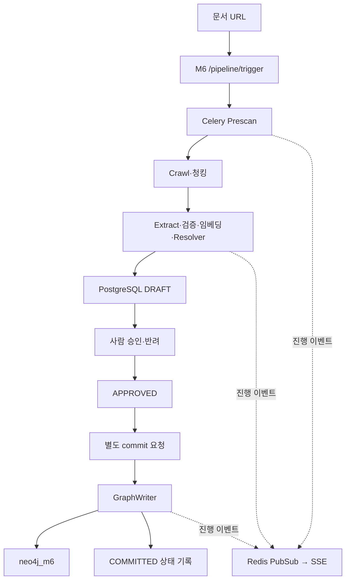

# Module 6 — 온톨로지 기반 지식 그래프 관리

Module 6는 **외부 기술 문서를 검수 가능한 지식 그래프로 구축·관리하는 서비스**다. [Module 5](MODULE_5_GRAPH_YOUTUBE_RULE.md)는 이 그래프를 조회해 YouTube 영상을 추천하는 별도 모듈이다.

## 목적과 책임

외부 URL 수집, 구조적 청킹, LLM 개념 추출·검증, 기존 개념과의 해소, 사람의 검수, Neo4j 반영을 담당한다. FastAPI :8007, Celery m6_graph queue, Redis, PostgreSQL/pgvector, Neo4j/APOC로 구성한다. 고정된 처리 순서와 명시적인 승인·재개 API를 사용하며 LangGraph는 사용하지 않는다.

## 아키텍처와 액션 흐름

Prescan·Crawl·Extract는 최초 chain이며 Resolver는 Extract 내부다. 메타데이터가 부족하면 입력 후 resume API로 crawl→extract를 제출한다. GraphWriter는 자동으로 chain에 연결되지 않으며 승인 이후 별도 commit 요청으로 시작한다.

## 4계층 온톨로지

| 계층 | 데이터 | 의미 |
| --- | --- | --- |
| L1 | Domain | security·performance 등 분야 |
| L2 | Concept | 문제·취약점·안티패턴 |
| L3 | Mechanism / RootCause / Component | 대응 기법 / 발생 원인 / 영향 지점 |
| L4 | CodeExample | 메커니즘에 연결된 코드·언어·프레임워크 |

관계는 MITIGATED_BY, CAUSED_BY, AFFECTS, HAS_EXAMPLE, RELATED_TO를 사용한다. L3는 병렬 분류다. topology는 domains 속성으로 Domain을 합성하며 시드의 Concept→Domain 저장 방향과 응답의 Domain→Concept 방향은 다르다. domain_registry는 분류 메타데이터이며 다섯 번째 지식 계층이 아니다.

## 개념 해소와 HITL

이름·별칭을 정규화해 정확 매칭을 먼저 적용한다. 의미 비교에서 이름·설명 cosine이 각각 0.8 이상이면 MERGE, 그 외 0.4×Jaro-Winkler + 0.3×이름 cosine + 0.3×설명 cosine이 0.72 이상이면 RELATED_TO, 나머지는 NEW다. 현재 비활성화되지 않은 PostgreSQL concepts 전체를 비교하며 Top-K 검색을 사용하지 않는다.

추출 결과는 DRAFT로 저장하고 승인·반려한다. GraphWriter는 APPROVED만 처리한다. 방어책 명칭으로 분류한 RELATED_TO 후보를 Mechanism으로 이관하는 분기도 있다.

## 중복 방지·멱등성의 범위

- 콘텐츠 해시 또는 URL+ETag로 기존 COMMITTED 문서를 찾으면 건너뛴다.
- 문서 레코드는 doc_id 기준 ON CONFLICT로 갱신한다.
- 단일 승인·GraphWriter의 상태 확인과 FOR UPDATE SKIP LOCKED로 동시 처리 경쟁을 줄인다.
- Neo4j 노드·관계는 MERGE하며 별칭·도메인을 보강한다.
- CodeExample은 메커니즘명 + 공백 정규화 코드의 MD5 앞 8자리 키를 재사용한다.
- 개념 시드는 concept_name 기준 upsert하며 누적 별칭을 보존해 임베딩을 갱신한다.

문서·코드의 짧은 해시는 충돌 가능성이 있다. staging은 일반 INSERT이고, 신규 개념의 PostgreSQL 마스터 동기화는 미완결이다. PostgreSQL 상태·별칭 벡터·Neo4j 쓰기는 하나의 분산 트랜잭션이 아니다. 따라서 전체 멱등성·exactly-once·DB 간 원자적 커밋을 보장한다고 표현하지 않는다.

## 사용 데이터·API·실행

현재 시드 입력은 security 12개 + performance 4개다. 이는 DB 실측 규모가 아니다. 실제 모드는 Gemini와 로컬 BGE-M3 1024차원 벡터를 사용한다. 기본 mock 동작과 청크 절단 등의 제약은 [상세 구현 근거](M5_M6_ARCHITECTURE.md)를 확인한다.

[실행·설정·시드·API 목록](../backend/m6/README.md) · [현행 API 계약](MODULE_CONTRACT.md#module-6--온톨로지-기반-지식-그래프-관리)

M6는 영상 검색 API를 소유하지 않는다. M5는 M6의 Python 코드나 내부 태스크를 호출하지 않고 공유 그래프를 조회한다.
