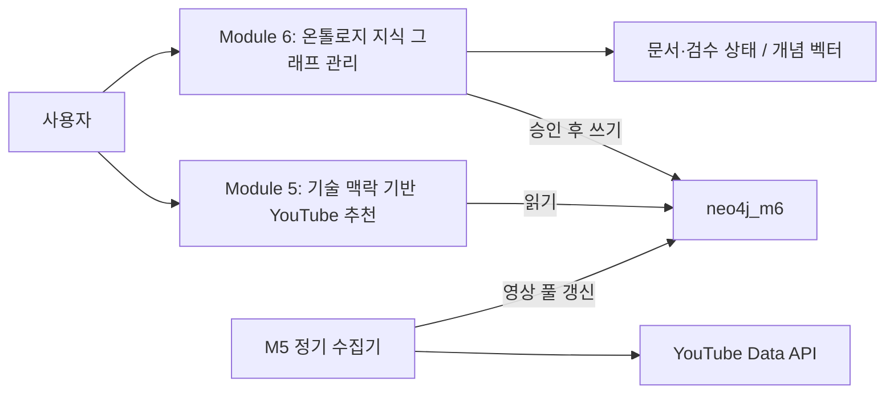

# MODULE_CONTRACT.md — 모듈별 입출력 계약

**버전**: v1.0 | **작성일**: 2026-06-04  
> 문서 정정: M5·M6는 현재 HTTP API 기준으로 각각 분리했습니다. M0~M4 본문은 초기 설계로, 모든 현행 실행과 일치한다는 보장은 없습니다. 이번 수정은 런타임 API 변경이 아닙니다.

---

## 계약 읽는 법

각 모듈 계약에서:
- **input**: 이 모듈이 받기를 기대하는 State 필드
- **output**: 이 모듈이 반환하는 State 필드 (기존 필드에 추가/갱신)
- **required_state_fields**: 이 모듈 실행 전 반드시 채워져 있어야 하는 필드
- **uses_kms**: Module 0 pgVector 검색을 호출하는지 여부

---

## Module 0 — KMS 사내 지식 파이프라인

```yaml
module_id:    module_0_kms
module_name:  KMS 사내 지식 파이프라인
responsibility: >
  사내 문서(PDF/DOCX/PPTX/TXT)를 Markdown으로 변환하고
  청킹·메타데이터 추출 후 pgVector/PostgreSQL/GraphDB에 저장한다.
  다른 모듈의 KMS 검색 소스를 생성하는 역할.

input:
  - file: multipart/form-data
  - source: "upload | notion | confluence | slack"
  - uploaded_by: str (user_id)

output:
  - doc_id: str (UUID)
  - status: "stored | hitl_pending | failed"
  - quality_score: float
  - chunk_count: int
  - trace_id: str (trc_000{stage}_{doc_id_8hex})

required_state_fields: []   # 독립 파이프라인, PlatformState 불사용

uses_kms: false             # 자체가 KMS 소스
uses_langsmith: true

validation_rule:
  - Stage 2: quality_score >= 0.8 (미달 시 HITL)
  - Stage 4: chunk 길이 100~1500 토큰 (초과 시 HITL)
  - Stage 5b: 메타데이터 필수 필드 존재 여부 검증

retry_rule:
  - Stage 2: max 2회 (STAGE2_MAX_FIX_ATTEMPTS env)
  - Stage 1: Upstage 실패 시 Gemini Multimodal 폴백 1회
  - 그 외 Stage: 재시도 없음 → HITL

error_rule:
  - quality_score < 0.8: HITL 큐 등록
  - 표/이미지 구조 손실: HITL 큐 등록
  - Parent-Child 연결 실패: HITL 큐 등록
  - DB 저장 실패: status=failed, agent_traces 기록
```

**Stage별 Trace ID:**
```
Stage 1: trc_0001_{doc_id_8hex}
Stage 2: trc_0002_{doc_id_8hex}
Stage 3: trc_0003_{doc_id_8hex}
Stage 4: trc_0004_{doc_id_8hex}
Stage 5: trc_0005_{doc_id_8hex}
Stage 6: trc_0006_{doc_id_8hex}
```

---

## Module 1 — 오케스트레이터

```yaml
module_id:    module_1_orchestrator
module_name:  오케스트레이터
responsibility: >
  GitHub Webhook을 수신하고 요청 유형을 분류한 뒤
  Module 2/3을 병렬 호출하고 결과를 취합하여 Module 4로 전달.
  KMS 컨텍스트 검색(pgVector)도 담당.

input:
  # GitHub Webhook 페이로드
  - X-Hub-Signature-256: str (HMAC-SHA256 서명, 없으면 403)
  - payload:
      action: str
      pull_request:
        number: int
        diff_url: str
        user.login: str
      repository.full_name: str

output:  # PlatformState 초기화
  - task_id: str (UUID, 신규 생성)
  - trace_id: str (pr_{12자리 hex}, 신규 생성)
  - request_type: RequestType
  - module_id: "module_1"
  - developer: DeveloperInfo (users 테이블 조회)
  - pr_context: PRContext
  - kms_context: KMSContext (pgVector 검색 결과)
  - analysis_results: []  # 초기값 빈 리스트
  - issues: []
  - retry_count: 0
  - status: "running"

required_state_fields: []  # 최초 진입점, State 초기화 담당

uses_kms: true             # pgVector 코사인 유사도 검색
uses_langsmith: true

validation_rule:
  - GitHub Webhook HMAC-SHA256 서명 검증 (X-Hub-Signature-256)
  - users 테이블에 user_id 존재 여부 (없으면 skill_level="junior" 기본값)
  - request_type 분류 결과 유효성 확인

retry_rule:
  - KMS 검색 0건: 빈 리스트 반환, 오류 없이 진행
  - GitHub API 429: 60초 대기 후 1회 재시도
  - 의도 분류 실패: "pr_review" 기본값으로 진행

error_rule:
  - X-Hub-Signature-256 없음: 403 즉시 반환
  - GitHub API 401/403: Slack 에스컬레이션 + status=fail
  - user_id 없음: skill_level="junior" 기본값, 경고 로그
```

**라우팅 로직:**
```python
def route(state: PlatformState) -> str:
    if state["request_type"] == RequestType.PR_REVIEW:
        return "parallel_analysis"    # Module 2 + 3 동시 실행
    elif state["request_type"] == RequestType.KMS_QUERY:
        return "kms_chat"             # Module 0 Chat API
    return "end"
```

---

## Module 2 — 정적 분석 + 보안 분석

```yaml
module_id:    module_2_static_security
module_name:  정적 분석 + 보안 분석
responsibility: >
  PR diff를 정적 분석(ESLint/Pylint/순환복잡도)하고
  보안 취약점(SQL Injection/XSS/CSRF/CVE)을 탐지한다.
  Module 1에서 asyncio.gather로 Module 3과 병렬 실행.

input:  # PlatformState에서 읽기
  - task_id: str
  - trace_id: str
  - pr_context.pr_diff: str       (분석 대상)
  - kms_context: KMSContext        (코딩 컨벤션, 이전 이슈 참조)
  - developer.skill_level: str     (피드백 수준 조정)

output:  # PlatformState에 추가
  - analysis_results: [AgentResult]   (기존 목록에 추가)
  - issues: [IssueItem]               (기존 목록에 추가)
  - module_id: "module_2"
  - status: AgentStatus

# Output Contract (AgentResult 형식)
agent_result:
  task_id: str
  trace_id: str
  agent_name: "StaticAnalysisAgent | SecurityScanAgent"
  module_id: "module_2"
  status: "success | fail | hitl_pending"
  issues:
    - severity: "Critical | Major | Minor"
      line: int
      file: str
      message: str
      rule_id: str     # 예: "SEC-001", "PERF-001", "STYLE-001"
      suggestion: str
  summary:
    critical: int
    major: int
    minor: int
  validation_result: "pass | fail | skip"
  execution_ms: int
  next_agent: null

required_state_fields:
  - task_id
  - trace_id
  - pr_context

uses_kms: true      # KMS에서 보안 가이드, 코딩 컨벤션 chunk 조회
uses_langsmith: true

validation_rule:
  - 1차: AgentResult Pydantic 검증
  - 2차: execution_ms > 0, issues 목록 타입 검증
  - 3차: rule_id 형식 확인 (예: "SEC-001")

retry_rule:
  - 타임아웃(30초): make_timeout_result() 반환, agent_traces status=fail
  - LLM JSON 파싱 실패: 1회 재시도 후 {"issues": [], "error": "parse_failed"}
  - 그 외: 재시도 없음

error_rule:
  - 타임아웃: 빈 AgentResult 반환 (파이프라인 중단 없음)
  - 분석 실패: status=fail + error_message 기록, Module 4에 빈 결과 전달
```

**Sub-trace ID 패턴:**
```
pr_{12자리 hex}_static_analysis_{4자리 hex}
pr_{12자리 hex}_security_scan_{4자리 hex}
```

---

## Module 3 — 테스트 검증 + 성능 분석

```yaml
module_id:    module_3_test_performance
module_name:  테스트 검증 + 성능 분석
responsibility: >
  테스트 커버리지 분석(80% 미달 시 Major)과
  N+1 쿼리, 시간복잡도 이슈를 탐지한다.
  Module 2와 asyncio.gather로 병렬 실행.

input:  # Module 2와 동일 구조
  - task_id: str
  - trace_id: str
  - pr_context.pr_diff: str
  - kms_context: KMSContext
  - developer.skill_level: str

output:  # Module 2와 동일 패턴
  - analysis_results: [AgentResult]   (기존 목록에 추가)
  - issues: [IssueItem]               (기존 목록에 추가)
  - module_id: "module_3"
  - status: AgentStatus

# Output Contract (AgentResult 형식)
agent_result:
  agent_name: "TestVerificationAgent | PerformanceAgent"
  module_id: "module_3"
  # 나머지 필드는 Module 2와 동일 구조

required_state_fields:
  - task_id
  - trace_id
  - pr_context

uses_kms: true       # KMS에서 테스트 가이드, 성능 패턴 chunk 조회
uses_langsmith: true

validation_rule:
  - 1차: AgentResult Pydantic 검증
  - 2차: 커버리지 수치 0~100 범위 확인
  - 3차: N+1 감지 근거 라인 번호 존재 여부

retry_rule:  # Module 2와 동일
  - 타임아웃(30초): make_timeout_result() 반환
  - LLM JSON 파싱 실패: 1회 재시도

error_rule:  # Module 2와 동일
  - 타임아웃: 빈 AgentResult 반환
  - 분석 실패: status=fail + error_message 기록
```

---

## Module 4 — 커리큘럼 에이전트

```yaml
module_id:    module_4_curriculum
module_name:  커리큘럼 에이전트 (Evaluator + Feedback Loop)
responsibility: >
  Module 2/3 결과를 취합하여 3-Way 판정(lgtm/rework/escalate)을 내리고
  GitHub 코멘트 작성, Slack 에스컬레이션, 커리큘럼 생성을 수행한다.
  반복 실수 패턴을 감지하여 pr_reviews에 기록하고 학습 자료를 추천한다.

input:  # PlatformState에서 읽기
  - task_id: str
  - trace_id: str
  - analysis_results: List[AgentResult]   (Module 2/3 결과 목록)
  - issues: List[IssueItem]               (전체 이슈 목록)
  - developer: DeveloperInfo              (학습 추천 개인화)
  - kms_context: KMSContext               (이전 PR 이슈 참조)

output:
  - verdict: "lgtm | rework | escalate"
  - comment_body: str                     (GitHub 코멘트 마크다운)
  - learning_resources: List[dict]        (학습 자료 목록)
  - onboarding_update: dict               (pr_reviews 갱신 데이터)
  - escalation:
      required: bool
      slack_channel: str | null
      message: str | null
  - module_id: "module_4"
  - status: AgentStatus
  - next_agent: null

# 판정 로직 (고정 규칙, LLM 임의 변경 금지)
verdict_rule:
  - analysis_results.summary.critical >= 1  →  escalate
  - analysis_results.summary.major >= 3     →  rework
  - 나머지                                   →  lgtm

required_state_fields:
  - task_id
  - trace_id
  - analysis_results
  - developer

uses_kms: true       # 학습 자료 chunk 조회, 이전 PR 이슈 패턴 검색
uses_langsmith: true

validation_rule:
  - 1차: verdict 값이 "lgtm | rework | escalate" 중 하나인지 확인
  - 2차: Critical >= 1인데 verdict != "escalate"이면 강제 수정
  - 3차: comment_body 마크다운 형식 최소 검증 (빈 문자열 금지)

retry_rule:
  - LLM 코멘트 생성 실패: 기본 템플릿으로 대체 (재시도 없음)
  - Slack 알림 실패: 로그만 남기고 계속 진행
  - GitHub 코멘트 작성 429: 60초 대기 후 1회 재시도

error_rule:
  - GitHub API 401/403: Slack 에스컬레이션 + status=fail
  - Slack 알림 실패: 경고 로그만, 파이프라인 중단 없음
  - pr_reviews INSERT 실패: 경고 로그, 계속 진행 (비필수 기록)

# 자동 머지 절대 금지
auto_merge: false    # 시니어 최종 승인은 항상 사람이 한다
```

**→ Frontend / GitHub / Slack 출력 형식:**
```json
{
  "task_id": "uuid",
  "pr_id": "42",
  "verdict": "lgtm | rework | escalate",
  "comment_body": "## 코드 리뷰 결과\n...",
  "learning_resources": [
    { "title": "N+1 쿼리 방지 가이드", "url": "notion://..." }
  ],
  "escalation": {
    "required": true,
    "slack_channel": "#team-security",
    "message": "Critical: SQL 인젝션 발견 — PR #42"
  },
  "onboarding_update": {
    "issue_pattern": "N+1 쿼리",
    "occurrence_count": 3
  }
}
```

---

## Module 5 — 기술 맥락 기반 YouTube 추천

**실행 서비스:** backend/m5 · FastAPI :8006. 문서 수집·개념 추출·검수·온톨로지 쓰기는 Module 6의 책임이다. M5 추천 API는 neo4j_m6의 저장 후보만 읽으며, 별도 M5 수집기가 영상 노드·검색 풀을 갱신한다. PlatformState나 LangGraph를 사용하지 않는다.

| 메서드 | 경로 | 입력·출력 / 동작 |
| --- | --- | --- |
| GET | `/health` | 서비스 응답 |
| GET | `/graph/overview` | Concept·Mechanism·Domain 요약 |
| GET | `/graph/concept` | query keyword 필수; 개념·연결 정보. 없으면 404 |
| GET | `/graph/mechanism/{mechanism_name}` | 메커니즘·코드 예시. 없으면 404 |
| POST | `/youtube/ranked` | 아래 요청 → concept_name과 videos 배열 |
| POST | `/extract` | 호환용 스텁. 추출·저장 작업을 실행하지 않음 |

```json
{
  "concept_name": "CsrfAttack",
  "mechanism_name": null,
  "code_id": null,
  "code_lang": "Python",
  "code_framework": "Django"
}
```

concept_name만 필수이며 나머지는 선택값이다. code_id는 현재 처리에 사용하지 않는다. 영상 항목은 rank, recommendation_type, query_used, title, url, thumbnail, channel_title을 포함한다. 추천용 검색어는 최대 5개이며 검색 풀마다 저장된 첫 미선택 영상을 최대 1개 선택한다. 규칙 기반 우선순위이며 영상 ID는 응답에서 중복 제거한다. 추천 요청은 YouTube API를 호출하지 않고 API 키도 필요하지 않다. 개념이 없으면 404, Neo4j 연결·인증 장애는 503이다. 미수집·만료·미등록 맥락은 생략하므로 결과 0~5개·rank 공백이 가능하다. 수집은 [별도 CLI](M5_VIDEO_COLLECTION.md)로 수행하며 공개 수집 HTTP 엔드포인트를 추가하지 않는다.

`/youtube/recommend`와 파일 업로드 기반 Module5State는 현행 API 계약이 아니다. 상세 정책은 [Module 5 전용 문서](MODULE_5_GRAPH_YOUTUBE_RULE.md), 실행·모델은 [M5 README](../backend/m5/README.md)와 [schemas.py](../backend/m5/app/schemas.py)를 따른다.

---

## Module 6 — 온톨로지 기반 지식 그래프 관리

**실행 서비스:** backend/m6 · FastAPI :8007 + Celery worker(queue m6_graph). 외부 URL을 수집·청킹하고 개념을 추출·해소한 후 HITL 승인 항목을 Neo4j에 반영한다. M5의 YouTube 검색을 실행하지 않으며 PlatformState나 LangGraph를 사용하지 않는다.

| 메서드 | 경로 | 입력·출력 / 동작 |
| --- | --- | --- |
| GET | `/health` | 서비스 응답 |
| POST | `/pipeline/trigger` | {doc_id: HTTP(S) URL} → 202, session_id·message |
| GET | `/pipeline/stream/{session_id}` | 세션별 Redis PubSub 이벤트를 SSE로 전달 |
| POST | `/documents/check-duplicate` | {url} → is_duplicate·doc_id. 최신 미배제 문서가 COMMITTED인지 확인 |
| POST | `/documents/metadata/learn` | framework·pattern·supported_langs·default_lang(선택) → framework·status |
| POST | `/documents/metadata/resume` | session_id·doc_id·url·framework/lang(선택) → 202, status |
| GET | `/staging/{session_id}` | {items: [...]} DRAFT·APPROVED 후보와 해소 결과 조회 |
| POST | `/staging/{id}/approve` | 개별 승인 또는 세션 일괄 승인 |
| POST | `/staging/{id}/reject` | 개별 반려 또는 세션 일괄 반려 |
| POST | `/staging/{session_id}/commit` | 202, session_id·status=write_graph_triggered; APPROVED 반영 태스크 제출 |
| GET | `/staging/{session_id}/diff` | draft·approved·committed 개수 |
| GET | `/graph/topology` | nodes·edges; 선택 session_id의 DRAFT 노드를 추가 |

staging 항목은 id, name, status, domains, infer_action, infer_confidence, target_concept_name, cwe_id, owasp_id, severity, description_ko, aliases, mechanisms, staging_id, state를 포함한다. status는 표시용 값이며 DB 검수 상태는 state로 구분한다. 메타데이터 재개 요청·응답은 [문서 API](../backend/m6/app/api/documents.py)를 따른다.

Prescan→Crawl→Extract는 Celery chain이며 Resolver는 Extract 내부 단계다. GraphWriter는 승인 후 별도 commit으로 실행한다. 202는 완료 응답이 아니므로 diff·topology로 확인한다. LOCAL_DEBUG=true는 eager 실행이다. SSE는 영속 replay를 제공하지 않는다.

4계층은 Domain → Concept → Mechanism/RootCause/Component → CodeExample이다. PostgreSQL은 문서·검수 상태와 개념 벡터를, Neo4j는 지식 관계를 보관한다. 단일 승인과 GraphWriter의 FOR UPDATE SKIP LOCKED는 동시성 제어이며 전체 exactly-once 보장이 아니다. staging 승인 API에 모든 세부 점수가 0인지 검사하는 게이트는 현재 구현되어 있지 않다.

문서 upsert·완료 문서 중복 검사·Neo4j MERGE·정규화 코드 키로 중복을 줄이지만 staging 재추출과 DB 간 원자성은 미완결이다. 상세 정책은 [Module 6 전용 문서](MODULE_6_ONTOLOGY_KNOWLEDGE_GRAPH.md), 실행·시드는 [M6 README](../backend/m6/README.md)를 따른다. `/graph/ingest`, `/graph/status/{task_id}`, `/graph/query`는 legacy 스텁이다.

---

## 모듈 간 연결 흐름 요약



M5와 M6는 각각 독립 서비스다. M6에서 그래프를 구축하고 M5에서 읽지만, 두 기능을 Module 5 하나의 파이프라인으로 정의하지 않는다. M0의 KMS 그래프와 neo4j_m6는 별도 인스턴스다.

M0~M4의 기존 설계 계약은 위에 보존했으며 현재 실행과 차이가 있을 수 있다. 현재 M1은 정적·보안·테스트·성능 분석과 M3 리뷰 집계를 순차 호출하고, M4 학습 생성은 별도 요청 경로다. M1이 M5·M6를 직접 호출하는 경로는 이 문서에서 전제하지 않는다.

---

## 계약 변경 절차

1. 이 문서의 해당 모듈 계약을 수정한다.
2. PR description에 "CONTRACT CHANGE: module_{N} output 변경" 명시.
3. 영향받는 모듈 담당자에게 직접 공지한다.
4. 영향받는 모듈의 테스트를 함께 업데이트한다.
5. CLAUDE.md 섹션 5 (Output Contracts)도 동기화한다.
