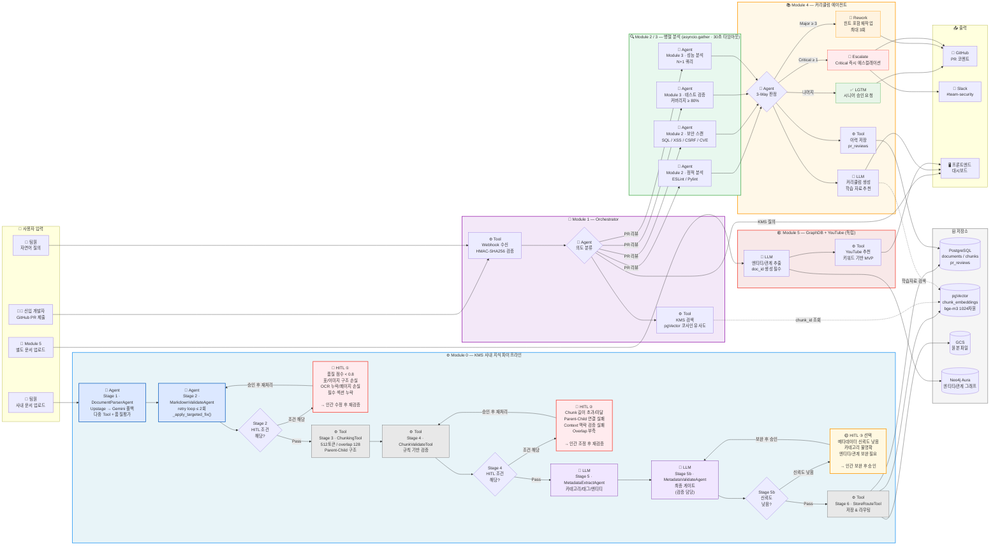

# PRD v2.0 — 사내 지식 관리 + 신입 개발자 온보딩 플랫폼 (모듈 기반)

**버전**: v2.0 | **기준**: Module 0~5 | **이전 버전**: PRD v1.1 (Dev1~Dev5 기반)  
**작성일**: 2026-06-04 | **상태**: 확정

---

## 1. 제품 한 줄 정의

> 사내 지식을 AI가 자동 구조화하고, 신입 개발자의 코드 리뷰·학습 경로를 자동화하는 MAS 기반 플랫폼.

**두 가지 핵심 목표:**

- **KMS (Knowledge Management System)**: 사내 문서 → Markdown 정규화 → 구조화 저장 → 자연어 검색
- **온보딩 자동화**: KMS 지식 활용 → PR 코드 리뷰 → 맞춤 학습 추천 → 성장 추적

---

## 2. 시스템 아키텍처 — 모듈 연결 맵



---

## 3. 모듈별 역할 정의

### Module 0. KMS 사내 지식 파이프라인

**MAS 패턴**: Sequential Pipeline (각 Stage가 이전 Stage 출력에 의존)

**역할**: 사내 문서를 AI가 검색 가능한 지식으로 변환·저장하는 전체 서비스의 지식 저장소.

**처리 흐름:**
```
문서 업로드 (PDF/DOCX/PPTX/TXT)
    → Stage 1: DocumentParser (Upstage/Gemini Multimodal)
    → Stage 2: MarkdownValidate (품질 검증 + retry + HITL)
    → Stage 3: Chunking (결정론적 분할, 512토큰/overlap 128)
    → Stage 4: ChunkValidate (규칙 기반 검증)
    → Stage 5: MetadataExtract (카테고리/태그/엔티티)
    → Stage 6: StoreRoute (pgVector + PostgreSQL + GraphDB)
```

**입력:**
```json
{
  "file": "multipart/form-data",
  "source": "upload | notion | confluence | slack",
  "uploaded_by": "user_id"
}
```

**출력:**
```json
{
  "doc_id": "uuid",
  "status": "stored | hitl_pending | failed",
  "quality_score": 0.85,
  "chunk_count": 12,
  "trace_id": "trc_0001_{doc_id_8hex}"
}
```

**KMS 사용 여부**: 자체가 KMS — 다른 모듈의 KMS 소스  
**HITL 조건**: quality_score < 0.8, 표/이미지 구조 손실, Parent-Child 연결 실패

---

### Module 1. 오케스트레이터

**MAS 패턴**: Supervisor (LangGraph StateGraph, conditional_edges)

**역할**: 사용자/Webhook 요청 수신 → 의도 분류 → 모듈 라우팅 → 결과 취합 → 최종 응답.

**입력:**
```json
{
  "request_type": "pr_review | kms_query | onboarding | architecture",
  "payload": {
    "pr_id": "github-pr-number",
    "pr_diff": "unified diff string",
    "user_id": "string"
  }
}
```

**출력:**
```json
{
  "task_id": "uuid",
  "verdict": "lgtm | rework | escalate",
  "comment_body": "마크다운 형식 GitHub 코멘트",
  "learning_resources": [{"title": "...", "url": "..."}],
  "escalation": {"required": false, "slack_channel": null}
}
```

**KMS 사용 여부**: Yes — pgVector 코사인 유사도 검색으로 관련 컨텍스트 조회  
**GitHub Webhook**: HMAC-SHA256 서명 검증 필수 (X-Hub-Signature-256 없으면 403)

---

### Module 2. 정적 분석 + 보안 분석

**MAS 패턴**: Parallel Independent Agent (asyncio.gather, 타임아웃 30초)

**역할**: PR diff 분석 → 정적 분석(ESLint/Pylint/순환복잡도) + 보안 탐지(SQL Injection/XSS/CSRF/CVE).

**입력 (Module 1이 채움):**
```json
{
  "task_id": "uuid",
  "pr_diff": "string",
  "context": {
    "architecture_docs": ["chunk_id_1"],
    "coding_conventions": "string",
    "previous_pr_issues": ["N+1 쿼리"]
  }
}
```

**출력 (Output Contract — 섹션 6 참고):**
```json
{
  "task_id": "uuid",
  "agent": "static_analysis | security_scan",
  "module_id": "module_2",
  "issues": [...],
  "summary": {"critical": 0, "major": 2, "minor": 5},
  "execution_ms": 1200
}
```

**KMS 사용 여부**: Yes — 코딩 컨벤션, 보안 가이드 chunk 조회  
**타임아웃**: 30초 (초과 시 빈 결과로 대체, agent_traces에 fail 기록)

---

### Module 3. 테스트 검증 + 성능 분석

**MAS 패턴**: Parallel Independent Agent (asyncio.gather, 타임아웃 30초)

**역할**: 커버리지 측정(80% 미달 시 Major) + N+1 쿼리 감지 + 시간복잡도 추정.

**입력**: Module 2와 동일 구조  
**출력**: Module 2와 동일 Output Contract (`agent: "test_verification | performance"`)  
**KMS 사용 여부**: Yes — 테스트 가이드, 성능 최적화 패턴 chunk 조회

---

### Module 4. 커리큘럼 에이전트

**MAS 패턴**: Cyclical Feedback Loop (LangGraph cyclical graph + HITL)

**역할**: Module 2/3 이슈 취합 → 3-Way 판정 → 개인화 피드백 → GitHub 코멘트 + Slack 알림 → 커리큘럼 생성.

**3-Way 판정 로직:**
```
Critical >= 1  → escalate  (Slack 즉시 알림)
Major >= 3     → rework    (힌트 포함, 최대 3회 리트라이)
나머지          → lgtm      (시니어 최종 승인 요청)
```

**입력**: Module 1 State + Module 2/3 Output Contract 목록  
**출력 (→ FE / GitHub / Slack):**
```json
{
  "task_id": "uuid",
  "verdict": "lgtm | rework | escalate",
  "comment_body": "마크다운",
  "learning_resources": [...],
  "onboarding_update": {"issue_pattern": "N+1 쿼리", "occurrence_count": 3}
}
```

**KMS 사용 여부**: Yes — 학습 자료 chunk 조회 + 이전 PR 이력 조회  
**자동 머지 금지**: 시니어 최종 승인은 항상 사람이 한다

---

### Module 5. 독립 GraphDB + YouTube 추천 모듈

**MAS 패턴**: 독립 Pipeline (Module 0~4와 현재 분리)

**역할**: 별도 웹 UI에서 문서 업로드 → 엔티티/관계 추출 → Neo4j Aura 저장 → 관계 그래프 시각화 → 키워드 기반 YouTube 추천.

**독립성**: Module 0~4와 직접 연결 없음. doc_id / file_hash로 향후 KMS 연결 가능.

**입력:**
```json
{
  "file": "multipart/form-data",
  "source_system": "graph_youtube"
}
```

**출력:**
```json
{
  "doc_id": "uuid",
  "source_system": "graph_youtube",
  "entities": [...],
  "relations": [...],
  "keywords": [...],
  "youtube_recommendations": [{"title": "...", "url": "..."}]
}
```

**KMS 연결 확장 포인트**: doc_id / file_hash → 향후 KMS chunk_id와 매칭 가능하도록 설계. 섹션 9 참고.

---

## 4. 공통 Output Contract (모든 모듈 필수 준수)

모듈 간 통신은 이 계약을 정확히 따른다. 필드 추가는 가능하지만 삭제 불가.

```json
{
  "task_id": "uuid",
  "trace_id": "string",
  "agent_name": "string",
  "module_id": "module_0 | module_1 | ... | module_5",
  "status": "success | fail | hitl_pending | escalated",
  "issues": [
    {
      "severity": "Critical | Major | Minor",
      "line": 42,
      "file": "src/auth.py",
      "message": "string",
      "rule_id": "string",
      "suggestion": "string"
    }
  ],
  "summary": {"critical": 0, "major": 2, "minor": 5},
  "validation_result": "pass | fail | skip",
  "execution_ms": 1200,
  "next_agent": "module_4 | null"
}
```

---

## 5. Clean Architecture 레이어

```
[Frameworks & Drivers]   FastAPI, LangGraph, PostgreSQL, pgVector, Neo4j, GitHub API, Slack
        ↑ depends on
[Interface Adapters]     API 계약 JSON, Repository 구현체, Webhook 핸들러
        ↑ depends on
[Use Cases / Application] 각 모듈 Agent 로직 (Module 0~5)
        ↑ depends on
[Entities / Domain]      Document, Chunk, PRReview, MistakePattern, AgentTrace, GraphNode
```

**의존성 방향**: 항상 안쪽(도메인)을 향한다. 상위 레이어는 인터페이스를 통해서만 하위 레이어를 참조.

---

## 6. LangSmith / Harness 적용 기준

**모든 모듈은 `common/harness.py`의 `AgentHarness`를 통해 실행한다.**

```python
# 환경변수 (개인별 GitHub ID 포함 필수)
LANGCHAIN_TRACING_V2=true
LANGCHAIN_PROJECT=module1-yourGitHubId  # 모듈별 + GitHub ID
```

**Trace ID 체계:**
```
문서 파이프라인:  trc_000{stage}_{doc_id_8hex}
PR 리뷰:        pr_{12자리 hex}
서브 trace:     {parent_trace_id}_{agent_name}_{4자리 hex}
```

---

## 7. DB 스키마 핵심

| 저장소 | 용도 | 주요 테이블/컬렉션 |
|--------|------|-------------------|
| PostgreSQL | 메타데이터, PR 이력, trace 로그 | users, documents, chunks, pr_reviews, agent_traces, categories |
| pgVector | 임베딩 벡터 검색 | chunk_embeddings (vector(1024), Ollama bge-m3) |
| Neo4j Aura | 엔티티-관계 그래프 | Module 0 GraphDB + Module 5 독립 그래프 |
| GCS/MinIO | 원본 파일 저장 | PDF, DOCX, 이미지 원본 |

**테이블명 주의**: `developers` ❌ → `users` ✅ / `dev_id` ❌ → `user_id` ✅

---

## 8. 마일스톤 (Module 기준)

| 주차 | 목표 | 담당 모듈 | 완료 기준 |
|------|------|-----------|-----------|
| Week 1 | DB 스키마 + API 계약 + Mock 서버 | 전체 | 계약 문서 완성, seed 데이터 INSERT |
| Week 2~3 | 각 모듈 P0 구현 (Mock 기반) | Module 0~5 독립 개발 | 독립 실행 + 단위 테스트 통과 |
| Week 4 | Module 0 문서 파이프라인 5단계 완성 | Module 0 중심 | 실제 문서 → pgVector 저장 확인 |
| Week 5 | Mock → 실제 모듈 연결 (Module 1이 Module 2/3 호출) | Module 1~4 통합 | PR 제출 → 코멘트 E2E 확인 |
| Week 6 | P1 기능 + 버그 수정 + Module 5 연동 준비 | 전체 | 전체 데모 시나리오 동작 |

---

## 9. HITL 위험 방지 규칙

| 상황 | 임계값 | 처리 |
|------|--------|------|
| Markdown 품질 점수 | < 0.8 | HITL 큐 등록, 자동 진행 중단 |
| 표/이미지 구조 손실 | 발생 시 | HITL 큐 등록 |
| Critical 보안 이슈 | >= 1건 | 즉시 Slack 에스컬레이션 |
| 재작업 요청 횟수 | > 3회 | 시니어 직접 개입 요청 |

> **자동 머지 없음.** 시니어의 최종 승인은 항상 사람이 한다.
