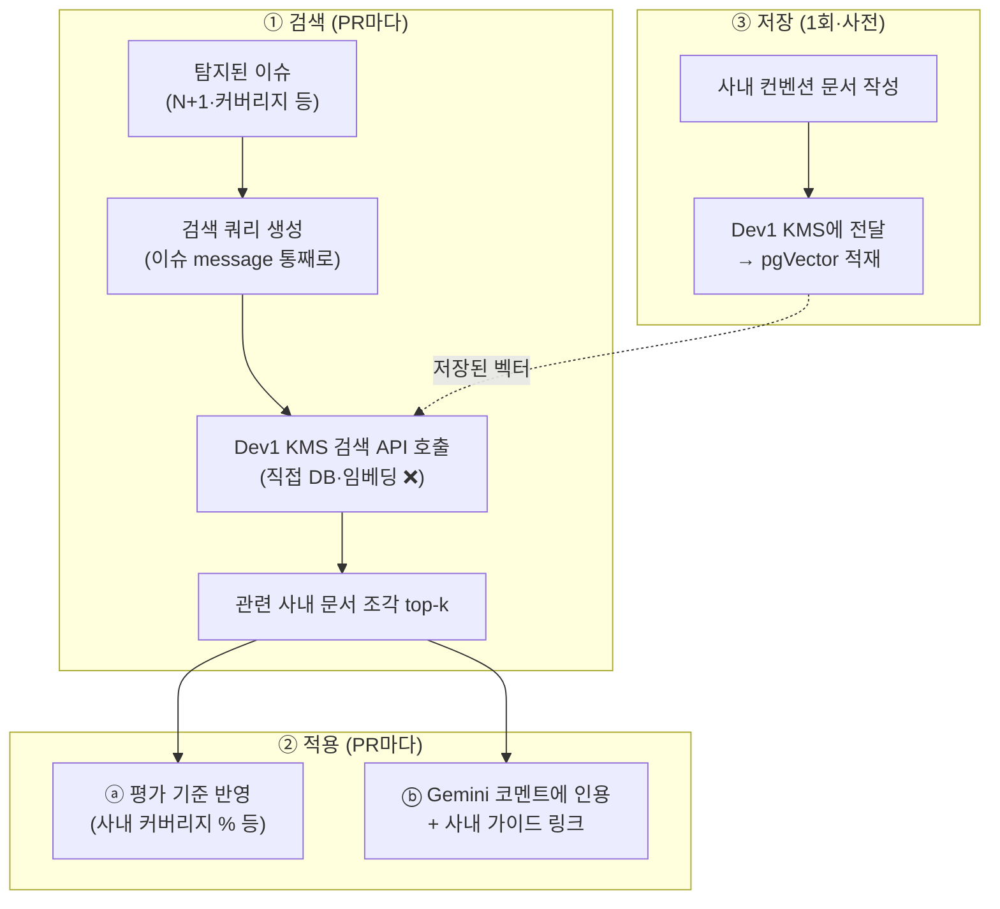

# 🔍 Dev3 사내 컨벤션 RAG — 설계서 (구현 직전·정본)

> ⭐ **이 파일이 RAG 설계의 유일한 정본.** (인수인계 §3은 요약일 뿐, 상세는 여기)
> 이 문서 = 구현 청사진. VS Code 클로드는 이거 보고 TDD로 구현만 하면 됨.
> LLM = Gemini 2.5 Flash 통일. 벡터DB = 이미 있는 pgVector(GCP tasklink, Dev1 KMS 소유).

---

## ⚠️⚠️ 설계 검증으로 발견한 4대 위험 + 확정 해결책 (가장 중요 — 먼저 읽어라)

> 초안 설계를 리뷰하다 발견한 함정들. **이 해결책을 반드시 지킬 것.** 안 지키면 운영에서 터짐.

| # | 위험 | 왜 터지나 | ✅ 확정 해결책 |
|---|---|---|---|
| **1** | **DB 직접 쿼리 (강결합)** | Dev3가 Dev1 소유 `chunk_embeddings`를 직접 SELECT → Dev1이 스키마/테이블명/벡터차원 바꾸면 Dev3 무경고 중단 | **Dev1에 Read-only 검색 API 요청**. 예: `GET /internal/kms/search?query=...&category=코딩컨벤션`. Dev3는 그 API만 호출 |
| **2** | **임베딩 인프라 중복** | Dev3가 쿼리 임베딩하려면 bge-m3 모델을 또 띄움 → 메모리/GPU 낭비 + Dev1 모델 버전 올릴 때마다 동기화 지옥 | **임베딩도 Dev1에 위임**. ①의 검색 API에 **텍스트만 던지면** Dev1이 자기 모델로 임베딩+검색. Dev3는 모델 몰라도 됨 |
| **3** | **정량 수치 자연어 파싱 (제일 위험)** | "신규 90% 필수, 레거시 80%, 향후 100%" 같은 문장에서 0.9 파싱? LLM/정규식 오작동 → **PR 통과/탈락 판정이 깨짐 = 재앙** | **정량 룰은 RAG로 절대 안 뽑음.** `config/settings.py` 또는 KMS metadata에 **구조화**해서 박음: `metadata.rules = {"payment_coverage": 0.9}`. RAG(자연어)는 **정성(설명·가이드)에만** |
| **4** | **짧은 키워드 벡터검색 품질** | "N+1" 2단어만 던지면 벡터검색이 엉뚱한 문서 매칭 | **이슈 message 통째로** 쿼리에. "N+1 쿼리: 루프 안에서 DB 호출이 반복됩니다" 전체를 검색어로. (ElasticSearch까진 불필요 — 사내 문서 소수라 오버) |

### 이 4개가 바꾸는 핵심 원칙
```
정량 기준 (커버리지% 등)  → RAG ❌  →  config/metadata 구조화 ✅
정성 가이드 (설명·패턴)    → RAG ✅ (코멘트 인용에만 한정)
검색·임베딩               → Dev3 직접 ❌  →  Dev1 검색 API 호출 ✅
검색 쿼리                 → 키워드 ❌  →  이슈 message 통째로 ✅
```

> **즉 RAG의 역할을 "정성 코멘트 강화"로 좁힌다.** PR 판정을 좌우하는 정량 기준은 RAG 밖(구조화 데이터)에 둔다.

---

## 0. 한 줄 정의

> 신입 PR을 평가할 때, **사내 코딩 컨벤션 문서를 검색해서** ① 평가 기준(커버리지 % 등)을 사내 기준으로 맞추고 ② 코멘트에 "우리 팀 방식 + 사내 가이드 링크"를 녹인다. → Dev3가 "범용 도구"에서 "우리 회사 전용 리뷰어"로.

---

## 1. ⚠️ 시작 전 필요한 것 (사전 데이터) — "바로 시작" 안 되는 이유

RAG는 **검색할 문서가 있어야** 작동. 지금 그 문서가 없음. 그래서 **순서상 ③ 저장(문서 준비)부터**.

### 1.1 만들어야 할 사내 컨벤션 문서 (재료)

| 문서 | 들어갈 내용 (예시) | 누가 씀 |
|---|---|---|
| **테스트 컨벤션** | "커버리지 라인 80% 필수, 결제/인증 모듈은 90%", "테스트 없는 public 함수 금지", "엣지케이스(null·음수·빈배열) 필수" | Dev3가 초안, 팀 검토 |
| **성능 컨벤션** | "N+1은 selectinload 표준", "O(n²) 이상 리뷰 필수", "루프 내 DB 호출 금지" | Dev3가 초안 |
| **ORM 가이드** | "우리 팀 SQLAlchemy 쿼리 최적화 패턴", joinedload vs selectinload 언제 | 팀 기존 문서 있으면 활용 |

> **MVP**: 위 3개를 각각 짧은 markdown으로. 실제 사내 문서 없으면 공개 자료(Google Style Guide 등) + 팀 합의값으로 시작. 마스터 PRD의 DB_데이터_요구사항에 "코딩 컨벤션 문서 최소 1개" 명시됨.

### 1.2 이미 있는 것 (재사용)
- ✅ **pgVector** (GCP tasklink `chunk_embeddings` 테이블) — Dev1 KMS가 구축.
- ✅ **임베딩 모델** — Dev1이 정함 (bge-m3 1024차원 등, KMS 따름).
- ✅ **청킹 파이프라인** — Dev1 KMS가 문서를 잘라 벡터로 저장.
- ✅ **Gemini 2.5 Flash** — 코멘트 생성에 이미 사용 중.

### 1.3 결론 (제미나이 프롬프트 대비)
제미나이가 물은 "벡터DB 뭐 쓸까/임베딩 뭐/청크 크기"는 **이미 Dev1 KMS가 정해서 불필요**. Dev3는 **KMS에 문서 얹고 + 검색해서 + 활용**만 하면 됨. → 직접 만드는 RAG 시스템 아님, **KMS에 올라탄 검색·활용 계층**.

---

## 2. 전체 흐름 (RAG 3단계)



---

## 3. ③ 저장 (Store) 설계

### 할 일
1. §1.1 문서 3개 작성 (markdown).
2. **Dev1에게 KMS 적재 요청** — 핸드오프 문서로:
   > "테스트/성능/ORM 컨벤션 문서 3개를 KMS에 넣어주세요. category='코딩컨벤션'으로 태깅해서,
   >  Dev3가 검색할 수 있게요. doc_id 받으면 알려주세요."
3. Dev1이 KMS 파이프라인으로 청킹·임베딩·pgVector 저장.

### Dev3가 알아야 할 것 (Dev1과 합의)
- 저장된 chunk에 `metadata.category = "코딩컨벤션"` 태그 (검색 필터용).
- **Dev1 검색 API 스펙** (query/category/top_k → results[]). ← 이거면 충분.
- ⚠️ `chunk_embeddings` 테이블 구조나 임베딩 모델은 **Dev3가 몰라도 됨** (위험 1·2). API가 다 처리.

---

## 4. ① 검색 (Retrieve) 설계 — Dev1 API 호출 (위험 1·2 반영)

### 4.1 검색 쿼리 생성 (위험 4 반영)
키워드만 ❌ → **이슈 message 통째로** 쿼리에 사용 (문맥 풍부 → 벡터검색 품질↑).

| 이슈 | 검색 쿼리 (message 통째로) |
|---|---|
| N+1 | "N+1 쿼리: 루프 안에서 DB 호출이 반복됩니다" |
| 커버리지 | "테스트 라인 커버리지 26.7% < 기준 80%" |
| 테스트 누락 | "함수 load_cart_items에 대한 테스트 실행 흔적이 없습니다" |

### 4.2 검색 — Dev1 KMS API 호출 (직접 DB ❌, 직접 임베딩 ❌)
```python
# rag/retriever.py (신규)
import requests

def search_convention(query_text: str, top_k: int = 3) -> list[dict]:
    """Dev1 KMS 검색 API 호출 (Dev3는 DB·임베딩 모델 몰라도 됨).
    - 텍스트만 던지면 Dev1이 임베딩+pgVector 검색+필터까지 처리.
    - 반환: [{content, doc_title, source_url, score}]
    - API 없거나 실패 → 빈 리스트 (환각 방지 fallback).
    """
    try:
        resp = requests.get(
            f"{KMS_SEARCH_URL}/internal/kms/search",
            params={"query": query_text, "category": "코딩컨벤션", "top_k": top_k},
            timeout=5,
        )
        if resp.status_code != 200:
            return []
        return resp.json().get("results", [])
    except Exception:
        return []   # 검색 실패 시 빈 결과 → 표준 기준 fallback
```
> ⚠️ `chunk_embeddings` 직접 SELECT 금지 (위험 1). 임베딩 직접 X (위험 2).
> Dev1과 합의: 이 API 스펙(query/category/top_k → results[]) 제공받기.
> Dev1 API 아직 없으면 → R3에서 **Mock 서버/스텁**으로 개발 (위험 1·2 회피하면서 진행).

### 4.3 환각 방지 (위험·정직성)
- 검색 결과 **score < 임계(0.5)** → "관련 사내 문서 없음" 처리.
- 문서 없으면 → **업계 표준 fallback** + 코멘트에 "사내 가이드 없음" 명시.
- → 없는 문서 지어내지 않음 (Dev3 정직성 원칙과 일치).

---

## 5. ② 적용 (Augment) 설계 — 2갈래

### ⓐ 평가 기준 반영 (정량) — ⚠️ RAG 아님! 구조화 데이터 (위험 3)
**자연어 문서에서 90% 파싱 절대 금지** (PR 판정 깨지면 재앙). 정량 룰은 **구조화 데이터**로:

```python
# config/conventions.py (또는 KMS metadata.rules)
COVERAGE_RULES = {
    "default": 0.80,
    "payment": 0.90,      # 결제 모듈
    "auth": 0.90,         # 인증 모듈
    "legacy": 0.70,       # 레거시
}
# coverage.py: 파일 경로로 모듈 판별 → 해당 기준값 적용 (없으면 default)
def threshold_for(file_path: str) -> float:
    if "payment" in file_path: return COVERAGE_RULES["payment"]
    if "auth" in file_path:    return COVERAGE_RULES["auth"]
    return COVERAGE_RULES["default"]
```
- 팀이 기준 바꾸면 → **이 dict(또는 KMS metadata)만 수정**. 코드·문서 파싱 불필요.
- 즉 "유동적으로 바뀜"은 **config 수정**으로 달성 (RAG 아님). 안전·명확.

### ⓑ 코멘트에 인용 (정성) ⭐ 핵심 차별점
Gemini 코멘트 만들 때 검색한 사내 문서를 프롬프트에 넣음:
```
기존 코멘트: "N+1 발견. joinedload 쓰세요." (일반론)

RAG 코멘트:  "N+1 발견. 우리 팀은 selectinload를 표준으로 씁니다.
             📖 [사내 가이드: ORM 쿼리 최적화](source_url)
             지난번에도 비슷한 지적이 있었어요." (사내 맥락 + 출처)
```
- 구현: `pr-comment-agent/llm_refiner.py`의 프롬프트에 `retrieved_docs` 추가.
- Gemini에 "이 사내 문서를 근거로 인용해서 설명해줘" + 문서 내용 + source_url.

---

## 6. 모듈 구조 (신규) — 하네스 원칙 반영

> 하네스 4원칙: ① 표준 DTO ② 플러그인 레지스트리 ③ RAG는 독립 미들웨어 ④ 100% 고립 테스트.
> ⚠️ 플러그인 레지스트리·표준 DTO는 **이미 존재** → `webhook-gateway/registry.py` + `contracts.py`.
> 처음부터 다시 만들지 말고 **재활용·확장**할 것.

```
test-performance-agent/
├── config/conventions.py   # ⚠️ 정량 룰 (구조화, RAG 아님 — 위험 3)
└── rag/                     # RAG = 독립 미들웨어 (탐지와 분리)
    ├── retriever.py         # Dev1 KMS 검색 API 호출 (직접 DB·임베딩 ❌ — 위험 1·2)
    └── augment.py           # 검색결과 → 코멘트용 rag_context 포맷 (정성만)
```

### 미들웨어 역할 (하네스 ③)
```
탐지기 → DTO(Issue, keyword 포함) 반환
              ↓ (탐지와 분리된 RAG 미들웨어)
        retriever: Issue.message로 검색
        augment:   Issue에 rag_context 채움 (정성 가이드)
              ↓
        llm_refiner: rag_context를 코멘트에 인용
```
- 출력 계약(AgentOutput) **불변**. 코멘트 내용만 사내화.
- Issue에 `rag_context` 필드 추가 (검색된 사내 가이드, 선택).

---

## 7. 구현 순서 (TDD) — 100% 고립 테스트 (하네스 ④)

> 실제 DB/LLM/Dev1 API 없이도 단위 테스트 가능하게 — 전부 Mock.

| Task | 내용 | 고립 테스트 (Mock) |
|---|---|---|
| R1 | 사내 컨벤션 문서 3개 작성 (재료) | 사람 검토 |
| R2 | Dev1에 KMS 적재 + 검색 API 스펙 핸드오프 | — (협의) |
| R3 | `config/conventions.py` — 정량 룰 dict (위험 3) | threshold_for("payment/x") → 0.9 |
| R4 | `coverage.py` 연동 — 모듈별 사내 기준 적용 | payment 90%/default 80% 검증 |
| R5 | `rag/retriever.py` — Dev1 API 호출 (위험 1·2) | **requests mock**: API 응답 가짜로 → 파싱 검증 |
| R6 | 환각 방지 — score<0.5 또는 API실패 → 빈 결과 | mock으로 실패 주입 → fallback 검증 (위험·정직) |
| R7 | `rag/augment.py` — 검색결과 → rag_context 포맷 | 입력 docs → 포맷 출력 검증 (DB 불필요) |
| R8 | `llm_refiner.py` ⓑ — 코멘트에 rag_context 인용 | **LLM mock**: 프롬프트에 docs 포함됐나 검증 |

> 모든 외부 의존(Dev1 API·Gemini·pgVector)은 **Mock**으로. → DB/키 없이 즉시 단위테스트 (하네스 ④ 달성).

---

## 8. 핵심 결정·주의 (위험 반영 최종)

- **위험 1·2**: 검색·임베딩은 **Dev1 KMS API 호출** (직접 DB SELECT·직접 임베딩 금지). API 없으면 Mock으로 개발.
- **위험 3**: 정량 기준(커버리지%)은 **config/conventions.py 구조화** (RAG 자연어 파싱 금지). 유동 변경은 dict 수정으로.
- **위험 4**: 검색 쿼리는 **이슈 message 통째로** (짧은 키워드 X).
- **RAG 역할 한정**: **정성(코멘트 가이드 인용)에만.** PR 판정 정량 로직엔 관여 X.
- **하네스**: 표준 DTO + 플러그인 레지스트리는 **기존 게이트웨이 재활용**. RAG는 독립 미들웨어. 전부 Mock 고립 테스트.
- **출력 계약 불변**: AgentOutput 형식 안 바뀜.
- **팀 합의**: ① Dev1 검색 API 스펙 ② 문서 KMS category='코딩컨벤션' 적재 ③ scan_issues 컬럼 추가(keyword 등).

---

## 9. 한 줄 요약 (위험 반영 최종)

> **정량 기준은 config 구조화(RAG 아님), 정성 가이드만 RAG로. 검색·임베딩은 Dev1 KMS API 호출(직접 DB·임베딩 금지). 검색 쿼리는 message 통째로. 문서 없으면 지어내지 말고 표준 fallback. 하네스(표준DTO·레지스트리)는 기존 게이트웨이 재활용, RAG는 독립 미들웨어, 전부 Mock 고립 테스트.**

---

## 10. VS Code 클로드에게 줄 시작 메시지 (복붙)

```
너는 우리 팀 시니어 아키텍트다. RAG_설계서.md 와 다음_작업_인수인계.md 읽어라.
나는 비전공자라 코드 직접 못 본다. 바로 프로덕션 코드 짜지 말고,
설계서 §6 모듈구조 + §7 TDD플랜대로 먼저 제시하고 합의 후 구현하라.

반드시 지킬 것 (설계서 ⚠️ 4대 위험):
1. chunk_embeddings 직접 SELECT 금지 → Dev1 KMS 검색 API 호출 (없으면 Mock)
2. 임베딩 직접 X → Dev1에 위임 (텍스트만 던짐)
3. 정량 기준(커버리지%)은 RAG 자연어 파싱 금지 → config/conventions.py 구조화
4. 검색 쿼리는 이슈 message 통째로 (짧은 키워드 X)
+ 표준 DTO·플러그인 레지스트리는 webhook-gateway/registry.py + contracts.py 재활용
+ 모든 외부의존(Dev1 API·Gemini·pgVector)은 Mock으로 100% 고립 단위테스트

TDD: 테스트 먼저 → 통과 → 다음. 한 번에 하나씩, 막히면 멈추고 물어봐라.
```

---

*연계: 다음_작업_인수인계.md §3(요약만), DEV3_PRD.md, 마스터 PRD(KMS·DB요구사항)*
